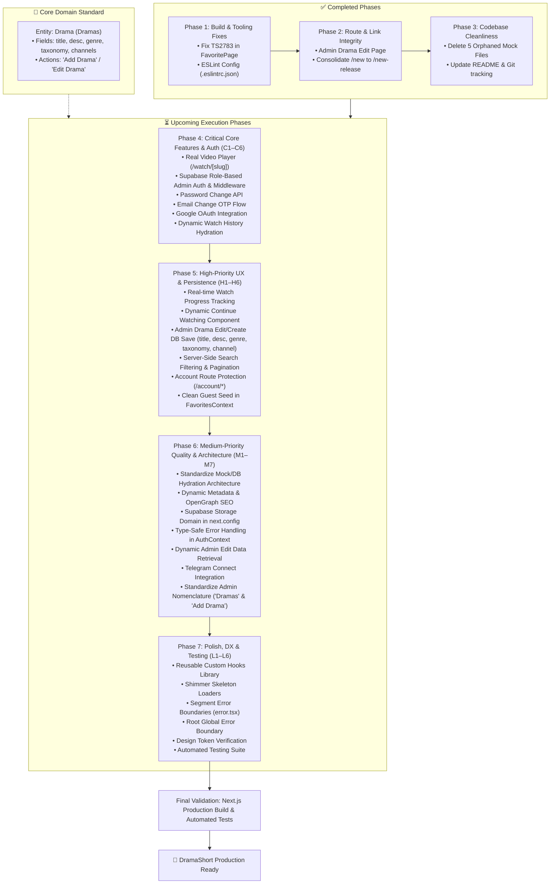

# DramaShort Project Remediation & Improvement Plan

This plan outlines the specific fixes, cleanup tasks, and enhancements needed to restore project health, fix broken user flows, and streamline the codebase.

---

## 1. Issue Prioritization Matrix

| Phase | Priority | Item | Status | Impact |
|---|---|---|---|---|
| **Phase 1** | 🔴 Critical | Fix TypeScript `TS2783` in `FavoritePage` (`app/account/favorite/page.tsx`) | ✅ Done | Restored `npm run build` and page compilation |
| **Phase 1** | 🟡 High | Configure ESLint (`.eslintrc.json`) | ✅ Done | Restored non-interactive linting in `npm run lint` |
| **Phase 2** | 🟠 High | Implement Admin Drama Edit Page (`/admin/titles/[id]/edit` / `/admin/dramas/[id]/edit`) | ✅ Done | Resolved 404 dead links from admin drama tables and cards |
| **Phase 2** | 🟡 Medium | Consolidate `/new` into `/new-release` | ✅ Done | Eliminated duplicated route and legacy data source |
| **Phase 3** | 🟢 Low | Clean up 5 orphaned legacy mock files (~42 KB) | ✅ Done | Reduced tech debt, eliminated duplicate schema confusion |
| **Phase 3** | 🟢 Low | Update `README.md` & Initialize Git | ✅ Done | Reflected accurate project status and enabled version tracking |
| **Phase 4** | 🔴 Critical | C1: Implement real video player (`app/watch/[slug]/page.tsx`) | ✅ Done | Unlocks high-performance streaming with custom player, HLS/MP4, & vertical/cinema modes |
| **Phase 4** | 🔴 Critical | C2: Supabase role-based admin auth & middleware route guard | ✅ Done | Closes localStorage privilege escalation; enforces server-side JWT and profile role checks |
| **Phase 4** | 🔴 Critical | C3: Wire password change to `supabase.auth.updateUser()` | ✅ Done | Eliminates false success toast; verifies current password and updates via Supabase Auth |
| **Phase 4** | 🔴 Critical | C4: Wire email change OTP verification flow with `OtpInput` | ⏳ Planned | Fixes broken email change flow and handles verification |
| **Phase 4** | 🔴 Critical | C5: Wire Google OAuth sign-in button in `app/login/page.tsx` | ⏳ Planned | Enables functional social authentication |
| **Phase 4** | 🔴 Critical | C6: Wire watch history to `getUserWatchHistory()` in `app/account/history/page.tsx` | ⏳ Planned | Replaces static mock history with persistent user watch history |
| **Phase 5** | 🟠 High | H1: Call `upsertWatchProgress()` from video playback events | ⏳ Planned | Persists user episode progress and enables resumption |
| **Phase 5** | 🟠 High | H2: Replace `ContinueWatching` mock with real user data | ⏳ Planned | Dynamic home page resume carousels for logged-in users |
| **Phase 5** | 🟠 High | H3: Wire admin edit form to Supabase content DB (Add/Edit Drama: title, desc, genre, taxonomy, channel) | ⏳ Planned | Prevents silent data loss when admins create or edit drama records |
| **Phase 5** | 🟠 High | H4: Server-side search filtering and pagination in `getPublishedTitles()` (Dramas query) | ⏳ Planned | Scalable search queries; eliminates full catalog download |
| **Phase 5** | 🟠 High | H5: Add auth guards and redirects for `/account/*` routes | ⏳ Planned | Protects user-specific pages against unauthenticated access |
| **Phase 5** | 🟠 High | H6: Fix `FavoritesContext` guest seed (remove `defaultFavoriteSlugs`) | ⏳ Planned | Prevents guest accounts from being pre-seeded with fake favorites |
| **Phase 6** | 🟡 Medium | M1: Audit and standardize mock/DB hydration pattern across components | ⏳ Planned | Consistent UX and elimination of stale mock data paths |
| **Phase 6** | 🟡 Medium | M2: Dynamic SEO & OpenGraph tags via `generateMetadata()` | ⏳ Planned | Social sharing previews and search engine discovery |
| **Phase 6** | 🟡 Medium | M3: Add Supabase Storage domain to `next.config.mjs` `remotePatterns` | ⏳ Planned | Prevents image load failures for storage-hosted assets |
| **Phase 6** | 🟡 Medium | M4: Replace `catch (err: any)` with typed error handling in `AuthContext` | ⏳ Planned | Strict TypeScript compliance and safer error handling |
| **Phase 6** | 🟡 Medium | M5: Load admin drama edit data from Supabase content DB | ⏳ Planned | Allows editing of dynamically created dramas not in mock array |
| **Phase 6** | 🟡 Medium | M6: Wire Telegram Connect integration in `app/account/page.tsx` | ⏳ Planned | Functional Telegram account linking / bot deep-linking |
| **Phase 6** | 🟡 Medium | M7: Standardize Admin nomenclature: "Dramas" & "Add Drama" in UI & routes | ⏳ Planned | Eliminates confusion between entity (Drama) and field (title) |
| **Phase 7** | 🟢 Low | L1: Reusable custom hooks (`useDebounce`, `useRequireAuth`, `useMediaQuery`) | ⏳ Planned | DRY code, standardized debounce, and cleaner component logic |
| **Phase 7** | 🟢 Low | L2: Add shimmer/skeleton loading states for async data | ⏳ Planned | Smooth loading UX; prevents layout shifts and mock flashes |
| **Phase 7** | 🟢 Low | L3: Implement route-segment error boundaries (`error.tsx`) | ⏳ Planned | Graceful degradation and user-friendly retry buttons |
| **Phase 7** | 🟢 Low | L4: Add root application error boundary (`app/error.tsx`) | ⏳ Planned | Catches unhandled runtime crashes globally |
| **Phase 7** | 🟢 Low | L5: Audit `design-tokens/` CSS variables and unused tokens | ⏳ Planned | Maintains lean, consistent token foundation |
| **Phase 7** | 🟢 Low | L6: Implement automated test suite (Auth, services, critical journeys) | ⏳ Planned | Regression prevention and verified end-to-end reliability |

---

## 2. Core Domain Architecture: "Drama" vs. "Title"

> **Architectural Standard**: The media entity stored in the database is formally and consistently defined as **`Drama`** (plural: **`Dramas`**).

### 2.1 Schema Attributes of a `Drama`
Every Drama entity in the database (`titles` / `dramas` table) contains the following core attributes:
* **`title`** (`string`): The textual title/name of the drama (e.g., *"The CEO's Secret Wife"*, *"Reborn to Ruin Him"*).
* **`desc` / `synopsis`** (`string`): Storyline synopsis and narrative description.
* **`genre`** (`string`): Primary genre classification (e.g., *Romance*, *Revenge*, *CEO*, *Rebirth*, *Marriage*, *Suspense*).
* **`taxonomy` / `tags`** (`string[]`): Granular categorization tags, tropes, and thematic classifications (e.g., `["CEO", "Contract Marriage", "Secret Identity"]`).
* **Related to `channels`** (`channel_id` / `channel_name`): Mandatory relation/association to the publishing or distributing channel.
* **Media & Streaming Assets**: `poster_url`, `total_episodes`, and relational `episodes` (`video_url`, duration, episode number).
* **Status & Metrics**: `status` (`Published` | `Draft` | `Scheduled` | `Archived`), `rating`, `views_count`, `release_year`, `created_at`.

### 2.2 Nomenclature Disambiguation: "Add Drama" vs. "Add Title"
To eliminate ambiguity across product requirements, admin CMS, and codebase interfaces:
* **The Entity**: Is always a **`Drama`**.
* **The Action**: Is always **"Add Drama"** or **"Edit Drama"** (never "Add Title").
* **The Field**: `title` is simply the text attribute representing the name of the Drama being added or edited.
* **Admin CMS Rules**:
  - Sidebar item: **"Dramas"** (replaces legacy "Titles" label).
  - Table & cards header: **"Dramas"** — *"All dramas in the database"*.
  - Primary Action Button: **"Add Drama"** (opens modal/page to input: *Title, Description, Genre, Taxonomy tags, and Channel*).
  - Navigation route: Support `/admin/dramas` with permanent redirect from `/admin/titles`.
  - Service Layer & Types: Expose `Drama` type (aliased to `Title` during transition) and functions like `getPublishedDramas()`, `getDramaBySlug()`.

---

## 3. Phase 1: Critical Build & Tooling Fixes

### Task 1.1: Fix Duplicate Property in `app/account/favorite/page.tsx`
* **File**: `app/account/favorite/page.tsx`
* **Problem**:
  ```typescript
  // Current code (lines 36-39)
  const favoriteEntries = Array.from(favoritedSlugs).map((slug) => ({
    slug,
    ...getTitleBySlugOrFallback(slug),
  }));
  ```
  `getTitleBySlugOrFallback(slug)` returns a `Title` object that already contains `slug: string`. In strict TypeScript object literals, declaring `slug` explicitly followed by `...getTitleBySlugOrFallback(slug)` throws `TS2783: 'slug' is specified more than once, so this usage will be overwritten`.
* **Fix**:
  ```typescript
  const favoriteEntries = Array.from(favoritedSlugs).map(getTitleBySlugOrFallback);
  ```
* **Verification**:
  - Run `npx tsc --noEmit` -> Must return code 0.
  - Run `npm run build` -> Must compile and produce static pages successfully.

---

### Task 1.2: Add ESLint Configuration
* **Target File**: `.eslintrc.json` in project root
* **Problem**: `package.json` specifies `"lint": "next lint"`. Because no config file exists, running `npm run lint` halts on an interactive prompt asking how to configure ESLint.
* **Fix**: Create `.eslintrc.json`:
  ```json
  {
    "extends": "next/core-web-vitals"
  }
  ```
* **Verification**:
  - Run `npm run lint` -> Runs without interactive prompts and completes with exit code 0.

---

## 4. Phase 2: Route & Link Integrity

### Task 2.1: Implement Admin Drama Edit Page (`/admin/titles/[id]/edit` / `/admin/dramas/[id]/edit`)
* **Problem**: In `app/admin/titles/page.tsx`, table row titles, edit action buttons, and card links route to `/admin/titles/${t.id}/edit`, which triggers a 404.
* **Target File**: `app/admin/titles/[id]/edit/page.tsx`
* **Implementation Plan**:
  1. Unwrap `params: Promise<{ id: string }>` using React `use()`.
  2. Lookup title in `titles` from `data/titles.mock.ts` (fallback if not found).
  3. Render an edit form styled consistently with the Admin layout:
     - Title, Channel dropdown (from `data/channels.mock.ts`), Genre, Tags (comma-separated or chips), Status dropdown (`Published`, `Draft`, `Scheduled`, `Archived`), Total Episodes, and Synopsis textarea.
     - Breadcrumbs: `Admin / Titles / Edit [Title]`.
     - Action buttons: "Save Changes" (simulates save + toast notification) and "Cancel" (returns to `/admin/titles`).
* **Verification**:
  - Navigate to `/admin/titles` and click Edit on any title.
  - Verify that the edit page renders with the title's pre-filled information, actions work, and navigation back works.

---

### Task 2.2: Consolidate Route `/new` → `/new-release`
* **Problem**:
  - `app/new-release/page.tsx` is the modern, integrated page referenced by navbar and footer links.
  - `app/new/page.tsx` is a legacy version still importing from `data/new-release-catalog.mock.ts`.
* **Fix Options**:
  - **Option A (Clean Redirect)**: Make `app/new/page.tsx` redirect to `/new-release` via Next.js permanent redirect or client router redirect, or add a redirect entry in `next.config.mjs`.
  - **Option B (Direct Removal)**: Remove `app/new/page.tsx` entirely since all user navigation already points to `/new-release`.

---

## 5. Phase 3: Codebase Cleanliness & Project Hygiene

### Task 3.1: Retire Orphaned Legacy Mock Files
* **Files to Remove**:
  1. `data/dramas.mock.ts` (10 KB) — Replaced by `titles.mock.ts`.
  2. `data/search-catalog.mock.ts` (8 KB) — Replaced by `titles.mock.ts`.
  3. `data/trending.mock.ts` (7 KB) — Replaced by `titles.mock.ts`.
  4. `data/admin-titles.mock.ts` (10 KB) — Replaced by `titles.mock.ts`.
  5. `data/new-release-catalog.mock.ts` (6.5 KB) — Replaced by `titles.mock.ts`.
* **Verification**: Search the entire codebase for any remaining import statements referencing these files to ensure 0 references before removal.

---

## 6. Phase 4: Critical Core Features & Auth Security (C1–C6)

### Task 4.1: Real Video Player Integration (C1)
* **Status**: ✅ Completed
* **Target Files**: `components/VideoPlayer.tsx`, `app/watch/[slug]/page.tsx`
* **Delivered Capabilities**:
  1. Built modular `VideoPlayer` component supporting both HLS (`.m3u8` via `hls.js`) and standard MP4/WebM streams.
  2. Implemented responsive aspect ratio modes: **9:16 Vertical Drama** (with ambient blur backdrop for desktop), **16:9 Cinema**, and **Fit**.
  3. Custom player overlay with auto-hide timer, center play/pause ripple indicator, and scrub bar with hover timestamp preview & buffer progress.
  4. Playback controls: Play/Pause, Skip ±10s, Previous/Next episode, Volume slider with mute toggle, Playback speed selector (`0.5x`–`2.0x`), Picture-in-Picture, Fullscreen API.
  5. Interactive Auto-Next countdown overlay with manual skip or cancel options.
  6. Keyboard shortcut support (`Space`/`k`, `Left`/`Right`, `Up`/`Down`, `m`, `f`, `n`, `p`).
  7. Robust error recovery overlay with retry button.
  8. Integrated throttled watch progress tracking (persisting every 10s to `user.service.ts`).
  9. Added breadcrumb navigation on `/watch/[slug]` and back link to drama overview.
* **Verification**:
  - `npx tsc --noEmit` compiles with 0 errors.
  - `npm run lint` passes with 0 warnings on player and watch page.
  - `npm run build` generates `/watch/[slug]` and all 33 pages successfully.

---

### Task 4.2: Supabase Role-Based Admin Auth & Middleware Guard (C2)
* **Status**: ✅ Completed
* **Target Files**: `contexts/AdminAuthContext.tsx`, `middleware.ts`, `app/admin/login/page.tsx`
* **Delivered Capabilities**:
  1. Replaced vulnerable `localStorage.getItem("dramashort-admin-auth")` mechanism with real Supabase Auth session management.
  2. Implemented profile role verification: checks `profile.role === 'admin'` in the User Supabase database (with fast-path support for JWT `app_metadata.role` and `user_metadata.role`).
  3. Upgraded `middleware.ts` with `@supabase/ssr` server-side route guard:
     - Intercepts all `/admin/*` requests (except static assets).
     - Unauthenticated requests are immediately redirected to `/admin/login?error=session_required&returnUrl=...`.
     - Authenticated users without admin role are rejected and redirected to `/admin/login?error=unauthorized`.
     - Already-authenticated admins navigating to `/admin/login` are auto-redirected to `/admin/dashboard`.
  4. Upgraded `app/admin/login/page.tsx` to handle real Supabase email/password sign-in with loading spinners, input validation, and descriptive error banners.
* **Verification**:
  - `npx tsc --noEmit` passed with 0 errors.
  - `npm run lint` passed with 0 warnings.
  - `npm run build` generated middleware bundle (94.9 kB) and all 33 routes successfully.

---

### Task 4.3: Real Password Change via Supabase Auth (C3)
* **Status**: ✅ Completed
* **Target Files**: `contexts/AuthContext.tsx`, `app/account/page.tsx`
* **Delivered Capabilities**:
  1. Implemented `changePassword(newPassword, currentPassword)` in `AuthContext`:
     - Verifies existing user credentials with `supabase.auth.signInWithPassword({ email, password: currentPassword })` to prevent unauthorized password overwriting.
     - Calls `supabase.auth.updateUser({ password: newPassword })` to securely update user authentication record.
     - Type-safe error handling avoiding `any` casts.
  2. Upgraded password change modal in `app/account/page.tsx`:
     - Added client-side validation: verifies current password is non-empty, checks minimum length of 6 characters, ensures new password differs from current, and validates confirmation match.
     - Added loading state with animated spinner (`Loader2`) on the submit button.
     - Shows descriptive inline error messages on failure (e.g. invalid current password, weak password).
     - Clears form fields, closes modal, and displays success toast only upon confirmed API success.
* **Verification**:
  - `npx tsc --noEmit` passed with 0 errors.
  - `npm run lint` passed with 0 warnings.
  - `npm run build` compiled all 33 pages successfully.

---

### Task 4.4: Email Change OTP Verification Flow (C4)
* **Target File**: `app/account/page.tsx`, `components/OtpInput.tsx`
* **Problem**: Line 256 contains `"Enter-the-code UI isn't wired up yet"`. Users initiating an email change receive no OTP input modal, leaving the flow broken.
* **Implementation Plan**:
  1. Trigger email update request via `supabase.auth.updateUser({ email: newEmail })`.
  2. Transition UI to an OTP verification step rendering the existing `OtpInput` component.
  3. Submit OTP code to `supabase.auth.verifyOtp({ email: newEmail, token: otpCode, type: 'email_change' })`.
  4. On successful verification, update local user state in `AuthContext` and show success notification.
* **Verification**:
  - Initiate email change; verify OTP modal displays correctly.
  - Enter OTP token and verify email is updated in Supabase and reflected in account profile UI.

---

### Task 4.5: Google OAuth Integration (C5)
* **Target File**: `app/login/page.tsx`
* **Problem**: The "Continue with Google" button is purely cosmetic and lacks an `onClick` handler.
* **Implementation Plan**:
  1. Implement click handler calling:
     ```typescript
     await supabase.auth.signInWithOAuth({
       provider: 'google',
       options: {
         redirectTo: `${window.location.origin}/auth/callback?next=${encodeURIComponent(returnUrl || '/home')}`,
       },
     });
     ```
  2. Ensure `/app/auth/callback/route.ts` handles the OAuth code exchange properly.
  3. Add loading spinner state to the Google button while redirect is initiating.
* **Verification**:
  - Clicking "Continue with Google" initiates the OAuth redirect flow.
  - Successful authorization redirects user to destination route with authenticated session.

---

### Task 4.6: Dynamic Watch History Hydration (C6)
* **Target File**: `app/account/history/page.tsx`
* **Problem**: Page imports static `historyItems` from `@/data/history.mock` and never calls the existing `getUserWatchHistory(user.id)` in `lib/services/user.service.ts`.
* **Implementation Plan**:
  1. When authenticated `user` is available, invoke `getUserWatchHistory(user.id)`.
  2. Extract unique title slugs/IDs from history rows and batch-fetch titles via `getTitlesBySlugs()`.
  3. Transform history records into display items (including episode number, timestamp, progress percentage).
  4. Display empty state (`"No watch history yet"`) when user has 0 records, rather than showing fake mock entries.
  5. Support "Clear History" action invoking `user.service.ts` deletion method.
* **Verification**:
  - Log in with a clean test account: watch history shows empty state.
  - Watch an episode: history reflects the watched item with accurate timestamp and progress.

---

## 7. Phase 5: High-Priority UX & Persistence Gaps (H1–H6)

### Task 5.1: Real-Time Watch Progress Tracking (H1)
* **Target Files**: `app/watch/[slug]/page.tsx`, `lib/services/user.service.ts`
* **Problem**: `upsertWatchProgress()` is fully implemented in the service layer but never invoked during playback.
* **Implementation Plan**:
  1. Add throttled event handler to the video player's `timeupdate` (e.g., save every 10 seconds).
  2. Save immediately on `pause`, `ended`, or component unmount (`beforeunload`).
  3. Payload: `userId`, `titleId`, `episodeId`, `episodeNumber`, `progressSeconds`, `durationSeconds`.
  4. On initial video load, query existing progress and offer/auto-seek to resume point.
* **Verification**:
  - Play an episode to 01:45, pause or navigate away.
  - Reopen episode: video resumes or prompts to resume at 01:45. Supabase `watch_history` row reflects accurate seconds.

---

### Task 5.2: Dynamic Continue Watching Feed (H2)
* **Target File**: `components/ContinueWatching.tsx`
* **Problem**: Component consumes static mock data from `continue-watching.mock.ts` instead of querying user watch progress.
* **Implementation Plan**:
  1. Fetch active in-progress items via `getUserWatchHistory(user.id)` (filtering records where `progress_seconds < duration_seconds * 0.95`).
  2. Hydrate poster, title, and channel information from `content.service.ts`.
  3. Render dynamic progress bars showing exact percentage watched.
  4. Hide section or show recommended prompt if user has no unfinished episodes.
* **Verification**:
  - Partially watching a title places it in the "Continue Watching" carousel on `/home`.
  - Finishing the episode removes it from the feed.

---

### Task 5.3: Admin Drama Edit & Persistence (H3)
* **Target File**: `app/admin/titles/[id]/edit/page.tsx` (aliased to `/admin/dramas/[id]/edit`)
* **Problem**: Form submission runs a `setTimeout` dummy timer and discards changes on navigation.
* **Implementation Plan**:
  1. Wire form submission to a real mutation method in `content.service.ts` (`updateDrama(id, payload)` / `updateTitle`).
  2. Ensure the form captures and persists all core attributes of a **Drama**:
     - `title`: The display name of the drama
     - `desc` / `synopsis`: Narrative description
     - `genre`: Primary genre category
     - `taxonomy`: Categorization tags & tropes
     - `channel`: Channel relationship / assignment
     - `status`: (`Published`, `Draft`, etc.) and `totalEpisodes`
  3. Perform optimistic updates or disable form fields with a loading spinner during mutation.
  4. Display success toast and router push back to `/admin/dramas` (or `/admin/titles`).
  5. Show clear error notification if database update fails (e.g., duplicate slug, network error).
* **Verification**:
  - Edit synopsis, title, or status of a drama in Admin; save and reload `/admin/dramas`.
  - Updated drama information persists across browser reloads.

---

### Task 5.4: Server-Side Search Filtering & Pagination (H4)
* **Target Files**: `app/search/page.tsx`, `lib/services/content.service.ts`
* **Problem**: Search downloads the entire catalog via parameter-less `getPublishedTitles()` and filters everything client-side in JavaScript.
* **Implementation Plan**:
  1. Enhance `getPublishedTitles()` to accept search parameters:
     ```typescript
     interface TitleQueryOptions {
       query?: string;
       genre?: string;
       channelSlug?: string;
       sort?: 'trending' | 'newest' | 'rating';
       page?: number;
       pageSize?: number;
     }
     ```
  2. Translate options to Supabase PostgREST filters (`.ilike('title', ...)`, `.eq('genre', ...)`, `.range(from, to)`).
  3. Implement debounced search input (300ms) on `/search` triggering server-side queries.
* **Verification**:
  - Verify network tab: search queries send query params to backend and return paginated subsets rather than entire database tables.

---

### Task 5.5: Route Protection for `/account/*` Pages (H5)
* **Target Files**: `middleware.ts`, `app/account/layout.tsx`, `hooks/useRequireAuth.ts`
* **Problem**: Direct access to `/account`, `/account/favorite`, `/account/history`, `/account/settings` does not redirect unauthenticated guests.
* **Implementation Plan**:
  1. Create a `useRequireAuth` hook or enforce server-side check in `middleware.ts` for `/account/:path*`.
  2. Unauthenticated visitors are redirected to `/login?returnUrl=/account/...`.
  3. Authenticated state hydration displays account skeleton until session is confirmed.
* **Verification**:
  - Open incognito window and navigate to `/account/favorite`.
  - User is immediately redirected to `/login?returnUrl=%2Faccount%2Ffavorite`.

---

### Task 5.6: Clean Guest Seed in `FavoritesContext.tsx` (H6)
* **Target File**: `contexts/FavoritesContext.tsx`
* **Problem**: Initial state seeds from `defaultFavoriteSlugs`, causing all guest users to see hardcoded fake favorites before logging in.
* **Implementation Plan**:
  1. Initialize guest `favoritedSlugs` as an empty `Set<string>()`.
  2. Only load stored IDs from `localStorage` once client hydration completes.
  3. For authenticated users, sync favorites strictly with Supabase `user_favorites` table.
* **Verification**:
  - Clear localStorage and open site in incognito.
  - Favorites count in navbar shows `0` and `/account/favorite` shows clean empty state for new visitors.

---

## 8. Phase 6: Medium-Priority Quality & Architecture (M1–M7)

### Task 6.1: Standardize Mock vs DB Hydration Architecture (M1)
* **Target Files**: All homepage components (`TopTrending.tsx`, `NewRelease.tsx`, `Hero.tsx`, etc.)
* **Problem**: Inconsistent fallback patterns exist across components: some replace mock data with DB results, others fall back silently, and others remain mock-only.
* **Implementation Plan**:
  1. Adopt a unified pattern:
     - If Supabase environment variables are missing or connection fails in development, gracefully fall back to typed mock fixture.
     - In production builds, display shimmer loaders while querying Supabase; show empty state or error boundary on query failure.
  2. Document the pattern in `lib/services/README.md`.
* **Verification**:
  - Standardized loading and error states across all carousel feeds.

---

### Task 6.2: Dynamic OpenGraph & Per-Page SEO (M2)
* **Target Files**: `app/drama/[slug]/page.tsx`, `app/watch/[slug]/page.tsx`, `app/channel/[slug]/page.tsx`
* **Problem**: Only global metadata in `app/layout.tsx` is defined. Shared drama links lack individual previews, posters, or synopses on social platforms.
* **Implementation Plan**:
  1. Implement Next.js `generateMetadata({ params })` on all dynamic routes.
  2. Fetch title/channel metadata and output:
     - `title`: `[Drama Title] — Watch on DramaShort`
     - `description`: Truncated drama synopsis
     - `openGraph`: images with drama poster URL, video duration, and genre tags.
* **Verification**:
  - Run `curl` or inspect page source on `/drama/sweet-revenge`: `<meta property="og:title">` and `<meta property="og:image">` reflect drama-specific information.

---

### Task 6.3: Add Supabase Storage Domain to `next.config.mjs` (M3)
* **Target File**: `next.config.mjs`
* **Problem**: `images.remotePatterns` only configures `images.unsplash.com`. Storing drama posters or avatars on Supabase Storage causes runtime image load exceptions.
* **Implementation Plan**:
  1. Add wildcard pattern or project-specific Supabase hostname:
     ```javascript
     {
       protocol: 'https',
       hostname: '*.supabase.co',
       pathname: '/storage/v1/object/public/**',
     }
     ```
* **Verification**:
  - Loading `<Image src="https://[project].supabase.co/storage/v1/object/public/posters/..." />` renders without Next.js hostname errors.

---

### Task 6.4: Type-Safe Error Handling in `AuthContext.tsx` (M4)
* **Target File**: `contexts/AuthContext.tsx`
* **Problem**: Catch blocks specify `catch (err: any)`, bypassing TypeScript type checking.
* **Implementation Plan**:
  1. Change to `catch (err: unknown)`.
  2. Implement an error utility `getErrorMessage(err)` checking for `instanceof Error` or Supabase `AuthError`.
* **Verification**:
  - Run `npx tsc --noEmit` -> Zero `any` warnings in auth context.

---

### Task 6.5: Dynamic Admin Drama Edit Data Retrieval (M5)
* **Target File**: `app/admin/titles/[id]/edit/page.tsx`
* **Problem**: The edit page searches the static `titles` array from `data/titles.mock.ts`. Newly inserted dramas in Supabase cannot be loaded for editing.
* **Implementation Plan**:
  1. Query `content.service.ts` with `getDramaById(id)` / `getTitleById(id)`.
  2. Populate form fields: `title`, `desc` (`synopsis`), `genre`, `taxonomy` (`tags`), and `channel`.
  3. Fall back to mock array only if local offline development flag is active.
* **Verification**:
  - Direct navigation to `/admin/titles/[new-supabase-uuid]/edit` loads drama data directly from database.

---

### Task 6.6: Telegram Account Connect Integration (M6)
* **Target File**: `app/account/page.tsx`
* **Problem**: The "Connect Telegram" button is cosmetic.
* **Implementation Plan**:
  1. Implement Telegram Login Widget or Bot deep-link (`https://t.me/DramaShortBot?start=auth_[user_token]`).
  2. Handle Telegram callback verifying user hash and persisting `telegram_user_id` to Supabase `profiles`.
* **Verification**:
  - Clicking Connect opens Telegram auth flow and associates Telegram identity with user profile.

---

### Task 6.7: Standardize Admin Nomenclature & Route Aliases ('Dramas' / 'Add Drama') (M7)
* **Target Files**: `components/admin/AdminSidebar.tsx`, `app/admin/titles/page.tsx`, `next.config.mjs`
* **Problem**: Admin UI and code historically interchanged "Titles" and "Dramas", creating ambiguity regarding whether the action is "Add Title" or "Add Drama".
* **Implementation Plan**:
  1. In `AdminSidebar.tsx`, update menu item label from `"Titles"` to `"Dramas"`, pointing to `/admin/dramas`.
  2. Set up route alias in `next.config.mjs` rewriting or redirecting `/admin/titles` to `/admin/dramas`.
  3. Update page heading in `app/admin/titles/page.tsx` to `"Dramas"` and add a prominent `"Add Drama"` CTA button.
  4. Clicking `"Add Drama"` opens a creation flow with inputs for: `title`, `desc`, `genre`, `taxonomy` (`tags`), and `channel`.
* **Verification**:
  - Admin sidebar clearly displays "Dramas".
  - Navigating to `/admin/dramas` renders the drama listing with the "Add Drama" action button.

---

## 9. Phase 7: Polish, Developer Experience & Testing (L1–L6)

### Task 7.1: Reusable Custom Hook Library (L1)
* **Target Directory**: `hooks/`
* **Implementation Plan**:
  1. `useDebounce<T>(value: T, delay: number)`: For search and filter inputs.
  2. `useRequireAuth(redirectTo?: string)`: For guarding account routes.
  3. `useMediaQuery(query: string)`: For dynamic layout switching.
* **Verification**:
  - Integrate `useDebounce` into `app/search/page.tsx` and confirm reduction in search queries.

---

### Task 7.2: Shimmer Skeleton Loaders (L2)
* **Target Files**: `components/skeletons/`
* **Implementation Plan**:
  1. Build reusable skeleton components: `DramaCardSkeleton`, `CarouselSkeleton`, `EpisodeListSkeleton`.
  2. Apply skeletons to `/home`, `/drama/[slug]`, and `/search` during async state.
* **Verification**:
  - Throttled network displays elegant pulsing skeletons without layout shifts.

---

### Task 7.3: Route-Level Error Boundaries (L3)
* **Target Files**: `app/drama/[slug]/error.tsx`, `app/watch/[slug]/error.tsx`, `app/search/error.tsx`
* **Implementation Plan**:
  1. Create Next.js `error.tsx` client components for critical route segments.
  2. Display clear error messaging and a "Try Again" recovery button calling `reset()`.
* **Verification**:
  - Simulating an API throw renders segment error boundary without crashing entire app layout.

---

### Task 7.4: Global Uncaught Error Boundary (L4)
* **Target File**: `app/error.tsx`
* **Implementation Plan**:
  1. Create root `app/error.tsx` matching application design system.
  2. Provide options to return to `/home` or contact support.
* **Verification**:
  - Unhandled root-level exceptions trigger custom error UI rather than generic Next.js error screen.

---

### Task 7.5: Design Token Verification (L5)
* **Target Directory**: `design-tokens/`
* **Implementation Plan**:
  1. Audit `design-tokens/tokens.css` against Tailwind utilities.
  2. Remove deprecated or unused variables.
* **Verification**:
  - Verify dark/light theme switching remains visually consistent.

---

### Task 7.6: Automated Unit & End-to-End Testing Suite (L6)
* **Target Directory**: `__tests__/`, `playwright/` or `cypress/`
* **Implementation Plan**:
  1. Unit tests for `lib/services/content.service.ts` and `user.service.ts`.
  2. Integration tests for `AuthContext` and `FavoritesContext`.
  3. E2E test covering critical funnel: Landing Page → Login → Drama Detail → Video Playback → Progress Persistence.
* **Verification**:
  - Run test script; all suites pass in CI.

---

## 10. Comprehensive Execution Workflow & Roadmap



