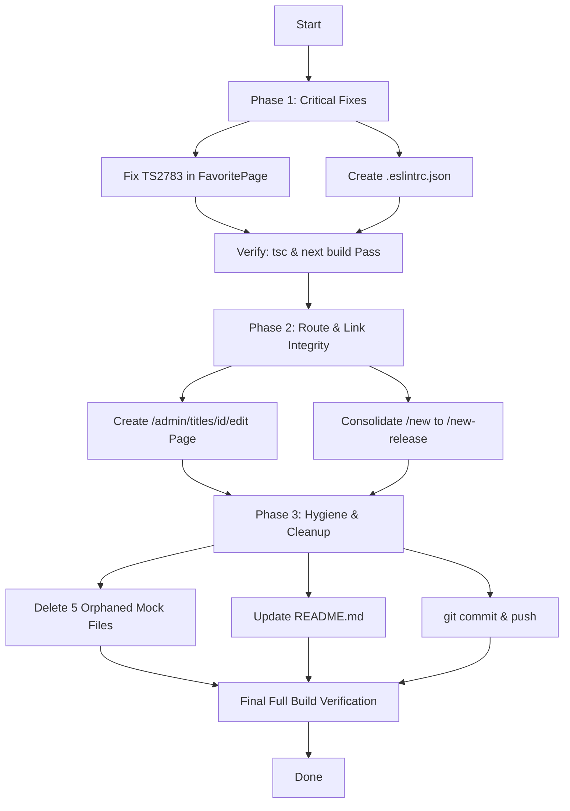

# DramaShort Project Remediation & Improvement Plan

This plan outlines the specific fixes, cleanup tasks, and enhancements needed to restore project health, fix broken user flows, and streamline the codebase.

---

## 1. Issue Prioritization Matrix

| Phase | Priority | Item | Status | Impact |
|---|---|---|---|---|
| **Phase 1** | 🔴 Critical | Fix TypeScript `TS2783` in `FavoritePage` (`app/account/favorite/page.tsx`) | ✅ Done | Restored `npm run build` and page compilation |
| **Phase 1** | 🟡 High | Configure ESLint (`.eslintrc.json`) | ✅ Done | Restored non-interactive linting in `npm run lint` |
| **Phase 2** | 🟠 High | Implement Admin Title Edit Page (`/admin/titles/[id]/edit`) | ✅ Done | Resolved 404 dead links from admin titles table and cards |
| **Phase 2** | 🟡 Medium | Consolidate `/new` into `/new-release` | ✅ Done | Eliminated duplicated route and legacy data source |
| **Phase 3** | 🟢 Low | Clean up 5 orphaned legacy mock files (~42 KB) | ✅ Done | Reduced tech debt, eliminated duplicate schema confusion |
| **Phase 3** | 🟢 Low | Update `README.md` & Initialize Git | ✅ Done | Reflected accurate project status and enabled version tracking |

---

## 2. Phase 1: Critical Build & Tooling Fixes

### Task 1.1: Fix Duplicate Property in `app/account/favorite/page.tsx`
* **File**: `app/account/favorite/page.tsx`
* **Problem**:
  ```typescript
  // Current code (lines 36-39)
  const favoriteEntries = Array.from(favoritedSlugs).map((slug) => ({
    slug,
    ...getTitleBySlugOrFallback(slug),
  }));
  ```
  `getTitleBySlugOrFallback(slug)` returns a `Title` object that already contains `slug: string`. In strict TypeScript object literals, declaring `slug` explicitly followed by `...getTitleBySlugOrFallback(slug)` throws `TS2783: 'slug' is specified more than once, so this usage will be overwritten`.
* **Fix**:
  ```typescript
  const favoriteEntries = Array.from(favoritedSlugs).map(getTitleBySlugOrFallback);
  ```
* **Verification**:
  - Run `npx tsc --noEmit` -> Must return code 0.
  - Run `npm run build` -> Must compile and produce static pages successfully.

---

### Task 1.2: Add ESLint Configuration
* **Target File**: `.eslintrc.json` in project root
* **Problem**: `package.json` specifies `"lint": "next lint"`. Because no config file exists, running `npm run lint` halts on an interactive prompt asking how to configure ESLint.
* **Fix**: Create `.eslintrc.json`:
  ```json
  {
    "extends": "next/core-web-vitals"
  }
  ```
* **Verification**:
  - Run `npm run lint` -> Runs without interactive prompts and completes with exit code 0.

---

## 3. Phase 2: Route & Link Integrity

### Task 2.1: Implement Admin Title Edit Page (`/admin/titles/[id]/edit`)
* **Problem**: In `app/admin/titles/page.tsx`, table row titles, edit action buttons, and card links route to `/admin/titles/${t.id}/edit`, which triggers a 404.
* **Target File**: `app/admin/titles/[id]/edit/page.tsx`
* **Implementation Plan**:
  1. Unwrap `params: Promise<{ id: string }>` using React `use()`.
  2. Lookup title in `titles` from `data/titles.mock.ts` (fallback if not found).
  3. Render an edit form styled consistently with the Admin layout:
     - Title, Channel dropdown (from `data/channels.mock.ts`), Genre, Tags (comma-separated or chips), Status dropdown (`Published`, `Draft`, `Scheduled`, `Archived`), Total Episodes, and Synopsis textarea.
     - Breadcrumbs: `Admin / Titles / Edit [Title]`.
     - Action buttons: "Save Changes" (simulates save + toast notification) and "Cancel" (returns to `/admin/titles`).
* **Verification**:
  - Navigate to `/admin/titles` and click Edit on any title.
  - Verify that the edit page renders with the title's pre-filled information, actions work, and navigation back works.

---

### Task 2.2: Consolidate Route `/new` → `/new-release`
* **Problem**:
  - `app/new-release/page.tsx` is the modern, integrated page referenced by navbar and footer links.
  - `app/new/page.tsx` is a legacy version still importing from `data/new-release-catalog.mock.ts`.
* **Fix Options**:
  - **Option A (Clean Redirect)**: Make `app/new/page.tsx` redirect to `/new-release` via Next.js permanent redirect or client router redirect, or add a redirect entry in `next.config.mjs`.
  - **Option B (Direct Removal)**: Remove `app/new/page.tsx` entirely since all user navigation already points to `/new-release`.

---

## 4. Phase 3: Codebase Cleanliness & Project Hygiene

### Task 3.1: Retire Orphaned Legacy Mock Files
* **Files to Remove**:
  1. `data/dramas.mock.ts` (10 KB) — Replaced by `titles.mock.ts`.
  2. `data/search-catalog.mock.ts` (8 KB) — Replaced by `titles.mock.ts`.
  3. `data/trending.mock.ts` (7 KB) — Replaced by `titles.mock.ts`.
  4. `data/admin-titles.mock.ts` (10 KB) — Replaced by `titles.mock.ts`.
  5. `data/new-release-catalog.mock.ts` (6.5 KB) — Replaced by `titles.mock.ts`.
* **Verification**: Search the entire codebase for any remaining import statements referencing these files to ensure 0 references before removal.

---

## 5. Execution Workflow


