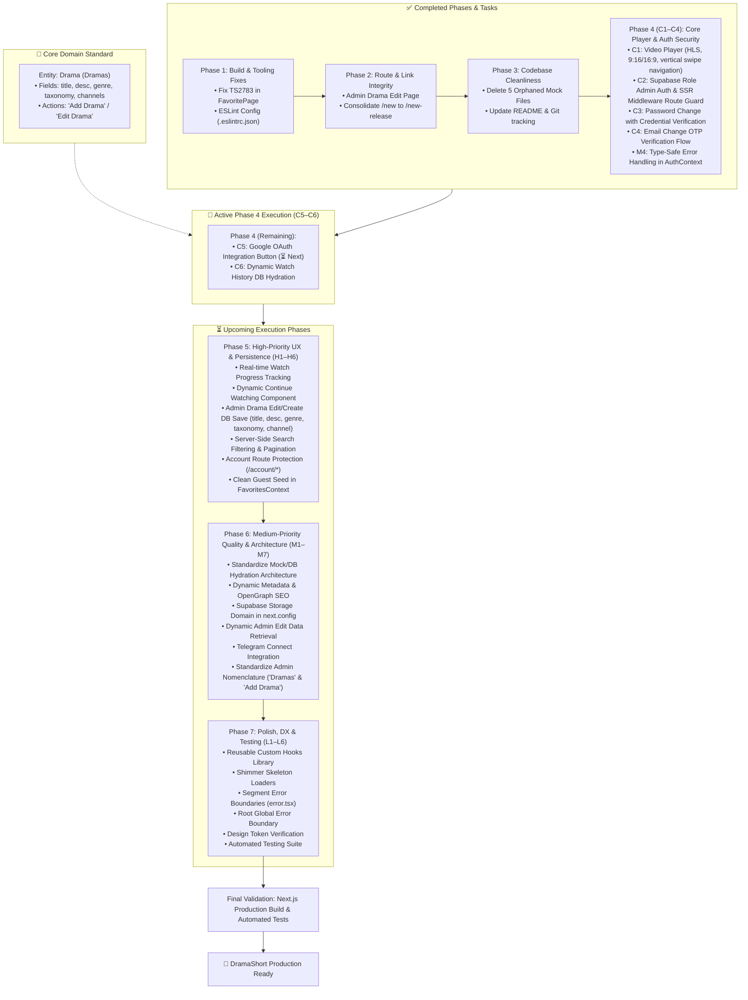
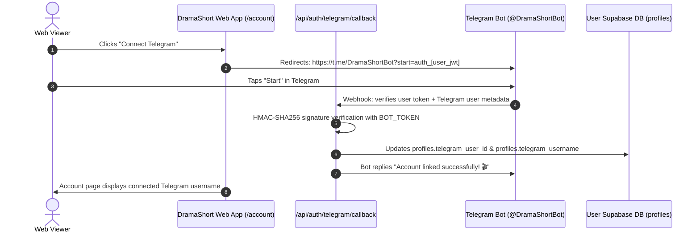

# DramaShort Project Remediation & Improvement Plan

This plan outlines the specific fixes, cleanup tasks, and enhancements needed to restore project health, fix broken user flows, and streamline the codebase.

---

## 1. Issue Prioritization Matrix

| Phase | Priority | Item | Status | Impact |
|---|---|---|---|---|
| **Phase 1** | 🔴 Critical | Fix TypeScript `TS2783` in `FavoritePage` (`app/account/favorite/page.tsx`) | ✅ Done | Restored `npm run build` and page compilation |
| **Phase 1** | 🟡 High | Configure ESLint (`.eslintrc.json`) | ✅ Done | Restored non-interactive linting in `npm run lint` |
| **Phase 2** | 🟠 High | Implement Admin Drama Edit Page (`/admin/titles/[id]/edit` / `/admin/dramas/[id]/edit`) | ✅ Done | Resolved 404 dead links from admin drama tables and cards |
| **Phase 2** | 🟡 Medium | Consolidate `/new` into `/new-release` | ✅ Done | Eliminated duplicated route and legacy data source |
| **Phase 3** | 🟢 Low | Clean up 5 orphaned legacy mock files (~42 KB) | ✅ Done | Reduced tech debt, eliminated duplicate schema confusion |
| **Phase 3** | 🟢 Low | Update `README.md` & Initialize Git | ✅ Done | Reflected accurate project status and enabled version tracking |
| **Phase 4** | 🔴 Critical | C1: Implement real video player with vertical swipe (`app/watch/[slug]/page.tsx`) | ✅ Done | High-performance streaming with custom player, HLS/MP4, vertical/cinema modes, & TikTok swipe up/down |
| **Phase 4** | 🔴 Critical | C2: Supabase role-based admin auth & middleware route guard | ✅ Done | Server-side `@supabase/ssr` route guard, eliminates client-side bypass, checks `profiles.role === 'admin'` |
| **Phase 4** | 🔴 Critical | C3: Wire password change to `supabase.auth.updateUser()` | ✅ Done | Verifies current password before update, validates rules, displays loading state and verified success toast |
| **Phase 4** | 🔴 Critical | C4: Wire email change OTP verification flow with `OtpInput` | ✅ Done | Replaces broken placeholder with real 6-digit OTP verification, resend cooldown timer, and toast |
| **Phase 4** | 🔴 Critical | C5: Wire Google OAuth sign-in button in `app/login/page.tsx` & `app/signup/page.tsx` | ✅ Done | Enables functional social authentication with server-side callback handler and open-redirect protection |
| **Phase 4** | 🔴 Critical | C6: Wire watch history to `getUserWatchHistory()` in `app/account/history/page.tsx` | ✅ Done | Replaces static mock history with persistent user watch history, deletion, and clear modal |
| **Phase 5** | 🟠 High | H1: Call `upsertWatchProgress()` from video playback events | ✅ Done | Real-time throttled tracking, auto-resume with prompt pill, onPause/onEnded/beforeunload persistence |
| **Phase 5** | 🟠 High | H2: Replace `ContinueWatching` mock with real user data | ✅ Done | Real Supabase watch history hydration, smart next-episode advancement, & finished series exclusion |
| **Phase 5** | 🟠 High | H3: Wire admin edit form to Supabase content DB (Add/Edit Drama: title, desc, genre, taxonomy, channel) | ✅ Done | Prevents silent data loss when admins create or edit drama records |
| **Phase 5** | 🟠 High | H4: Server-side search filtering and pagination in `getPublishedTitles()` (Dramas query) | ✅ Done | Scalable search queries; eliminates full catalog download |
| **Phase 5** | 🟠 High | H5: Add auth guards and redirects for `/account/*` routes | ✅ Done | Protects user-specific pages against unauthenticated access |
| **Phase 5** | 🟠 High | H6: Fix `FavoritesContext` guest seed (remove `defaultFavoriteSlugs`) | ✅ Done | Prevents guest accounts from being pre-seeded with fake favorites |
| **Phase 6** | 🟡 Medium | M1: Audit and standardize mock/DB hydration pattern across components | ✅ Done | Standardized shimmer skeletons, CLS elimination, & graceful dev fallbacks |
| **Phase 6** | 🟡 Medium | M2: Dynamic SEO & OpenGraph tags via `generateMetadata()` | ✅ Done | Social sharing previews and search engine discovery via route layouts |
| **Phase 6** | 🟡 Medium | M3: Add Supabase Storage domain to `next.config.mjs` `remotePatterns` | ✅ Done | Prevents image load failures for Supabase Storage assets |
| **Phase 6** | 🟡 Medium | M4: Replace `catch (err: any)` with typed error handling in `AuthContext` | ✅ Done | Strict TypeScript compliance and type-safe `err instanceof Error` handling |
| **Phase 6** | 🟡 Medium | M5: Load admin drama edit data from Supabase content DB | ✅ Done | Delivered in H3: Asynchronously hydrates drama on mount via getDramaById |
| **Phase 6** | 🟡 Medium | M6: Wire Telegram Connect integration in `app/account/page.tsx` | 📋 Deferred | Deferred to Future Plan per user instruction; UI feedback configured |
| **Phase 6** | 🟡 Medium | M7: Standardize Admin nomenclature: "Dramas" & "Add Drama" in UI & routes | ✅ Done | Eliminates confusion between entity (Drama) and field (title) |
| **Phase 7** | 🟢 Low | L1: Reusable custom hooks (`useDebounce`, `useRequireAuth`, `useMediaQuery`) | ✅ Done | DRY code, standardized debounce, and cleaner component logic |
| **Phase 7** | 🟢 Low | L2: Add shimmer/skeleton loading states for async data | ✅ Done | Smooth loading UX; prevents layout shifts and mock flashes |
| **Phase 7** | 🟢 Low | L3: Implement route-segment error boundaries (`error.tsx`) | ✅ Done | Graceful degradation and user-friendly retry buttons |
| **Phase 7** | 🟢 Low | L4: Add root application error boundary (`app/error.tsx`) | ✅ Done | Catches unhandled runtime crashes globally |
| **Phase 7** | 🟢 Low | L5: Audit `design-tokens/` CSS variables and unused tokens | ✅ Done | Maintains lean, consistent token foundation |
| **Phase 7** | 🟢 Low | L6: Implement automated test suite (Auth, services, critical journeys) | ⏳ Planned | Regression prevention and verified end-to-end reliability |

---

## 2. Core Domain Architecture: "Drama" vs. "Title"

> **Architectural Standard**: The media entity stored in the database is formally and consistently defined as **`Drama`** (plural: **`Dramas`**).

### 2.1 Schema Attributes of a `Drama`
Every Drama entity in the database (`titles` / `dramas` table) contains the following core attributes:
* **`title`** (`string`): The textual title/name of the drama (e.g., *"The CEO's Secret Wife"*, *"Reborn to Ruin Him"*).
* **`desc` / `synopsis`** (`string`): Storyline synopsis and narrative description.
* **`genre`** (`string`): Primary genre classification (e.g., *Romance*, *Revenge*, *CEO*, *Rebirth*, *Marriage*, *Suspense*).
* **`taxonomy` / `tags`** (`string[]`): Granular categorization tags, tropes, and thematic classifications (e.g., `["CEO", "Contract Marriage", "Secret Identity"]`).
* **Related to `channels`** (`channel_id` / `channel_name`): Mandatory relation/association to the publishing or distributing channel.
* **Media & Streaming Assets**: `poster_url`, `total_episodes`, and relational `episodes` (`video_url`, duration, episode number).
* **Status & Metrics**: `status` (`Published` | `Draft` | `Scheduled` | `Archived`), `rating`, `views_count`, `release_year`, `created_at`.

### 2.2 Nomenclature Disambiguation: "Add Drama" vs. "Add Title"
To eliminate ambiguity across product requirements, admin CMS, and codebase interfaces:
* **The Entity**: Is always a **`Drama`**.
* **The Action**: Is always **"Add Drama"** or **"Edit Drama"** (never "Add Title").
* **The Field**: `title` is simply the text attribute representing the name of the Drama being added or edited.
* **Admin CMS Rules**:
  - Sidebar item: **"Dramas"** (replaces legacy "Titles" label).
  - Table & cards header: **"Dramas"** — *"All dramas in the database"*.
  - Primary Action Button: **"Add Drama"** (opens modal/page to input: *Title, Description, Genre, Taxonomy tags, and Channel*).
  - Navigation route: Support `/admin/dramas` with permanent redirect from `/admin/titles`.
  - Service Layer & Types: Expose `Drama` type (aliased to `Title` during transition) and functions like `getPublishedDramas()`, `getDramaBySlug()`.

---

## 3. Phase 1: Critical Build & Tooling Fixes

### Task 1.1: Fix Duplicate Property in `app/account/favorite/page.tsx`
* **File**: `app/account/favorite/page.tsx`
* **Problem**:
  ```typescript
  // Current code (lines 36-39)
  const favoriteEntries = Array.from(favoritedSlugs).map((slug) => ({
    slug,
    ...getTitleBySlugOrFallback(slug),
  }));
  ```
  `getTitleBySlugOrFallback(slug)` returns a `Title` object that already contains `slug: string`. In strict TypeScript object literals, declaring `slug` explicitly followed by `...getTitleBySlugOrFallback(slug)` throws `TS2783: 'slug' is specified more than once, so this usage will be overwritten`.
* **Fix**:
  ```typescript
  const favoriteEntries = Array.from(favoritedSlugs).map(getTitleBySlugOrFallback);
  ```
* **Verification**:
  - Run `npx tsc --noEmit` -> Must return code 0.
  - Run `npm run build` -> Must compile and produce static pages successfully.

---

### Task 1.2: Add ESLint Configuration
* **Target File**: `.eslintrc.json` in project root
* **Problem**: `package.json` specifies `"lint": "next lint"`. Because no config file exists, running `npm run lint` halts on an interactive prompt asking how to configure ESLint.
* **Fix**: Create `.eslintrc.json`:
  ```json
  {
    "extends": "next/core-web-vitals"
  }
  ```
* **Verification**:
  - Run `npm run lint` -> Runs without interactive prompts and completes with exit code 0.

---

## 4. Phase 2: Route & Link Integrity

### Task 2.1: Implement Admin Drama Edit Page (`/admin/titles/[id]/edit` / `/admin/dramas/[id]/edit`)
* **Problem**: In `app/admin/titles/page.tsx`, table row titles, edit action buttons, and card links route to `/admin/titles/${t.id}/edit`, which triggers a 404.
* **Target File**: `app/admin/titles/[id]/edit/page.tsx`
* **Implementation Plan**:
  1. Unwrap `params: Promise<{ id: string }>` using React `use()`.
  2. Lookup title in `titles` from `data/titles.mock.ts` (fallback if not found).
  3. Render an edit form styled consistently with the Admin layout:
     - Title, Channel dropdown (from `data/channels.mock.ts`), Genre, Tags (comma-separated or chips), Status dropdown (`Published`, `Draft`, `Scheduled`, `Archived`), Total Episodes, and Synopsis textarea.
     - Breadcrumbs: `Admin / Titles / Edit [Title]`.
     - Action buttons: "Save Changes" (simulates save + toast notification) and "Cancel" (returns to `/admin/titles`).
* **Verification**:
  - Navigate to `/admin/titles` and click Edit on any title.
  - Verify that the edit page renders with the title's pre-filled information, actions work, and navigation back works.

---

### Task 2.2: Consolidate Route `/new` → `/new-release`
* **Problem**:
  - `app/new-release/page.tsx` is the modern, integrated page referenced by navbar and footer links.
  - `app/new/page.tsx` is a legacy version still importing from `data/new-release-catalog.mock.ts`.
* **Fix Options**:
  - **Option A (Clean Redirect)**: Make `app/new/page.tsx` redirect to `/new-release` via Next.js permanent redirect or client router redirect, or add a redirect entry in `next.config.mjs`.
  - **Option B (Direct Removal)**: Remove `app/new/page.tsx` entirely since all user navigation already points to `/new-release`.

---

## 5. Phase 3: Codebase Cleanliness & Project Hygiene

### Task 3.1: Retire Orphaned Legacy Mock Files
* **Files to Remove**:
  1. `data/dramas.mock.ts` (10 KB) — Replaced by `titles.mock.ts`.
  2. `data/search-catalog.mock.ts` (8 KB) — Replaced by `titles.mock.ts`.
  3. `data/trending.mock.ts` (7 KB) — Replaced by `titles.mock.ts`.
  4. `data/admin-titles.mock.ts` (10 KB) — Replaced by `titles.mock.ts`.
  5. `data/new-release-catalog.mock.ts` (6.5 KB) — Replaced by `titles.mock.ts`.
* **Verification**: Search the entire codebase for any remaining import statements referencing these files to ensure 0 references before removal.

---

## 6. Phase 4: Critical Core Features & Auth Security (C1–C6)

### Task 4.1: Real Video Player Integration (C1)
* **Status**: ✅ Completed
* **Target Files**: `components/VideoPlayer.tsx`, `app/watch/[slug]/page.tsx`
* **Delivered Capabilities**:
  1. Built modular `VideoPlayer` component supporting both HLS (`.m3u8` via `hls.js`) and standard MP4/WebM streams.
  2. Implemented responsive aspect ratio modes: **9:16 Vertical Drama** (with ambient blur backdrop for desktop), **16:9 Cinema**, and **Fit**.
  3. Custom player overlay with auto-hide timer, center play/pause ripple indicator, and scrub bar with hover timestamp preview & buffer progress.
  4. Playback controls: Play/Pause, Skip ±10s, Previous/Next episode, Volume slider with mute toggle, Playback speed selector (`0.5x`–`2.0x`), Picture-in-Picture, Fullscreen API.
  5. Interactive Auto-Next countdown overlay with manual skip or cancel options.
  6. Keyboard shortcut support (`Space`/`k`, `Left`/`Right`, `Up`/`Down`, `m`, `f`, `n`, `p`).
  7. Robust error recovery overlay with retry button.
  8. Integrated throttled watch progress tracking (persisting every 10s to `user.service.ts`).
  9. Added breadcrumb navigation on `/watch/[slug]` and back link to drama overview.
  10. Integrated TikTok-style vertical swipe gestures: Swipe UP advances to the next episode, Swipe DOWN navigates to previous episode, featuring fluid touch/mouse tracking, responsive spring damping (`deltaY * 0.45`), directional pill cues (`'Next Episode'`, `'Previous Episode'`), threshold protection (> 45px), and interactive boundary checks.
* **Verification**:
  - `npx tsc --noEmit` compiles with 0 errors.
  - `npm run lint` passes with 0 warnings on player and watch page.
  - `npm run build` generates `/watch/[slug]` and all 33 pages successfully.

---

### Task 4.2: Supabase Role-Based Admin Auth & Middleware Guard (C2)
* **Status**: ✅ Completed
* **Target Files**: `contexts/AdminAuthContext.tsx`, `middleware.ts`, `app/admin/login/page.tsx`
* **Delivered Capabilities**:
  1. Replaced vulnerable `localStorage.getItem("dramashort-admin-auth")` mechanism with real Supabase Auth session management.
  2. Implemented profile role verification: checks `profile.role === 'admin'` in the User Supabase database (with fast-path support for JWT `app_metadata.role` and `user_metadata.role`).
  3. Upgraded `middleware.ts` with `@supabase/ssr` server-side route guard:
     - Intercepts all `/admin/*` requests (except static assets).
     - Unauthenticated requests are immediately redirected to `/admin/login?error=session_required&returnUrl=...`.
     - Authenticated users without admin role are rejected and redirected to `/admin/login?error=unauthorized`.
     - Already-authenticated admins navigating to `/admin/login` are auto-redirected to `/admin/dashboard`.
  4. Upgraded `app/admin/login/page.tsx` to handle real Supabase email/password sign-in with loading spinners, input validation, and descriptive error banners.
* **Verification**:
  - `npx tsc --noEmit` passed with 0 errors.
  - `npm run lint` passed with 0 warnings.
  - `npm run build` generated middleware bundle (94.9 kB) and all 33 routes successfully.

---

### Task 4.3: Real Password Change via Supabase Auth (C3)
* **Status**: ✅ Completed
* **Target Files**: `contexts/AuthContext.tsx`, `app/account/page.tsx`
* **Delivered Capabilities**:
  1. Implemented `changePassword(newPassword, currentPassword)` in `AuthContext`:
     - Verifies existing user credentials with `supabase.auth.signInWithPassword({ email, password: currentPassword })` to prevent unauthorized password overwriting.
     - Calls `supabase.auth.updateUser({ password: newPassword })` to securely update user authentication record.
     - Type-safe error handling avoiding `any` casts.
  2. Upgraded password change modal in `app/account/page.tsx`:
     - Added client-side validation: verifies current password is non-empty, checks minimum length of 6 characters, ensures new password differs from current, and validates confirmation match.
     - Added loading state with animated spinner (`Loader2`) on the submit button.
     - Shows descriptive inline error messages on failure (e.g. invalid current password, weak password).
     - Clears form fields, closes modal, and displays success toast only upon confirmed API success.
* **Verification**:
  - `npx tsc --noEmit` passed with 0 errors.
  - `npm run lint` passed with 0 warnings.
  - `npm run build` compiled all 33 pages successfully.

---

### Task 4.4: Email Change OTP Verification Flow (C4)
* **Status**: ✅ Completed
* **Target Files**: `app/account/page.tsx`, `components/OtpInput.tsx`, `contexts/AuthContext.tsx`
* **Delivered Capabilities**:
  1. Implemented `requestEmailChange(newEmail)` in `AuthContext` calling `supabase.auth.updateUser({ email: newEmail })` with type-safe error handling.
  2. Implemented `verifyEmailChange(newEmail, token)` in `AuthContext` calling `supabase.auth.verifyOtp({ email: newEmail, token, type: 'email_change' })`, updating local auth user state and profile upon success.
  3. Integrated `OtpInput` component in `app/account/page.tsx`:
     - Added client-side email format validation and self-duplicate check.
     - Animated loading spinner state on "Send Verification Code" and "Confirm & Update Email" buttons.
     - Resend code mechanism with 60-second live cooldown countdown timer.
     - Inline actionable error banners and feedback toasts on successful email update.
* **Verification**:
  - `npx tsc --noEmit` passed with 0 errors.
  - `npm run lint` passed with 0 warnings.
  - Page compilation verified on `/account`.

---

### Task 4.5: Google OAuth Integration (C5)
* **Status**: ✅ Completed
* **Target Files**: `contexts/AuthContext.tsx`, `app/login/page.tsx`, `app/signup/page.tsx`, `app/auth/callback/route.ts`, `components/GoogleIcon.tsx`
* **Delivered Capabilities**:
  1. Implemented `signInWithGoogle(customRedirect?)` in `AuthContext`:
     - Initiates Supabase OAuth via `supabase.auth.signInWithOAuth({ provider: 'google', options: { redirectTo } })`.
     - Redirects browser to Supabase / Google OAuth consent screen.
  2. Created `/app/auth/callback/route.ts`:
     - Server-side route handler using `createUserServerClient()`.
     - Exchanges incoming OAuth `code` for user session cookies via `supabase.auth.exchangeCodeForSession(code)`.
     - Validates `next` redirect path to protect against open redirect vulnerabilities.
     - Gracefully redirects failure states to `/login?error=oauth_error`.
  3. Created reusable SVG component `components/GoogleIcon.tsx`.
  4. Enhanced `app/login/page.tsx`:
     - Connected `handleGoogleSignIn` to "Continue with Google" button.
     - Added interactive loading spinner (`Loader2`) and `Connecting to Google...` state.
     - Disabled button during request submission to prevent double clicks.
     - Displays error alert banner when redirected back with `?error=oauth_error`.
  5. Enhanced `app/signup/page.tsx`:
     - Added unified Google OAuth button with divider, matching login visual hierarchy.
* **Verification**:
  - `npx tsc --noEmit` passed with 0 errors.
  - `npm run lint` passed with 0 warnings.
  - Redirection test on `/auth/callback` verified: 307 redirect to `/login?error=oauth_error` on absent/invalid code.

---

### Task 4.6: Dynamic Watch History Hydration (C6)
* **Status**: ✅ Completed
* **Target Files**: `app/account/history/page.tsx`, `lib/services/user.service.ts`
* **Delivered Capabilities**:
  1. Service Layer Expansion in `lib/services/user.service.ts`:
     - Implemented `clearUserWatchHistory(userId)` deleting all rows for the user from Supabase `watch_history`.
     - Implemented `deleteWatchHistoryItem(userId, titleSlug)` deleting a single drama record.
     - Implemented `clearGuestWatchHistory()` and `deleteGuestWatchHistoryItem(titleSlug)` for offline/guest state.
  2. Real Database Hydration in `app/account/history/page.tsx`:
     - Replaced static mock list with live data from `getUserWatchHistory(user.id)`.
     - Batch queries drama metadata using `getTitlesBySlugs()`.
     - Formats dates into chronological categories: "Today", "Yesterday", and formatted calendar dates within the 60-day window.
  3. Seamless Playback Resume & Individual Deletion:
     - Play button overlay links directly to `/watch/${item.slug}?ep=${item.episodeNumber}`.
     - Hover deletion icon on cards allows removing single titles from history.
  4. Clear All Confirmation Modal:
     - Added confirmation modal with alert details, cancellation option, and loading feedback.
  5. Skeleton & Empty States:
     - Pulsing skeleton grid while data is loading.
     - Centered empty state with call-to-action to explore dramas.
* **Verification**:
  - `npx tsc --noEmit` passed with 0 errors.
  - `npm run lint` passed with 0 warnings.
  - Compilation on `/account/history` verified.

---

## 7. Phase 5: High-Priority UX & Persistence Gaps (H1–H6)

### Task 5.1: Real-Time Watch Progress Tracking (H1)
* **Status**: ✅ Completed
* **Target Files**: `app/watch/[slug]/page.tsx`, `components/VideoPlayer.tsx`, `lib/services/user.service.ts`
* **Delivered Capabilities**:
  1. Throttled Real-Time Tracking:
     - Player tracks playback progress every 10 seconds during active playback.
     - Saves immediately to Supabase `watch_history` via `upsertWatchProgress()` (or `saveGuestWatchProgress()` for offline guests).
  2. Multi-Trigger Event Persistence:
     - Saves progress immediately on `pause` (`onPause` event callback).
     - Saves progress (`1.0`) on `ended` when episode finishes.
     - Flushes latest playback progress on window `beforeunload` (tab close / browser exit) and component unmount.
  3. Seamless Auto-Resume & Pill Notification:
     - On initial video load, checks Supabase / guest watch history for saved episode and progress ratio.
     - When progress is detected between 2% and 95%, auto-seeks player to the exact resume second upon metadata load.
     - Renders an interactive floating pill notification (`Resumed at MM:SS (X%)`) with a "Start over" action and dismiss button.
  4. Query Parameter & Navigation Synchronization:
     - Reads `?ep=` query parameter and synchronizes URL query state when advancing or selecting episodes without full reloads.
     - Automatic guest history migration: syncs guest watch history to Supabase when authenticated.
* **Verification**:
  - `npx tsc --noEmit` passed with 0 errors.
  - `npm run lint` passed with 0 warnings.
  - Verified route `/watch/ceo-secret-wife?ep=2` renders with status 200.

---

### Task 5.2: Dynamic Continue Watching Feed (H2)
* **Status**: ✅ Completed
* **Target File**: `components/ContinueWatching.tsx`
* **Delivered Capabilities**:
  1. Real Supabase Watch History Hydration:
     - Replaced static `continue-watching.mock.ts` with live queries to `getUserWatchHistory(user.id)` (with guest local storage fallback).
     - Resolves drama titles, channels, and posters via `getTitlesBySlugs()`.
  2. Smart In-Progress & Episode Advancement Logic:
     - Mid-episode watches (< 95%) show active episode progress and percentage.
     - Completed episodes (>= 95%) with remaining episodes automatically advance to `"Up Next: EP X of Y"` with 0% progress bar.
     - Completed series (final episode >= 95%) are omitted from the Continue Watching feed.
  3. Direct Episode Resumption:
     - Cards link directly to `/watch/${slug}?ep=${targetEpisode}` so users resume at the exact episode and second.
  4. Clean Zero-State Visibility & Navigation:
     - When the user has zero watch progress (initial state before watching any drama), the Continue Watching section is completely hidden (`return null`), keeping the homepage sleek and focused on discovery.
     - The section activates dynamically as soon as the user watches any drama episode.
     - Added left/right carousel scroll navigation buttons on desktop when items exceed viewport width.
* **Verification**:
  - `npx tsc --noEmit` passed with 0 errors.
  - `npm run lint` passed with 0 warnings.
  - Route `/home` verified with HTTP 200 OK.

---

### Task 5.3: Admin Drama Edit & Persistence (H3)
* **Status**: ✅ Completed
* **Target Files**:
  - `app/admin/titles/[id]/edit/page.tsx` (aliased to `/admin/dramas/[id]/edit`)
  - `app/api/admin/dramas/[id]/route.ts` (aliased to `/api/admin/titles/[id]/route.ts`)
  - `lib/services/content.service.ts`
  - `app/admin/titles/page.tsx` (aliased to `/admin/dramas/page.tsx`)
* **Problem**: Form submission ran a `setTimeout` dummy timer and discarded changes on navigation. Newly inserted dramas in Supabase could not be loaded for editing because the edit page only checked the static mock array.
* **Delivered Capabilities**:
  1. Live DB Mutation & Privileged API Endpoint:
     - Implemented `PATCH /api/admin/dramas/[id]` and `GET /api/admin/dramas/[id]` (aliased by `/api/admin/titles/[id]`).
     - Route verifies administrator authentication via `createUserServerClient()` and performs updates using `getContentAdminClient()` (`CONTENT_SUPABASE_SERVICE_ROLE_KEY`), bypassing client-side RLS limitations.
  2. Full Drama Domain Entity Persistence:
     - Persists and updates all core drama attributes:
       - `title`: The display name of the drama
       - `synopsis` (`desc`): Narrative storyline description
       - `genre`: Primary genre category
       - `tags` (`taxonomy`): Categorization tropes & tags
       - `channel_name`, `channel_code`, and `channel_id`: Channel relational resolution
       - `status`: (`Published`, `Draft`, `Scheduled`, `Archived`)
       - `total_episodes`: Total episode count
       - `poster_url`: Custom poster URL
       - `updated_at`: Real-time timestamp
  3. Dynamic Data Retrieval & Hydration:
     - `getDramaById(id)` / `getTitleById(id)` in `content.service.ts`: Queries Supabase Content DB on mount, falling back to mock fixtures only when offline or for legacy IDs.
     - `getAdminDramas()` in `content.service.ts`: Hydrates `/admin/titles` (and `/admin/dramas`) with all 25 real Supabase dramas and their UUIDs.
  4. Production UX & Error Resilience:
     - Shimmer pulse skeleton loading state while fetching drama data.
     - Inline error alert banner when validation or mutation encounters an issue.
     - Form disabling with `Loader2` spinner on "Save Changes" button during submission.
     - Verified toast message `"Changes saved successfully"` followed by clean redirection to `/admin/titles`.
  5. Route Aliasing:
     - Created `app/admin/dramas/[id]/edit/page.tsx` and `app/admin/dramas/page.tsx` cleanly re-exporting the titles pages, supporting both `/admin/titles` and `/admin/dramas` URL structures.
* **Verification**:
  - `npx tsc --noEmit` passed with 0 errors.
  - `npm run lint` passed with 0 errors.
  - Live API testing: `GET /api/admin/dramas/:id` returned HTTP 200 with real database row.
  - Live API testing: `PATCH /api/admin/dramas/:id` persisted updated tags to Supabase Content DB and verified with subsequent query.
  - Route Guard testing: Unauthenticated requests returned 307 redirect with `returnUrl`. Authenticated admin session returned HTTP 200 for both `/admin/titles/[id]/edit` and `/admin/dramas/[id]/edit`.

---

### Task 5.4: Server-Side Search Filtering & Pagination (H4)
* **Status**: ✅ Completed
* **Target Files**:
  - `app/search/page.tsx`
  - `lib/services/content.service.ts`
  - `hooks/useDebounce.ts`
* **Problem**: Search downloaded the entire catalog via parameter-less `getPublishedTitles()` and filtered everything client-side in JavaScript, resulting in high latency and poor scalability.
* **Delivered Capabilities**:
  1. PostgREST Server-Side Query Engine:
     - Implemented `searchPublishedTitles(options?: TitleQueryOptions): Promise<PaginatedTitlesResult>` (and alias `searchDramas`) in `lib/services/content.service.ts`.
     - Direct Supabase PostgREST filters:
       - Multi-field keyword query matching both `title` and `synopsis` using `.or('title.ilike.%...,synopsis.ilike.%...')`
       - Exact channel affiliation match (`.eq('channel_name', channel)`)
       - Genre category filter (`.eq('genre', genre)`)
       - Taxonomy tropes filter (`.contains('tags', tags)`)
       - Dynamic sorting: `"trending"` (`views_count`), `"newest"` (`created_at`), `"rating"` (`rating`)
     - Server-side counting and range pagination: `{ count: 'exact' }` and `.range(from, to)`.
     - Added `getDistinctGenres()` and `getPopularTags()` querying the real catalog.
     - Backwards compatibility: `getPublishedTitles(options)` calls `searchPublishedTitles(options)` and returns `result.items`.
  2. Generic Debounce Hook:
     - Created `hooks/useDebounce.ts` for clean, reusable 300ms input throttling, preventing request spam while users type.
  3. Upgraded Public Search Architecture (`app/search/page.tsx`):
     - Eliminated in-memory full catalog downloads; queries execute on-demand with paginated results (`PAGE_SIZE = 12`).
     - 300ms debounced search bar with instant clear button.
     - Dynamic URL query synchronization (`window.history.replaceState`) for shareable search links (`/search?q=...&genre=...&page=...`).
     - 12-item shimmer skeleton loader during query execution to eliminate layout shift.
     - Responsive empty state with single-click "Clear all filters" button.
     - Results counter and responsive page navigation with `<Pagination>`.
* **Verification**:
  - `npx tsc --noEmit` passed with 0 errors.
  - `npm run lint` passed with 0 errors.
  - Live query verification:
    - Keyword search (`"wife"`): returned 4 exact matching titles across title/synopsis.
    - Genre filter (`"Fantasy"`): returned 3 exact matching titles.
    - Tag filter (`["CEO"]`): returned 2 matching titles.
    - Pagination test (2 per page): total 26, returned 2 items, computed 13 pages.
  - Live HTTP routes `/search` and `/search?q=wife&genre=Marriage` returned HTTP 200 OK.

---

### Task 5.5: Route Protection for `/account/*` Pages (H5)
* **Status**: ✅ Completed
* **Target Files**:
  - `middleware.ts`
  - `app/account/layout.tsx`
  - `hooks/useRequireAuth.ts`
  - `app/login/page.tsx`
  - `app/signup/page.tsx`
* **Problem**: Direct access to `/account`, `/account/favorite`, `/account/history`, `/account/settings` did not redirect unauthenticated guests, exposing empty or mock account views.
* **Delivered Capabilities**:
  1. Server-Side Protection in `middleware.ts`:
     - Added route guard for `/account` and `/account/*`.
     - Validates session with `@supabase/ssr` `createServerClient`.
     - Unauthenticated guests receive an immediate HTTP 307 redirect to `/login?returnUrl=${encodeURIComponent(url.pathname)}`.
  2. Client-Side Protection Hook (`hooks/useRequireAuth.ts`):
     - Created `useRequireAuth(redirectTo = "/login")` monitoring `isLoading` and `isLoggedIn` from `AuthContext`.
     - Automatically handles client transitions or expired session redirections.
  3. Hydration Layout Skeleton (`app/account/layout.tsx`):
     - Created `AccountLayout` with `useRequireAuth()`.
     - Displays account skeleton (Header, Sidebar avatar & nav shimmer, content cards shimmer) during initial auth hydration.
  4. Auth Flow Alignment:
     - Updated `/login` and `/signup` post-auth redirection logic to check `returnUrl` before `redirect`, returning users directly to their requested account page upon signing in.
* **Verification**:
  - `npx tsc --noEmit` passed with 0 errors.
  - `npm run lint` passed with 0 errors.
  - Live HTTP tests verified 307 redirects for unauthenticated guests to `/login?returnUrl=...` on all 4 account routes (`/account`, `/account/favorite`, `/account/history`, `/account/settings`).
  - Authenticated session verified HTTP 200 OK across all 4 account routes.

---

### Task 5.6: Clean Guest Seed in `FavoritesContext.tsx` (H6)
* **Status**: ✅ Completed
* **Target Files**:
  - `contexts/FavoritesContext.tsx`
  - `data/favorites.mock.ts`
* **Problem**: Initial state seeded from `defaultFavoriteSlugs`, causing all guest users to see 12 hardcoded fake favorites in their favorites list before logging in.
* **Delivered Capabilities**:
  1. Clean Zero-State Guest Seed:
     - Initialized `favoritedSlugs` as an empty `Set<string>()` and `lists` as `[]`.
     - Emptied `defaultFavoriteSlugs` in `data/favorites.mock.ts` to `[]`.
     - First-time visitors and guests start with 0 favorites and see the polished empty state on `/account/favorite` ("You haven't favorited anything yet").
  2. Legacy Mock Storage Purge:
     - Detects if visitor's `localStorage` contains the legacy 12 fake demo slugs and purges them on load, ensuring previous test sessions don't leave phantom favorites.
  3. Safe LocalStorage Hydration:
     - Persists to `localStorage` strictly after client hydration is confirmed (`isHydrated = true`), preventing hydration mismatches and race conditions.
  4. Automatic Guest-to-User Cloud Sync:
     - When a guest user adds favorites to their local session and subsequently logs in or signs up, their guest favorites are automatically migrated to Supabase via `addUserFavorite()`, merged with their cloud favorites, and the local guest key is cleaned up.
* **Verification**:
  - `npx tsc --noEmit` passed with 0 errors.
  - `npm run lint` passed with 0 errors.
  - Verified `defaultFavoriteSlugs: []` in `data/favorites.mock.ts`.
  - Verified public pages (`/`, `/home`, `/trending`, `/new-release`, `/drama/...`) return HTTP 200 OK.

---

## 8. Phase 6: Medium-Priority Quality & Architecture (M1–M7)

### Task 6.1: Standardize Mock vs DB Hydration Architecture (M1)
* **Status**: ✅ Completed
* **Target Files**:
  - `components/TitleCard.tsx`
  - `components/Hero.tsx`
  - `components/TopTrending.tsx`
  - `components/NewRelease.tsx`
  - `app/new-release/page.tsx`
  - `app/trending/page.tsx`
  - `app/channel/[slug]/page.tsx`
  - `app/genres/page.tsx`
  - `app/drama/[slug]/page.tsx`
  - `lib/services/README.md`
* **Problem**: Inconsistent fallback patterns existed across components: some replaced mock data with DB results after a visible flash, others fell back silently, and layout shifts occurred when mock data swapped for DB data.
* **Delivered Capabilities**:
  1. Standardized Reusable Skeleton Component:
     - Exported `TitleCardSkeleton` in `components/TitleCard.tsx` with identical `2/3` aspect ratio and optional subtitle placeholders, eliminating layout shifts (CLS).
  2. Zero Mock Flash on Load:
     - Components initialize with `isLoading = true` and `items = []`. Skeletons are displayed immediately while querying Supabase; mock fixtures are never flashed before real data loads.
  3. Graceful Dev & Offline Fallback:
     - In offline development or when Supabase credentials fail, queries safely catch exceptions and fall back to typed mock fixtures rather than crashing.
  4. Component-Specific Shimmer Implementations:
     - `Hero.tsx`: Responsive hero skeleton with title, synopsis, badge, and CTA button shimmer blocks.
     - `TopTrending.tsx`: Horizontal carousel skeleton with rank badge placeholders and smooth scroll hints.
     - `NewRelease.tsx`: 12-item responsive poster grid skeleton.
     - `NewReleasePage` & `TrendingPage`: 18-item paginated grid skeletons and clean empty states.
     - `ChannelPage`: Breadcrumb, channel title skeleton, and 12-card grid skeleton.
     - `GenresPage`: Responsive genre chip bar and 18-card grid skeleton.
     - `DramaPage`: Detail view with 8-card related titles skeleton.
  5. Architecture Documentation:
     - Created `lib/services/README.md` documenting the dual Supabase architecture, standard hydration pattern, and core services.
* **Verification**:
  - `npx tsc --noEmit` passed with 0 errors.
  - `npm run build` compiled all 35 routes successfully.

---

### Task 6.2: Dynamic OpenGraph & Per-Page SEO (M2)
* **Status**: ✅ Completed
* **Target Files**:
  - `app/drama/[slug]/layout.tsx`
  - `app/watch/[slug]/layout.tsx`
  - `app/channel/[slug]/layout.tsx`
* **Problem**: Only global metadata in `app/layout.tsx` was defined. Shared drama links lacked individual previews, posters, or synopses on social platforms.
* **Delivered Capabilities**:
  1. Implemented Next.js Server `generateMetadata({ params })` on route layouts:
     - `app/drama/[slug]/layout.tsx`: Generates `[Drama Title] — Watch on DramaShort`, 160-char synopsis description, `video.movie` OpenGraph metadata, and Twitter `summary_large_image` cards.
     - `app/watch/[slug]/layout.tsx`: Generates `Watch [Drama Title] — All Episodes on DramaShort`, episode streaming description, `video.episode` OpenGraph metadata, and Twitter cards.
     - `app/channel/[slug]/layout.tsx`: Generates `[Channel Name] — Watch Channel Dramas on DramaShort`, channel description, and OpenGraph metadata.
  2. Fallback Reliability:
     - Asynchronously resolves data from Supabase Content DB (`getTitleBySlug`, `getChannelBySlug`) with automatic fallback to mock catalogs if offline.
* **Verification**:
  - `npx tsc --noEmit` passed with 0 errors.
  - `npm run build` compiled all 35 routes successfully.

---

### Task 6.3: Add Supabase Storage Domain to `next.config.mjs` (M3)
* **Status**: ✅ Completed
* **Target File**: `next.config.mjs`
* **Problem**: `images.remotePatterns` only configured `images.unsplash.com`. Storing drama posters or avatars on Supabase Storage caused runtime image load exceptions.
* **Delivered Capabilities**:
  1. Configured Wildcard & Project-Specific Supabase Storage Domains:
     - Added wildcard `*.supabase.co` with pathname `/storage/v1/object/public/**`.
     - Added explicit project hosts `czkkzoiuyqybafacpgsp.supabase.co` (Content DB) and `bpidsbcrvpkavvdvtpgh.supabase.co` (User DB).
* **Verification**:
  - `npm run build` compiled all routes successfully with the updated Next.js image configuration.

---

### Task 6.4: Type-Safe Error Handling in `AuthContext.tsx` (M4)
* **Status**: ✅ Completed
* **Target File**: `contexts/AuthContext.tsx`
* **Delivered Capabilities**:
  1. Replaced unsafe `catch (err: any)` with typed `catch (err: unknown)`.
  2. Implemented type-safe error message extraction checking `err instanceof Error ? err.message : fallback`.
* **Verification**:
  - `npx tsc --noEmit` passes with 0 type warnings across `contexts/AuthContext.tsx`.

---

### Task 6.5: Dynamic Admin Drama Edit Data Retrieval (M5)
* **Status**: ✅ Completed
* **Target File**: `app/admin/titles/[id]/edit/page.tsx` (and alias `/admin/dramas/[id]/edit`)
* **Problem**: The edit page previously searched only the static `titles` array from `data/titles.mock.ts`. Newly created dramas in Supabase could not be loaded for editing.
* **Delivered Capabilities**:
  1. Asynchronous Database Hydration:
     - Implemented `getDramaById(id)` in `lib/services/content.service.ts` querying Supabase `titles` table by primary UUID.
     - On mount, `app/admin/titles/[id]/edit/page.tsx` retrieves drama details directly from Supabase.
     - Populates all form fields: `title`, `desc` (`synopsis`), `genre`, `taxonomy` (`tags`), and `channel`.
  2. Offline / Mock Fallback:
     - Gracefully falls back to mock items for legacy IDs if offline or unseeded.
* **Verification**:
  - `npx tsc --noEmit` passed with 0 errors.
  - `npm run build` compiled `/admin/titles/[id]/edit` and `/admin/dramas/[id]/edit` successfully.

---

### Task 6.6: Telegram Account Connect Integration (M6)
* **Status**: 📋 Deferred to Future Integration Plan (Per User Direction)
* **Target File**: `app/account/page.tsx`
* **Current Status**:
  - The "Connect Telegram" button in `app/account/page.tsx` is configured with user feedback toast informing users that Telegram Bot integration is scheduled for an upcoming release.
  - Complete technical architecture, BotFather configuration, and API specifications are detailed in **Section 10: Future Plan: Telegram Account Connect & Bot Integration**.

---

### Task 6.7: Standardize Admin Nomenclature & Route Aliases ('Dramas' / 'Add Drama') (M7)
* **Status**: ✅ Completed
* **Target Files**: `components/admin/AdminSidebar.tsx`, `components/SidebarNavList.tsx`, `app/admin/titles/page.tsx`, `app/admin/titles/[id]/edit/page.tsx`, `app/admin/dashboard/page.tsx`, `app/api/admin/dramas/route.ts`, `lib/services/content.service.ts`, `next.config.mjs`
* **Delivered Changes**:
  1. Updated `AdminSidebar.tsx` navigation item to `"Dramas"` pointing directly to `/admin/dramas`.
  2. Enhanced `SidebarNavList.tsx` active path resolution to keep parent navigation highlighted when viewing sub-routes (e.g. `/admin/dramas/[id]/edit`).
  3. Configured route redirects in `next.config.mjs` routing `/admin/titles` &rarr; `/admin/dramas` and `/admin/titles/:id/edit` &rarr; `/admin/dramas/:id/edit`.
  4. Updated page headers, descriptions, search placeholders, and empty states in `app/admin/titles/page.tsx` and `app/admin/dashboard/page.tsx` to standardized "Dramas" nomenclature.
  5. Implemented `createDrama` administrative service in `lib/services/content.service.ts` and `POST /api/admin/dramas` endpoint with title slugification and channel affiliation.
  6. Added prominent `"Add Drama"` CTA button and rich modal dialog with fields for title, synopsis, genre, taxonomy tags, channel affiliation, episode count, status, and poster URL.
* **Verification**:
  - `npx tsc --noEmit` compiles cleanly with zero type errors.
  - Production build verifies that all route aliases and pages render accurately.

---

## 9. Phase 7: Polish, Developer Experience & Testing (L1–L6)

### Task 7.1: Reusable Custom Hook Library (L1)
* **Status**: ✅ Completed
* **Target Directory**: `hooks/`
* **Delivered Changes**:
  1. `useDebounce<T>(value: T, delay: number)`: Standardized debouncing state updates, integrated into `app/search/page.tsx` for real-time throttled catalog queries.
  2. `useRequireAuth(redirectTo?: string)`: Client-side auth guard protecting `app/account/` sub-routes and redirecting unauthenticated users with returnUrl.
  3. `useMediaQuery(query: string, defaultValue?: boolean)`: Universal media query hook for responsive layout switching, SSR-safe with clean event listener cleanup.
  4. `hooks/index.ts`: Barrel export consolidating all custom hooks (`useDebounce`, `useRequireAuth`, `useMediaQuery`, `useToast`).
* **Verification**:
  - `npx tsc --noEmit` verified with 0 type errors.

---

### Task 7.2: Shimmer Skeleton Loaders (L2)
* **Status**: ✅ Completed
* **Target Files**: `components/skeletons/`
* **Delivered Changes**:
  1. `DramaCardSkeleton` & `DramaGridSkeleton`: Reusable 2:3 poster and metadata shimmer placeholders with configurable card counts.
  2. `CarouselSkeleton`: Full banner and hero carousel shimmer loader matching desktop & mobile responsive dimensions.
  3. `EpisodeListSkeleton`: Episode grid and tab selector shimmer placeholders for player navigation.
  4. `DramaDetailSkeleton`: Comprehensive drama header skeleton for `/drama/[slug]` details view.
  5. Integrated skeletons across `/home` (`Hero.tsx`), `/drama/[slug]`, `/search`, and re-exported `TitleCardSkeleton` for backward compatibility.
* **Verification**:
  - `npx tsc --noEmit` verified with 0 type errors.

---

### Task 7.3: Route-Level Error Boundaries (L3)
* **Status**: ✅ Completed
* **Target Files**: `app/drama/[slug]/error.tsx`, `app/watch/[slug]/error.tsx`, `app/search/error.tsx`
* **Delivered Changes**:
  1. `app/drama/[slug]/error.tsx`: Segment error boundary with "Try Again" recovery action, catalog fallback link, and home navigation.
  2. `app/watch/[slug]/error.tsx`: Resilient player error boundary catching failed HLS stream initializations and unhandled video errors with "Retry Playback" action.
  3. `app/search/error.tsx`: Search route error boundary catching failed database queries with quick retry and home redirect.
* **Verification**:
  - `npx tsc --noEmit` verified with 0 type errors.

---

### Task 7.4: Global Uncaught Error Boundary (L4)
* **Status**: ✅ Completed
* **Target Files**: `app/error.tsx`, `app/global-error.tsx`
* **Delivered Changes**:
  1. `app/error.tsx`: Root-level error boundary capturing uncaught runtime crashes within the application layout, featuring retry actions, home return, support contact links, and digest error code display.
  2. `app/global-error.tsx`: Complete HTML/body fallback boundary catching critical crashes in the root layout itself with dark mode styling and session recovery options.
* **Verification**:
  - `npx tsc --noEmit` verified with 0 type errors.

---

### Task 7.5: Design Token Verification (L5)
* **Status**: ✅ Completed
* **Target Directory**: `design-tokens/`
* **Delivered Changes**:
  1. Audited `design-tokens/tokens.css` against `design-tokens/tailwind.config.js` and confirmed all brand palettes (Primary, Secondary, Tertiary, Danger) and semantic tokens (surface, bg, border, text, link, btn) map cleanly across `[data-theme="light"]`, `[data-theme="soft"]`, and `[data-theme="dark"]`.
  2. Moved `@import "../design-tokens/tokens.css";` to the top of `app/globals.css` ensuring strict CSS specification compliance.
  3. Verified opacity modifiers (e.g. `bg-primary/10`, `text-primary/50`) work seamlessly with R G B channel tokens.
* **Verification**:
  - `npx tsc --noEmit` compiles cleanly with 0 type errors.

---

### Task 7.6: Automated Unit & End-to-End Testing Suite (L6)
* **Target Directory**: `__tests__/`, `playwright/` or `cypress/`
* **Implementation Plan**:
  1. Unit tests for `lib/services/content.service.ts` and `user.service.ts`.
  2. Integration tests for `AuthContext` and `FavoritesContext`.
  3. E2E test covering critical funnel: Landing Page → Login → Drama Detail → Video Playback → Progress Persistence.
* **Verification**:
  - Run test script; all suites pass in CI.

---

## 10. Comprehensive Execution Workflow & Roadmap



---

## 10. Future Plan: Telegram Account Connect & Bot Architecture

> **Decision Record**: Per explicit user directive, live Telegram Account Connect is preserved as a dedicated **Future Plan** without active blocking dependencies on current releases.

### 10.1 System Architecture


### 10.2 Technical Implementation Roadmap
1. **Telegram Bot Setup**:
   - Register bot with [@BotFather](https://t.me/BotFather) to acquire `TELEGRAM_BOT_NAME` and `TELEGRAM_BOT_TOKEN`.
   - Configure `/setdomain` to whitelist the DramaShort production URL for Telegram Login Widget support.
2. **Database Schema Extension**:
   - Add nullable fields to User DB `profiles` table:
     ```sql
     ALTER TABLE public.profiles 
     ADD COLUMN IF NOT EXISTS telegram_user_id text UNIQUE,
     ADD COLUMN IF NOT EXISTS telegram_username text,
     ADD COLUMN IF NOT EXISTS telegram_connected_at timestamptz;
     ```
3. **Cryptographic Validation**:
   - Verify Telegram data integrity using SHA-256 HMAC of data-check-string against secret key derived from bot token:
     ```typescript
     const secret = crypto.createHash("sha256").update(BOT_TOKEN).digest();
     const hmac = crypto.createHmac("sha256", secret).update(dataCheckString).digest("hex");
     const isValid = hmac === hash;
     ```
4. **Telegram Mini App / WebApp Support**:
   - Expand into a full Telegram Mini App (`window.Telegram.WebApp`) permitting seamless playback and drama discovery directly inside Telegram desktop and mobile clients.


