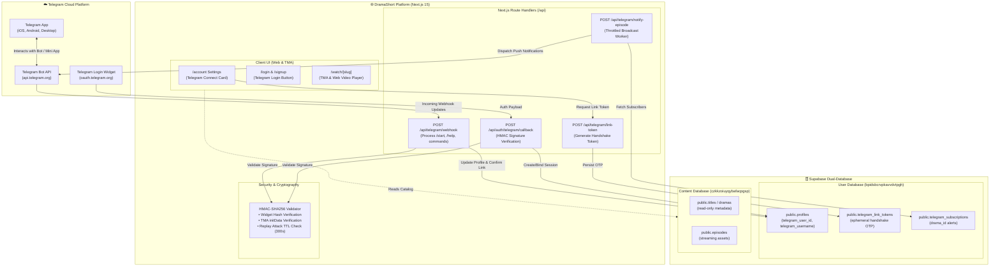
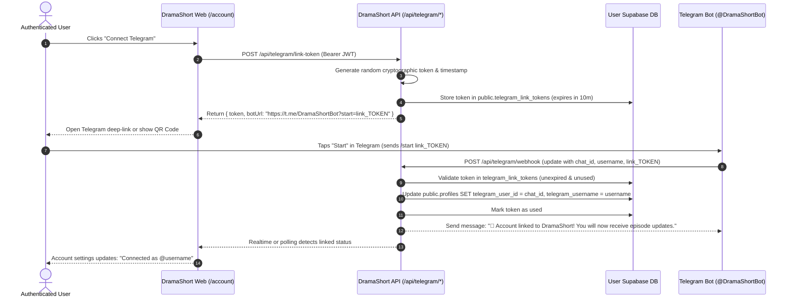
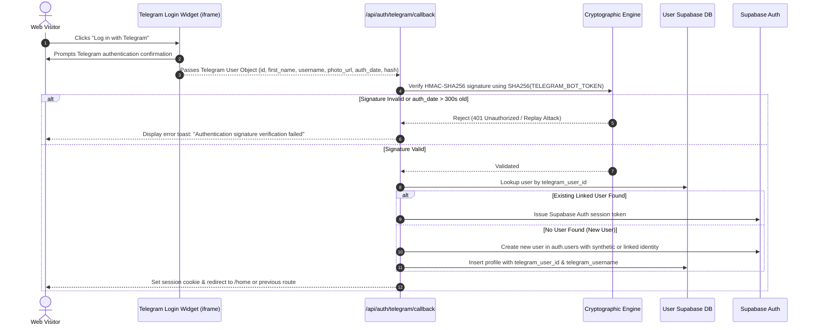
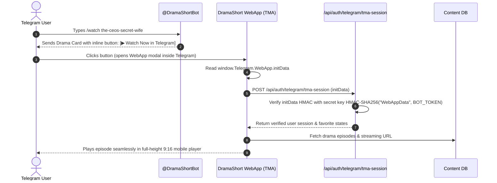

# DramaShort Future Plan: Telegram Ecosystem Integration

> **Document Purpose**: This file serves as the definitive, production-ready implementation plan for integrating the **Telegram Ecosystem** into DramaShort. It details complete technical specifications, architectural workflows, step-by-step implementation tasks, cryptographic security requirements, and an exhaustive **Regression Prevention & System Impact Assessment**.

---

## 1. Executive Summary & Product Vision

### 1.1 Why Telegram for DramaShort?
Short-form vertical dramas thrive on immediacy, habitual daily consumption, and rapid viral distribution. Telegram is one of the highest-converting communication and content channels for serial video entertainment:
1. **Instant Engagement & Push Delivery**: Push notifications on Telegram boast open rates exceeding 80%, far higher than standard web push or marketing emails. Subscribers get notified the instant a new episode of their favorited drama drops.
2. **Frictionless 1-Click Identity**: Mobile users can authenticate via the Telegram Login Widget or direct bot deep-link without entering emails, typing passwords, or managing OTP codes.
3. **Telegram Mini App (TMA)**: DramaShort can run directly inside Telegram as a full WebApp (`window.Telegram.WebApp`), enabling users to discover, swipe, and stream vertical dramas natively within their messaging app.
4. **Viral Viral Referral & Deep-Linking**: Telegram channels and chat shares can include direct deep-links (`t.me/DramaShortBot?start=watch_<slug>_ep_<num>`) that launch the player immediately.

### 1.2 Phased Rollout Strategy
* **Phase A (Account Linking & Identity)**: Allow registered web users to link their Telegram account from `/account` and sign in via the Telegram Login Widget.
* **Phase B (Interactive Bot & Push Notifications)**: Launch the `@DramaShortBot` to deliver personalized episode alerts, new releases, and watchlist sync.
* **Phase C (Telegram Mini App - TMA)**: Deliver embedded vertical drama streaming directly inside Telegram clients (iOS, Android, macOS, Windows, Web).

---

## 2. Architecture & Topology Overview



---

## 3. User Journeys & Sequence Flows

### Flow 1: Account Linking from Web Settings (`/account`)
This flow links an existing authenticated DramaShort user's account to their Telegram account without exposing user credentials.



---

### Flow 2: 1-Click Sign-In via Telegram Login Widget
Allows new or existing users to log in directly using their Telegram identity from `/login` or `/signup`.



---

### Flow 3: Telegram Mini App (TMA) In-Client Streaming



---

## 4. Complete Step-by-Step Implementation Guide

### Step 1: Telegram Bot Registration & Platform Setup

1. Open Telegram and search for [@BotFather](https://t.me/BotFather).
2. Create the bot:
   ```text
   /newbot
   > Name: DramaShort Official
   > Username: DramaShortBot (or dramashort_app_bot)
   ```
3. Secure the bot token returned by BotFather (format: `123456789:ABCdefGhIJKlmNoPQRsTUVwxyZ_0123456`).
4. Configure domain whitelist for Telegram Login Widget:
   ```text
   /setdomain
   > Select your bot
   > Enter domain: dramashort.com (and staging domain if applicable)
   ```
5. Set bot commands for autocomplete:
   ```text
   /setcommands
   > Select your bot
   > Enter list:
     start - Launch DramaShort & link account
     dramas - Browse popular trending short dramas
     continue - Resume your last watched episode
     watchlist - View your saved favorite dramas
     settings - Manage notifications & account link
     help - Customer support and guidelines
   ```
6. Configure the Mini App WebApp shortcut:
   ```text
   /newapp
   > Select your bot
   > Title: DramaShort
   > Description: Stream high-speed vertical short dramas anytime
   > Web App URL: https://dramashort.com/home
   > Short Name: app
   ```
7. Store environment variables in `.env.local` and deployment secrets:
   ```env
   # Telegram Integration
   TELEGRAM_BOT_TOKEN="123456789:ABCdefGhIJKlmNoPQRsTUVwxyZ_0123456"
   TELEGRAM_BOT_USERNAME="DramaShortBot"
   TELEGRAM_WEBHOOK_SECRET="super-secure-random-32-byte-hex"
   NEXT_PUBLIC_TELEGRAM_BOT_USERNAME="DramaShortBot"
   ```

---

### Step 2: Database Schema & Migration (User Database)

> **Important**: This migration applies strictly to the **User Database** (`bpidsbcrvpkavvdvtpgh`). The Content Database is not modified.

```sql
-- Migration: Add Telegram support to User Database
-- 1. Extend profiles table with Telegram metadata
ALTER TABLE public.profiles
ADD COLUMN IF NOT EXISTS telegram_user_id BIGINT UNIQUE,
ADD COLUMN IF NOT EXISTS telegram_username TEXT,
ADD COLUMN IF NOT EXISTS telegram_first_name TEXT,
ADD COLUMN IF NOT EXISTS telegram_photo_url TEXT,
ADD COLUMN IF NOT EXISTS telegram_linked_at TIMESTAMPTZ,
ADD COLUMN IF NOT EXISTS telegram_notifications_enabled BOOLEAN DEFAULT true;

CREATE INDEX IF NOT EXISTS idx_profiles_telegram_user_id ON public.profiles(telegram_user_id);

-- 2. Ephemeral link token table for secure /start deep-linking
CREATE TABLE IF NOT EXISTS public.telegram_link_tokens (
    id UUID PRIMARY KEY DEFAULT gen_random_uuid(),
    user_id UUID NOT NULL REFERENCES auth.users(id) ON DELETE CASCADE,
    token_hash TEXT NOT NULL UNIQUE,
    expires_at TIMESTAMPTZ NOT NULL,
    used_at TIMESTAMPTZ,
    created_at TIMESTAMPTZ NOT NULL DEFAULT timezone('utc'::text, now())
);

CREATE INDEX IF NOT EXISTS idx_telegram_tokens_hash ON public.telegram_link_tokens(token_hash);
CREATE INDEX IF NOT EXISTS idx_telegram_tokens_expires ON public.telegram_link_tokens(expires_at);

-- 3. Notification subscriptions for episode drops
CREATE TABLE IF NOT EXISTS public.telegram_subscriptions (
    id UUID PRIMARY KEY DEFAULT gen_random_uuid(),
    user_id UUID NOT NULL REFERENCES auth.users(id) ON DELETE CASCADE,
    drama_id UUID NOT NULL,
    drama_slug TEXT NOT NULL,
    created_at TIMESTAMPTZ NOT NULL DEFAULT timezone('utc'::text, now()),
    UNIQUE(user_id, drama_id)
);

CREATE INDEX IF NOT EXISTS idx_tg_subs_drama_id ON public.telegram_subscriptions(drama_id);

-- 4. Enable Row Level Security (RLS)
ALTER TABLE public.telegram_link_tokens ENABLE ROW LEVEL SECURITY;
ALTER TABLE public.telegram_subscriptions ENABLE ROW LEVEL SECURITY;

CREATE POLICY "Users can create their own link tokens"
ON public.telegram_link_tokens FOR INSERT
TO authenticated
WITH CHECK (auth.uid() = user_id);

CREATE POLICY "Users can view their own subscriptions"
ON public.telegram_subscriptions FOR SELECT
TO authenticated
USING (auth.uid() = user_id);

CREATE POLICY "Users can manage their own subscriptions"
ON public.telegram_subscriptions FOR ALL
TO authenticated
USING (auth.uid() = user_id);
```

---

### Step 3: Security & Cryptographic Handshake Engine

Create `lib/services/telegram-crypto.service.ts`:

```typescript
import crypto from "crypto";

export interface TelegramWidgetAuthData {
  id: number;
  first_name: string;
  last_name?: string;
  username?: string;
  photo_url?: string;
  auth_date: number;
  hash: string;
}

/**
 * Validates the HMAC-SHA256 signature from Telegram Login Widget.
 * Algorithm:
 * 1. Filter out 'hash'.
 * 2. Sort remaining keys alphabetically.
 * 3. Format as "key=value\nkey2=value2".
 * 4. secret_key = SHA256(bot_token).
 * 5. expected_hash = HMAC-SHA256(dataCheckString, secret_key).
 */
export function verifyTelegramWidgetAuth(
  data: TelegramWidgetAuthData,
  botToken: string,
  maxAgeSeconds = 300 // 5 minutes TTL against replay attacks
): boolean {
  if (!botToken || !data || !data.hash) return false;

  // Check timestamp freshness
  const now = Math.floor(Date.now() / 1000);
  if (now - data.auth_date > maxAgeSeconds) {
    return false; // Stale or replayed payload
  }

  const { hash, ...rest } = data;
  const dataCheckArr: string[] = [];

  const keys = Object.keys(rest).sort();
  for (const key of keys) {
    const val = (rest as Record<string, any>)[key];
    if (val !== undefined && val !== null) {
      dataCheckArr.push(`${key}=${val}`);
    }
  }

  const dataCheckString = dataCheckArr.join("\n");
  const secretKey = crypto.createHash("sha256").update(botToken).digest();
  const calculatedHash = crypto
    .createHmac("sha256", secretKey)
    .update(dataCheckString)
    .digest("hex");

  // Constant-time comparison to prevent timing vulnerabilities
  return crypto.timingSafeEqual(
    Buffer.from(calculatedHash, "hex"),
    Buffer.from(hash, "hex")
  );
}

/**
 * Validates the initData signature from Telegram Mini Apps (TMA).
 * Algorithm uses HMAC-SHA256 with key derived from HMAC-SHA256("WebAppData", bot_token).
 */
export function verifyTelegramInitData(
  initData: string,
  botToken: string,
  maxAgeSeconds = 3600 // 1 hour TTL for active app sessions
): { isValid: boolean; parsedData?: Record<string, any> } {
  if (!initData || !botToken) return { isValid: false };

  const urlParams = new URLSearchParams(initData);
  const hash = urlParams.get("hash");
  if (!hash) return { isValid: false };

  urlParams.delete("hash");
  const authDateStr = urlParams.get("auth_date");
  if (authDateStr) {
    const authDate = parseInt(authDateStr, 10);
    const now = Math.floor(Date.now() / 1000);
    if (now - authDate > maxAgeSeconds) {
      return { isValid: false };
    }
  }

  // Sort remaining parameters
  const params: string[] = [];
  const entries = Array.from(urlParams.entries()).sort(([a], [b]) => a.localeCompare(b));
  for (const [key, value] of entries) {
    params.push(`${key}=${value}`);
  }

  const dataCheckString = params.join("\n");
  const secretKey = crypto
    .createHmac("sha256", "WebAppData")
    .update(botToken)
    .digest();

  const calculatedHash = crypto
    .createHmac("sha256", secretKey)
    .update(dataCheckString)
    .digest("hex");

  const isValid = crypto.timingSafeEqual(
    Buffer.from(calculatedHash, "hex"),
    Buffer.from(hash, "hex")
  );

  if (!isValid) return { isValid: false };

  const parsedData: Record<string, any> = {};
  for (const [k, v] of urlParams.entries()) {
    try {
      parsedData[k] = JSON.parse(v);
    } catch {
      parsedData[k] = v;
    }
  }

  return { isValid: true, parsedData };
}
```

---

### Step 4: Next.js API Routes Implementation

#### 4.1 Token Generation Endpoint (`app/api/telegram/link-token/route.ts`)
* Authenticated user calls this to generate a temporary link token.
* Returns `botUrl: "https://t.me/DramaShortBot?start=link_<token>"`.

#### 4.2 Webhook Handler (`app/api/telegram/webhook/route.ts`)
* Receives incoming messages from Telegram Cloud.
* Must verify `x-telegram-bot-api-secret-token` header against `TELEGRAM_WEBHOOK_SECRET`.
* Processes `/start link_<token>`:
  1. Hashes incoming token and queries `telegram_link_tokens`.
  2. If valid and not expired, updates `profiles.telegram_user_id` and `telegram_username`.
  3. Sends reply via Telegram Bot API: `"🎉 Your Telegram account is successfully connected to DramaShort!"`.
  4. Returns `200 OK` within $< 2000\text{ ms}$ to prevent Telegram webhook timeouts.

#### 4.3 Telegram Login Callback (`app/api/auth/telegram/callback/route.ts`)
* Receives widget callback payload.
* Validates HMAC signature via `verifyTelegramWidgetAuth()`.
* Signs the user in using Supabase Auth or sets a secure session cookie.

---

### Step 5: Frontend UI & Client Integration

1. **Account Settings (`app/account/page.tsx`)**:
   - Replace placeholder toast with dynamic Telegram status:
     - If `profile.telegram_user_id` is null: Show **"Connect Telegram"** CTA button.
     - When clicked, open modal with a direct deep-link button (*"Open in Telegram"*) and a QR code for desktop users.
     - Poll `/api/telegram/status` or listen to Supabase realtime changes on `profiles`.
     - When connected: Show green **"Connected as @username"** badge, toggle for **"Episode Push Notifications"**, and a red **"Disconnect Telegram"** button with confirmation modal.
2. **Login & Signup Pages (`app/login/page.tsx`, `app/signup/page.tsx`)**:
   - Add `TelegramLoginButton` below Google OAuth.
   - Dynamically load `https://telegram.org/js/telegram-widget.js`.
   - Provide a clean fallback if third-party cookies or scripts are blocked.
3. **Mini App Detection Hook (`hooks/useTelegramWebApp.ts`)**:
   - Detects if running inside Telegram via `typeof window !== 'undefined' && window.Telegram?.WebApp`.
   - Calls `webApp.expand()` to maximize vertical height for short drama playback.
   - Binds the Telegram native back button (`webApp.BackButton`) to Next.js router.

---

## 5. Comprehensive Regression Analysis & Impact Assessment

> [!CAUTION]
> Integrating Telegram touches critical paths in authentication, session persistence, database schemas, and networking headers. Below is an exhaustive regression audit and resolution strategy to guarantee existing functionality remains uncompromised.

### 5.1 Authentication & Session Collision Risks

| Risk Scenario | Potential Regression | Prevention & Resolution Strategy |
|---|---|---|
| **Scenario 1: Email Collision** | A user signs in with Telegram, but their Telegram metadata does not expose an email (Telegram accounts can be phone-only). If the system attempts to auto-create an email account, it could cause collisions or duplicate identity orphans. | **Resolution**: Do NOT synthesize random fake emails without distinction. If a user logs in via Telegram for the first time without an email, link them to a dedicated provider identity `provider: 'telegram'`. Provide an optional "Add Email" prompt in Account Settings to merge with standard email login. |
| **Scenario 2: Account Takeover via Unverified Link** | An attacker crafts a spoofed link URL attempting to link a victim's web account to the attacker's Telegram bot chat. | **Resolution**: Handshake tokens must be cryptographically generated (random 32-byte hex), hashed in the database, single-use (`used_at IS NULL`), and strictly time-limited ($\le 10$ minutes). Deep links must require the user to explicitly tap "Start" in Telegram from their own client. |
| **Scenario 3: Unlinking Leaves Account Inaccessible** | A user registered solely through Telegram unlinks their Telegram account, leaving no password or Google login to access the account. | **Resolution**: The "Disconnect Telegram" action must check if an alternative login method (password or Google OAuth) is configured. If Telegram is the sole auth method, prompt the user: *"Please set an email and password in Account Settings before disconnecting Telegram."* |

---

### 5.2 Dual-Database Architectural Separation Integrity

DramaShort maintains a strict architectural split between two independent Supabase projects:
1. **Content Database (`czkkzoiuyqybafacpgsp`)**: `channels`, `titles` (dramas), `episodes`, `genres`.
2. **User Database (`bpidsbcrvpkavvdvtpgh`)**: `profiles`, `user_watch_history`, `favorites`.

**Mandatory Rule for Telegram**:
* **Telegram data must live 100% in the User Database**.
* The Content Database must remain completely agnostic of Telegram user IDs, chat IDs, or notification tokens.
* When querying drama metadata for a notification (e.g. drama title, cover poster), the Next.js API route reads from the Content Database using `contentService`, then dispatches messages to the user list retrieved from the User Database.

---

### 5.3 Guest Watch History & Favorites Synchronization

Currently, guest users have their watch history and favorites stored in browser `localStorage`.
* **Risk**: When a user logs in via the Telegram Login Widget or opens the Telegram Mini App for the first time, their existing local favorites and history might be erased or fail to sync.
* **Resolution**:
  - Re-use the existing `mergeGuestWatchHistory()` pattern established in Phase 5: on successful Telegram sign-in, read `localStorage` guest history and upsert to Supabase `user_watch_history` before clearing local storage.
  - In Telegram Mini App environments where `localStorage` is scoped to the Telegram WebView container, ensure guest watch sessions gracefully initialize if no previous web session exists.

---

### 5.4 Content Security Policy (CSP) & Script Security

The Telegram Login Widget and Telegram Mini App SDK require loading external scripts:
* `https://telegram.org/js/telegram-widget.js`
* `https://telegram.org/js/telegram-web-app.js`
* `https://oauth.telegram.org` (iframe host)

**Regression Mitigation**:
* Update `next.config.mjs` security headers:
  ```javascript
  const securityHeaders = [
    {
      key: 'Content-Security-Policy',
      value: [
        "default-src 'self'",
        "script-src 'self' 'unsafe-eval' 'unsafe-inline' https://telegram.org",
        "frame-src 'self' https://oauth.telegram.org",
        "connect-src 'self' https://api.telegram.org https://*.supabase.co",
        "img-src 'self' data: blob: https://*.telegram.org https://*.supabase.co https://images.unsplash.com"
      ].join('; ')
    }
  ];
  ```
* If CSP is modified, test all existing third-party assets (HLS video streams, Supabase Storage posters, Unsplash mock images) to ensure no existing media loads are blocked.

---

### 5.5 Telegram API Rate Limits & Webhook Timeouts

* **Rate Limits**:
  - Telegram limits bots to **30 messages per second** across all chats, and **1 message per second** to a specific chat.
  - A popular drama releasing a new episode could have thousands of subscribers.
  - **Regression Risk**: A naive `for (const sub of subs) await bot.sendMessage()` will trigger HTTP `429 Too Many Requests` and crash or hang the serverless function.
  - **Resolution**: Implement a chunked batch dispatcher (e.g., 25 messages per second with exponential backoff or use a background queue / Supabase Edge Worker).
* **Webhook Timeouts**:
  - Telegram requires webhook endpoints to respond with `200 OK` within a few seconds. If the endpoint hangs doing database operations, Telegram will retry the webhook repeatedly, flooding the server.
  - **Resolution**: Next.js webhook handler must acknowledge receipt immediately (`return NextResponse.json({ ok: true })`) and handle heavy tasks asynchronously or within 1.5 seconds.

---

### 5.6 Zero-Dependency Guarantee & Graceful Fallback

The DramaShort web application must remain fully functional in environments where Telegram credentials are not configured (e.g. local developer machines, preview builds, or self-hosted instances):
1. **Missing Environment Variables**:
   - If `TELEGRAM_BOT_TOKEN` is undefined, the application must compile and build cleanly with `npm run build`.
   - The `/account` page must detect the missing configuration and gracefully render a disabled or "Coming Soon" badge rather than throwing runtime exceptions.
2. **Missing Network Connectivity to Telegram**:
   - If `api.telegram.org` is unreachable (e.g., network restrictions or ISP blocks), web authentication and drama playback must continue to operate without interference.

---

## 6. Pre-Implementation Verification Checklist

Before deploying the Telegram feature to production, execute the following regression checklist:

- [ ] **Auth Regression**: Email/password registration, login, password update, and email change OTP remain 100% functional.
- [ ] **Google OAuth**: Google social login continues to authenticate smoothly.
- [ ] **Video Player**: HLS/MP4 playback, vertical swipe navigation, cinema mode, and episode progress continue without regression.
- [ ] **Continue Watching**: Hydration and progress percentage calculation on `/home` remain accurate.
- [ ] **Admin CMS**: Drama creation, editing, channel assignment, and admin route middleware guards remain unaffected.
- [ ] **Database Integrity**: Dual-database isolation is preserved; Content DB schema is unchanged.
- [ ] **Automated Test Suite**: `npm test` executes with 14/14 passing tests, plus new Telegram crypto unit tests.
- [ ] **Production Build**: `npm run build` succeeds with 0 type errors and 0 lint warnings.
