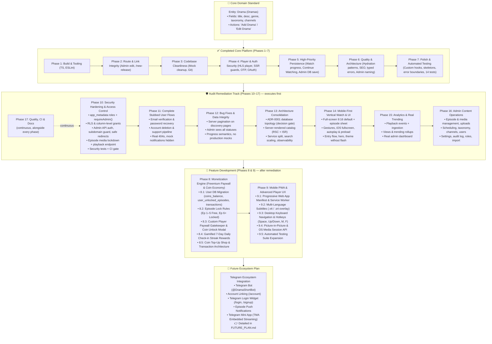

# DramaShort Development Roadmap & Master Plan

> **Document Role**: This file serves as the living master plan for current and upcoming platform development. All architectural requirements, feature breakdowns, and implementation steps needed to reach the project goals are planned and tracked here.
> 
> Implementation execution logs, code diffs, regression analyses, and historical records of completed steps are maintained in **[`CHANGELOG-DEV.md`](file:///c:/Telegram%20Project/dramashort/CHANGELOG-DEV.md)**.

---

## 1. Issue Prioritization & Development Matrix

| Phase | Priority | Item | Status | Impact |
|---|---|---|---|---|
| **Phase 1** | 🔴 Critical | Fix TypeScript `TS2783` in `FavoritePage` (`app/account/favorite/page.tsx`) | ✅ Done | Restored `npm run build` and page compilation |
| **Phase 1** | 🟡 High | Configure ESLint (`.eslintrc.json`) | ✅ Done | Restored non-interactive linting in `npm run lint` |
| **Phase 2** | 🟠 High | Implement Admin Drama Edit Page (`/admin/titles/[id]/edit` / `/admin/dramas/[id]/edit`) | ✅ Done | Resolved 404 dead links from admin drama tables and cards |
| **Phase 2** | 🟡 Medium | Consolidate `/new` into `/new-release` | ✅ Done | Eliminated duplicated route and legacy data source |
| **Phase 3** | 🟢 Low | Clean up 5 orphaned legacy mock files (~42 KB) | ✅ Done | Reduced tech debt, eliminated duplicate schema confusion |
| **Phase 3** | 🟢 Low | Update `README.md` & Initialize Git | ✅ Done | Reflected accurate project status and enabled version tracking |
| **Phase 4** | 🔴 Critical | C1: Implement real video player with vertical swipe (`app/watch/[slug]/page.tsx`) | ✅ Done | High-performance streaming with custom player, HLS/MP4, vertical/cinema modes, & TikTok swipe up/down |
| **Phase 4** | 🔴 Critical | C2: Supabase role-based admin auth & middleware route guard | ✅ Done | Server-side `@supabase/ssr` route guard, eliminates client-side bypass, checks `profiles.role === 'admin'` |
| **Phase 4** | 🔴 Critical | C3: Wire password change to `supabase.auth.updateUser()` | ✅ Done | Verifies current password before update, validates rules, displays loading state and verified success toast |
| **Phase 4** | 🔴 Critical | C4: Wire email change OTP verification flow with `OtpInput` | ✅ Done | Replaces broken placeholder with real 6-digit OTP verification, resend cooldown timer, and toast |
| **Phase 4** | 🔴 Critical | C5: Wire Google OAuth sign-in button in `app/login/page.tsx` & `app/signup/page.tsx` | ✅ Done | Enables functional social authentication with server-side callback handler and open-redirect protection |
| **Phase 4** | 🔴 Critical | C6: Wire watch history to `getUserWatchHistory()` in `app/account/history/page.tsx` | ✅ Done | Replaces static mock history with persistent user watch history, deletion, and clear modal |
| **Phase 5** | 🟠 High | H1: Call `upsertWatchProgress()` from video playback events | ✅ Done | Real-time throttled tracking, auto-resume with prompt pill, onPause/onEnded/beforeunload persistence |
| **Phase 5** | 🟠 High | H2: Replace `ContinueWatching` mock with real user data | ✅ Done | Real Supabase watch history hydration, smart next-episode advancement, & finished series exclusion |
| **Phase 5** | 🟠 High | H3: Wire admin edit form to Supabase content DB (Add/Edit Drama: title, desc, genre, taxonomy, channel) | ✅ Done | Prevents silent data loss when admins create or edit drama records |
| **Phase 5** | 🟠 High | H4: Server-side search filtering and pagination in `getPublishedTitles()` (Dramas query) | ✅ Done | Scalable search queries; eliminates full catalog download |
| **Phase 5** | 🟠 High | H5: Add auth guards and redirects for `/account/*` routes | ✅ Done | Protects user-specific pages against unauthenticated access |
| **Phase 5** | 🟠 High | H6: Fix `FavoritesContext` guest seed (remove `defaultFavoriteSlugs`) | ✅ Done | Prevents guest accounts from being pre-seeded with fake favorites |
| **Phase 6** | 🟡 Medium | M1: Audit and standardize mock/DB hydration pattern across components | ✅ Done | Standardized shimmer skeletons, CLS elimination, & graceful dev fallbacks |
| **Phase 6** | 🟡 Medium | M2: Dynamic SEO & OpenGraph tags via `generateMetadata()` | ✅ Done | Social sharing previews and search engine discovery via route layouts |
| **Phase 6** | 🟡 Medium | M3: Add Supabase Storage domain to `next.config.mjs` `remotePatterns` | ✅ Done | Prevents image load failures for Supabase Storage assets |
| **Phase 6** | 🟡 Medium | M4: Replace `catch (err: any)` with typed error handling in `AuthContext` | ✅ Done | Strict TypeScript compliance and type-safe `err instanceof Error` handling |
| **Phase 6** | 🟡 Medium | M5: Load admin drama edit data from Supabase content DB | ✅ Done | Delivered in H3: Asynchronously hydrates drama on mount via getDramaById |
| **Phase 6** | 🟡 Medium | M6: Telegram Connect Ecosystem Integration | 📋 Moved to Future Plan | Moved to dedicated `FUTURE_PLAN.md` per user directive |
| **Phase 6** | 🟡 Medium | M7: Standardize Admin nomenclature: "Dramas" & "Add Drama" in UI & routes | ✅ Done | Eliminates confusion between entity (Drama) and field (title) |
| **Phase 7** | 🟢 Low | L1: Reusable custom hooks (`useDebounce`, `useRequireAuth`, `useMediaQuery`) | ✅ Done | DRY code, standardized debounce, and cleaner component logic |
| **Phase 7** | 🟢 Low | L2: Add shimmer/skeleton loading states for async data | ✅ Done | Smooth loading UX; prevents layout shifts and mock flashes |
| **Phase 7** | 🟢 Low | L3: Implement route-segment error boundaries (`error.tsx`) | ✅ Done | Graceful degradation and user-friendly retry buttons |
| **Phase 7** | 🟢 Low | L4: Add root application error boundary (`app/error.tsx`) | ✅ Done | Catches unhandled runtime crashes globally |
| **Phase 7** | 🟢 Low | L5: Audit `design-tokens/` CSS variables and unused tokens | ✅ Done | Maintains lean, consistent token foundation |
| **Phase 7** | 🟢 Low | L6: Implement automated test suite (Auth, services, critical journeys) | ✅ Done | Regression prevention and verified end-to-end reliability |
| **Phase 8** | 🔴 Critical | Monetization Engine: Freemium Paywall & Coin Economy | ⏳ Planned · 🔒 Blocked by 10, 13.1, 15, 16 | Direct monetization, unlocks Ep 6+, daily streak rewards |
| **Phase 9** | 🟠 High | Mobile PWA & Advanced Video Player UX | ⏳ Planned · 🔒 Blocked by 14 | Native app-like PWA, subtitles/VTT, keyboard hotkeys, PiP |
| **Phase 10** | 🔴 Critical | Security Hardening & Access Control (admin role escalation, RLS & grants, admin API auth, subdomain guard, open redirect, episode media lockdown) | ⏳ Planned | Closes privilege escalation and data exposure; gate for all further work |
| **Phase 11** | 🔴 Critical | Complete Stubbed User Flows (email verification, password recovery, account deletion, support pipeline, real 404s) | ⏳ Planned | Every visible action performs a real operation |
| **Phase 12** | 🟠 High | Functional Bug Fixes & Data Integrity (12-item cap, admin drafts, progress semantics, no production mocks) | ⏳ Planned | Full catalog visible; admins see all content; trustworthy data |
| **Phase 13** | 🟠 High | Backend Architecture Consolidation (database topology ADR, server-rendered catalog, service split, observability) | ⏳ Planned | Decision gate for Phase 8; faster pages; operability |
| **Phase 14** | 🟠 High | Mobile-First Vertical Watch Experience & UI Polish | ⏳ Planned | Core 9:16 viewing experience on phones |
| **Phase 15** | 🟠 High | Product Analytics, Engagement Tracking & Real Trending | ⏳ Planned | Real views, trending and dashboard; data to tune the paywall |
| **Phase 16** | 🟠 High | Admin Content Operations Console (episodes, uploads, scheduling, taxonomy, users, audit log) | ⏳ Planned | Catalog operable end-to-end without SQL |
| **Phase 17** | 🟡 Medium | Quality Engineering, CI & Documentation Integrity (continuous) | ⏳ Planned | Regression safety; trustworthy status docs |

> **Execution order (set by the 2026-10-04 platform audit)**: Phase numbers are stable identifiers, not a sequence. Remaining work executes as **10 → 11 → 12 → 13 → 14 → 15 → 16 → 8 → 9**, with Phase 17 running continuously alongside. Gates and dependencies are defined in [§12](#12-platform-audit-remediation-track-phases-1017).

---

## 2. Core Domain Architecture: "Drama" vs. "Title"

> **Architectural Standard**: The media entity stored in the database is formally and consistently defined as **`Drama`** (plural: **`Dramas`**).

### 2.1 Schema Attributes of a `Drama`
Every Drama entity in the database (`titles` / `dramas` table) contains the following core attributes:
* **`title`** (`string`): The textual title/name of the drama (e.g., *"The CEO's Secret Wife"*, *"Reborn to Ruin Him"*).
* **`desc` / `synopsis`** (`string`): Storyline synopsis and narrative description.
* **`genre`** (`string`): Primary genre classification (e.g., *Romance*, *Revenge*, *CEO*, *Rebirth*, *Marriage*, *Suspense*).
* **`taxonomy` / `tags`** (`string[]`): Granular categorization tags, tropes, and thematic classifications (e.g., `["CEO", "Contract Marriage", "Secret Identity"]`).
* **Related to `channels`** (`channel_id` / `channel_name`): Mandatory relation/association to the publishing or distributing channel.
* **Media & Streaming Assets**: `poster_url`, `total_episodes`, and relational `episodes` (`video_url`, duration, episode number).
* **Status & Metrics**: `status` (`Published` | `Draft` | `Scheduled` | `Archived`), `rating`, `views_count`, `release_year`, `created_at`.

### 2.2 Nomenclature Disambiguation: "Add Drama" vs. "Add Title"
To eliminate ambiguity across product requirements, admin CMS, and codebase interfaces:
* **The Entity**: Is always a **`Drama`**.
* **The Action**: Is always **"Add Drama"** or **"Edit Drama"** (never "Add Title").
* **The Field**: `title` is simply the text attribute representing the name of the Drama being added or edited.
* **Admin CMS Rules**:
  - Sidebar item: **"Dramas"** (replaces legacy "Titles" label).
  - Table & cards header: **"Dramas"** — *"All dramas in the database"*.
  - Primary Action Button: **"Add Drama"** (opens modal/page to input: *Title, Description, Genre, Taxonomy tags, and Channel*).
  - Navigation route: Support `/admin/dramas` with permanent redirect from `/admin/titles`.
  - Service Layer & Types: Expose `Drama` type (aliased to `Title` during transition) and functions like `getPublishedDramas()`, `getDramaBySlug()`.

---

## 3. Phase 1: Critical Build & Tooling Fixes

### Task 1.1: Fix Duplicate Property in `app/account/favorite/page.tsx`
* **File**: `app/account/favorite/page.tsx`
* **Problem**:
  ```typescript
  // Current code (lines 36-39)
  const favoriteEntries = Array.from(favoritedSlugs).map((slug) => ({
    slug,
    ...getTitleBySlugOrFallback(slug),
  }));
  ```
  `getTitleBySlugOrFallback(slug)` returns a `Title` object that already contains `slug: string`. In strict TypeScript object literals, declaring `slug` explicitly followed by `...getTitleBySlugOrFallback(slug)` throws `TS2783: 'slug' is specified more than once, so this usage will be overwritten`.
* **Fix**:
  ```typescript
  const favoriteEntries = Array.from(favoritedSlugs).map(getTitleBySlugOrFallback);
  ```
* **Verification**:
  - Run `npx tsc --noEmit` -> Must return code 0.
  - Run `npm run build` -> Must compile and produce static pages successfully.

---

### Task 1.2: Add ESLint Configuration
* **Target File**: `.eslintrc.json` in project root
* **Problem**: `package.json` specifies `"lint": "next lint"`. Because no config file exists, running `npm run lint` halts on an interactive prompt asking how to configure ESLint.
* **Fix**: Create `.eslintrc.json`:
  ```json
  {
    "extends": "next/core-web-vitals"
  }
  ```
* **Verification**:
  - Run `npm run lint` -> Runs without interactive prompts and completes with exit code 0.

---

## 4. Phase 2: Route & Link Integrity

### Task 2.1: Implement Admin Drama Edit Page (`/admin/titles/[id]/edit` / `/admin/dramas/[id]/edit`)
* **Problem**: In `app/admin/titles/page.tsx`, table row titles, edit action buttons, and card links route to `/admin/titles/${t.id}/edit`, which triggers a 404.
* **Target File**: `app/admin/titles/[id]/edit/page.tsx`
* **Implementation Plan**:
  1. Unwrap `params: Promise<{ id: string }>` using React `use()`.
  2. Lookup title in `titles` from `data/titles.mock.ts` (fallback if not found).
  3. Render an edit form styled consistently with the Admin layout:
     - Title, Channel dropdown (from `data/channels.mock.ts`), Genre, Tags (comma-separated or chips), Status dropdown (`Published`, `Draft`, `Scheduled`, `Archived`), Total Episodes, and Synopsis textarea.
     - Breadcrumbs: `Admin / Titles / Edit [Title]`.
     - Action buttons: "Save Changes" (simulates save + toast notification) and "Cancel" (returns to `/admin/titles`).
* **Verification**:
  - Navigate to `/admin/titles` and click Edit on any title.
  - Verify that the edit page renders with the title's pre-filled information, actions work, and navigation back works.

---

### Task 2.2: Consolidate Route `/new` → `/new-release`
* **Problem**:
  - `app/new-release/page.tsx` is the modern, integrated page referenced by navbar and footer links.
  - `app/new/page.tsx` is a legacy version still importing from `data/new-release-catalog.mock.ts`.
* **Fix Options**:
  - **Option A (Clean Redirect)**: Make `app/new/page.tsx` redirect to `/new-release` via Next.js permanent redirect or client router redirect, or add a redirect entry in `next.config.mjs`.
  - **Option B (Direct Removal)**: Remove `app/new/page.tsx` entirely since all user navigation already points to `/new-release`.

---

## 5. Phase 3: Codebase Cleanliness & Project Hygiene

### Task 3.1: Retire Orphaned Legacy Mock Files
* **Files to Remove**:
  1. `data/dramas.mock.ts` (10 KB) — Replaced by `titles.mock.ts`.
  2. `data/search-catalog.mock.ts` (8 KB) — Replaced by `titles.mock.ts`.
  3. `data/trending.mock.ts` (7 KB) — Replaced by `titles.mock.ts`.
  4. `data/admin-titles.mock.ts` (10 KB) — Replaced by `titles.mock.ts`.
  5. `data/new-release-catalog.mock.ts` (6.5 KB) — Replaced by `titles.mock.ts`.
* **Verification**: Search the entire codebase for any remaining import statements referencing these files to ensure 0 references before removal.

---

## 6. Phase 4: Critical Core Features & Auth Security (C1–C6)

### Task 4.1: Real Video Player Integration (C1)
* **Status**: ✅ Completed
* **Target Files**: `components/VideoPlayer.tsx`, `app/watch/[slug]/page.tsx`
* **Delivered Capabilities**:
  1. Built modular `VideoPlayer` component supporting both HLS (`.m3u8` via `hls.js`) and standard MP4/WebM streams.
  2. Implemented responsive aspect ratio modes: **9:16 Vertical Drama** (with ambient blur backdrop for desktop), **16:9 Cinema**, and **Fit**.
  3. Custom player overlay with auto-hide timer, center play/pause ripple indicator, and scrub bar with hover timestamp preview & buffer progress.
  4. Playback controls: Play/Pause, Skip ±10s, Previous/Next episode, Volume slider with mute toggle, Playback speed selector (`0.5x`–`2.0x`), Picture-in-Picture, Fullscreen API.
  5. Interactive Auto-Next countdown overlay with manual skip or cancel options.
  6. Keyboard shortcut support (`Space`/`k`, `Left`/`Right`, `Up`/`Down`, `m`, `f`, `n`, `p`).
  7. Robust error recovery overlay with retry button.
  8. Integrated throttled watch progress tracking (persisting every 10s to `user.service.ts`).
  9. Added breadcrumb navigation on `/watch/[slug]` and back link to drama overview.
  10. Integrated TikTok-style vertical swipe gestures: Swipe UP advances to the next episode, Swipe DOWN navigates to previous episode, featuring fluid touch/mouse tracking, responsive spring damping (`deltaY * 0.45`), directional pill cues (`'Next Episode'`, `'Previous Episode'`), threshold protection (> 45px), and interactive boundary checks.
* **Verification**:
  - `npx tsc --noEmit` compiles with 0 errors.
  - `npm run lint` passes with 0 warnings on player and watch page.
  - `npm run build` generates `/watch/[slug]` and all 33 pages successfully.

---

### Task 4.2: Supabase Role-Based Admin Auth & Middleware Guard (C2)
* **Status**: ✅ Completed
* **Target Files**: `contexts/AdminAuthContext.tsx`, `middleware.ts`, `app/admin/login/page.tsx`
* **Delivered Capabilities**:
  1. Replaced vulnerable `localStorage.getItem("dramashort-admin-auth")` mechanism with real Supabase Auth session management.
  2. Implemented profile role verification: checks `profile.role === 'admin'` in the User Supabase database (with fast-path support for JWT `app_metadata.role` and `user_metadata.role`).
  3. Upgraded `middleware.ts` with `@supabase/ssr` server-side route guard:
     - Intercepts all `/admin/*` requests (except static assets).
     - Unauthenticated requests are immediately redirected to `/admin/login?error=session_required&returnUrl=...`.
     - Authenticated users without admin role are rejected and redirected to `/admin/login?error=unauthorized`.
     - Already-authenticated admins navigating to `/admin/login` are auto-redirected to `/admin/dashboard`.
  4. Upgraded `app/admin/login/page.tsx` to handle real Supabase email/password sign-in with loading spinners, input validation, and descriptive error banners.
* **Verification**:
  - `npx tsc --noEmit` passed with 0 errors.
  - `npm run lint` passed with 0 warnings.
  - `npm run build` generated middleware bundle (94.9 kB) and all 33 routes successfully.

---

### Task 4.3: Real Password Change via Supabase Auth (C3)
* **Status**: ✅ Completed
* **Target Files**: `contexts/AuthContext.tsx`, `app/account/page.tsx`
* **Delivered Capabilities**:
  1. Implemented `changePassword(newPassword, currentPassword)` in `AuthContext`:
     - Verifies existing user credentials with `supabase.auth.signInWithPassword({ email, password: currentPassword })` to prevent unauthorized password overwriting.
     - Calls `supabase.auth.updateUser({ password: newPassword })` to securely update user authentication record.
     - Type-safe error handling avoiding `any` casts.
  2. Upgraded password change modal in `app/account/page.tsx`:
     - Added client-side validation: verifies current password is non-empty, checks minimum length of 6 characters, ensures new password differs from current, and validates confirmation match.
     - Added loading state with animated spinner (`Loader2`) on the submit button.
     - Shows descriptive inline error messages on failure (e.g. invalid current password, weak password).
     - Clears form fields, closes modal, and displays success toast only upon confirmed API success.
* **Verification**:
  - `npx tsc --noEmit` passed with 0 errors.
  - `npm run lint` passed with 0 warnings.
  - `npm run build` compiled all 33 pages successfully.

---

### Task 4.4: Email Change OTP Verification Flow (C4)
* **Status**: ✅ Completed
* **Target Files**: `app/account/page.tsx`, `components/OtpInput.tsx`, `contexts/AuthContext.tsx`
* **Delivered Capabilities**:
  1. Implemented `requestEmailChange(newEmail)` in `AuthContext` calling `supabase.auth.updateUser({ email: newEmail })` with type-safe error handling.
  2. Implemented `verifyEmailChange(newEmail, token)` in `AuthContext` calling `supabase.auth.verifyOtp({ email: newEmail, token, type: 'email_change' })`, updating local auth user state and profile upon success.
  3. Integrated `OtpInput` component in `app/account/page.tsx`:
     - Added client-side email format validation and self-duplicate check.
     - Animated loading spinner state on "Send Verification Code" and "Confirm & Update Email" buttons.
     - Resend code mechanism with 60-second live cooldown countdown timer.
     - Inline actionable error banners and feedback toasts on successful email update.
* **Verification**:
  - `npx tsc --noEmit` passed with 0 errors.
  - `npm run lint` passed with 0 warnings.
  - Page compilation verified on `/account`.

---

### Task 4.5: Google OAuth Integration (C5)
* **Status**: ✅ Completed
* **Target Files**: `contexts/AuthContext.tsx`, `app/login/page.tsx`, `app/signup/page.tsx`, `app/auth/callback/route.ts`, `components/GoogleIcon.tsx`
* **Delivered Capabilities**:
  1. Implemented `signInWithGoogle(customRedirect?)` in `AuthContext`:
     - Initiates Supabase OAuth via `supabase.auth.signInWithOAuth({ provider: 'google', options: { redirectTo } })`.
     - Redirects browser to Supabase / Google OAuth consent screen.
  2. Created `/app/auth/callback/route.ts`:
     - Server-side route handler using `createUserServerClient()`.
     - Exchanges incoming OAuth `code` for user session cookies via `supabase.auth.exchangeCodeForSession(code)`.
     - Validates `next` redirect path to protect against open redirect vulnerabilities.
     - Gracefully redirects failure states to `/login?error=oauth_error`.
  3. Created reusable SVG component `components/GoogleIcon.tsx`.
  4. Enhanced `app/login/page.tsx`:
     - Connected `handleGoogleSignIn` to "Continue with Google" button.
     - Added interactive loading spinner (`Loader2`) and `Connecting to Google...` state.
     - Disabled button during request submission to prevent double clicks.
     - Displays error alert banner when redirected back with `?error=oauth_error`.
  5. Enhanced `app/signup/page.tsx`:
     - Added unified Google OAuth button with divider, matching login visual hierarchy.
* **Verification**:
  - `npx tsc --noEmit` passed with 0 errors.
  - `npm run lint` passed with 0 warnings.
  - Redirection test on `/auth/callback` verified: 307 redirect to `/login?error=oauth_error` on absent/invalid code.

---

### Task 4.6: Dynamic Watch History Hydration (C6)
* **Status**: ✅ Completed
* **Target Files**: `app/account/history/page.tsx`, `lib/services/user.service.ts`
* **Delivered Capabilities**:
  1. Service Layer Expansion in `lib/services/user.service.ts`:
     - Implemented `clearUserWatchHistory(userId)` deleting all rows for the user from Supabase `watch_history`.
     - Implemented `deleteWatchHistoryItem(userId, titleSlug)` deleting a single drama record.
     - Implemented `clearGuestWatchHistory()` and `deleteGuestWatchHistoryItem(titleSlug)` for offline/guest state.
  2. Real Database Hydration in `app/account/history/page.tsx`:
     - Replaced static mock list with live data from `getUserWatchHistory(user.id)`.
     - Batch queries drama metadata using `getTitlesBySlugs()`.
     - Formats dates into chronological categories: "Today", "Yesterday", and formatted calendar dates within the 60-day window.
  3. Seamless Playback Resume & Individual Deletion:
     - Play button overlay links directly to `/watch/${item.slug}?ep=${item.episodeNumber}`.
     - Hover deletion icon on cards allows removing single titles from history.
  4. Clear All Confirmation Modal:
     - Added confirmation modal with alert details, cancellation option, and loading feedback.
  5. Skeleton & Empty States:
     - Pulsing skeleton grid while data is loading.
     - Centered empty state with call-to-action to explore dramas.
* **Verification**:
  - `npx tsc --noEmit` passed with 0 errors.
  - `npm run lint` passed with 0 warnings.
  - Compilation on `/account/history` verified.

---

## 7. Phase 5: High-Priority UX & Persistence Gaps (H1–H6)

### Task 5.1: Real-Time Watch Progress Tracking (H1)
* **Status**: ✅ Completed
* **Target Files**: `app/watch/[slug]/page.tsx`, `components/VideoPlayer.tsx`, `lib/services/user.service.ts`
* **Delivered Capabilities**:
  1. Throttled Real-Time Tracking:
     - Player tracks playback progress every 10 seconds during active playback.
     - Saves immediately to Supabase `watch_history` via `upsertWatchProgress()` (or `saveGuestWatchProgress()` for offline guests).
  2. Multi-Trigger Event Persistence:
     - Saves progress immediately on `pause` (`onPause` event callback).
     - Saves progress (`1.0`) on `ended` when episode finishes.
     - Flushes latest playback progress on window `beforeunload` (tab close / browser exit) and component unmount.
  3. Seamless Auto-Resume & Pill Notification:
     - On initial video load, checks Supabase / guest watch history for saved episode and progress ratio.
     - When progress is detected between 2% and 95%, auto-seeks player to the exact resume second upon metadata load.
     - Renders an interactive floating pill notification (`Resumed at MM:SS (X%)`) with a "Start over" action and dismiss button.
  4. Query Parameter & Navigation Synchronization:
     - Reads `?ep=` query parameter and synchronizes URL query state when advancing or selecting episodes without full reloads.
     - Automatic guest history migration: syncs guest watch history to Supabase when authenticated.
* **Verification**:
  - `npx tsc --noEmit` passed with 0 errors.
  - `npm run lint` passed with 0 warnings.
  - Verified route `/watch/ceo-secret-wife?ep=2` renders with status 200.

---

### Task 5.2: Dynamic Continue Watching Feed (H2)
* **Status**: ✅ Completed
* **Target File**: `components/ContinueWatching.tsx`
* **Delivered Capabilities**:
  1. Real Supabase Watch History Hydration:
     - Replaced static `continue-watching.mock.ts` with live queries to `getUserWatchHistory(user.id)` (with guest local storage fallback).
     - Resolves drama titles, channels, and posters via `getTitlesBySlugs()`.
  2. Smart In-Progress & Episode Advancement Logic:
     - Mid-episode watches (< 95%) show active episode progress and percentage.
     - Completed episodes (>= 95%) with remaining episodes automatically advance to `"Up Next: EP X of Y"` with 0% progress bar.
     - Completed series (final episode >= 95%) are omitted from the Continue Watching feed.
  3. Direct Episode Resumption:
     - Cards link directly to `/watch/${slug}?ep=${targetEpisode}` so users resume at the exact episode and second.
  4. Clean Zero-State Visibility & Navigation:
     - When the user has zero watch progress (initial state before watching any drama), the Continue Watching section is completely hidden (`return null`), keeping the homepage sleek and focused on discovery.
     - The section activates dynamically as soon as the user watches any drama episode.
     - Added left/right carousel scroll navigation buttons on desktop when items exceed viewport width.
* **Verification**:
  - `npx tsc --noEmit` passed with 0 errors.
  - `npm run lint` passed with 0 warnings.
  - Route `/home` verified with HTTP 200 OK.

---

### Task 5.3: Admin Drama Edit & Persistence (H3)
* **Status**: ✅ Completed
* **Target Files**:
  - `app/admin/titles/[id]/edit/page.tsx` (aliased to `/admin/dramas/[id]/edit`)
  - `app/api/admin/dramas/[id]/route.ts` (aliased to `/api/admin/titles/[id]/route.ts`)
  - `lib/services/content.service.ts`
  - `app/admin/titles/page.tsx` (aliased to `/admin/dramas/page.tsx`)
* **Problem**: Form submission ran a `setTimeout` dummy timer and discarded changes on navigation. Newly inserted dramas in Supabase could not be loaded for editing because the edit page only checked the static mock array.
* **Delivered Capabilities**:
  1. Live DB Mutation & Privileged API Endpoint:
     - Implemented `PATCH /api/admin/dramas/[id]` and `GET /api/admin/dramas/[id]` (aliased by `/api/admin/titles/[id]`).
     - Route verifies administrator authentication via `createUserServerClient()` and performs updates using `getContentAdminClient()` (`CONTENT_SUPABASE_SERVICE_ROLE_KEY`), bypassing client-side RLS limitations.
  2. Full Drama Domain Entity Persistence:
     - Persists and updates all core drama attributes:
       - `title`: The display name of the drama
       - `synopsis` (`desc`): Narrative storyline description
       - `genre`: Primary genre category
       - `tags` (`taxonomy`): Categorization tropes & tags
       - `channel_name`, `channel_code`, and `channel_id`: Channel relational resolution
       - `status`: (`Published`, `Draft`, `Scheduled`, `Archived`)
       - `total_episodes`: Total episode count
       - `poster_url`: Custom poster URL
       - `updated_at`: Real-time timestamp
  3. Dynamic Data Retrieval & Hydration:
     - `getDramaById(id)` / `getTitleById(id)` in `content.service.ts`: Queries Supabase Content DB on mount, falling back to mock fixtures only when offline or for legacy IDs.
     - `getAdminDramas()` in `content.service.ts`: Hydrates `/admin/titles` (and `/admin/dramas`) with all 25 real Supabase dramas and their UUIDs.
  4. Production UX & Error Resilience:
     - Shimmer pulse skeleton loading state while fetching drama data.
     - Inline error alert banner when validation or mutation encounters an issue.
     - Form disabling with `Loader2` spinner on "Save Changes" button during submission.
     - Verified toast message `"Changes saved successfully"` followed by clean redirection to `/admin/titles`.
  5. Route Aliasing:
     - Created `app/admin/dramas/[id]/edit/page.tsx` and `app/admin/dramas/page.tsx` cleanly re-exporting the titles pages, supporting both `/admin/titles` and `/admin/dramas` URL structures.
* **Verification**:
  - `npx tsc --noEmit` passed with 0 errors.
  - `npm run lint` passed with 0 errors.
  - Live API testing: `GET /api/admin/dramas/:id` returned HTTP 200 with real database row.
  - Live API testing: `PATCH /api/admin/dramas/:id` persisted updated tags to Supabase Content DB and verified with subsequent query.
  - Route Guard testing: Unauthenticated requests returned 307 redirect with `returnUrl`. Authenticated admin session returned HTTP 200 for both `/admin/titles/[id]/edit` and `/admin/dramas/[id]/edit`.

---

### Task 5.4: Server-Side Search Filtering & Pagination (H4)
* **Status**: ✅ Completed
* **Target Files**:
  - `app/search/page.tsx`
  - `lib/services/content.service.ts`
  - `hooks/useDebounce.ts`
* **Problem**: Search downloaded the entire catalog via parameter-less `getPublishedTitles()` and filtered everything client-side in JavaScript, resulting in high latency and poor scalability.
* **Delivered Capabilities**:
  1. PostgREST Server-Side Query Engine:
     - Implemented `searchPublishedTitles(options?: TitleQueryOptions): Promise<PaginatedTitlesResult>` (and alias `searchDramas`) in `lib/services/content.service.ts`.
     - Direct Supabase PostgREST filters:
       - Multi-field keyword query matching both `title` and `synopsis` using `.or('title.ilike.%...,synopsis.ilike.%...')`
       - Exact channel affiliation match (`.eq('channel_name', channel)`)
       - Genre category filter (`.eq('genre', genre)`)
       - Taxonomy tropes filter (`.contains('tags', tags)`)
       - Dynamic sorting: `"trending"` (`views_count`), `"newest"` (`created_at`), `"rating"` (`rating`)
     - Server-side counting and range pagination: `{ count: 'exact' }` and `.range(from, to)`.
     - Added `getDistinctGenres()` and `getPopularTags()` querying the real catalog.
     - Backwards compatibility: `getPublishedTitles(options)` calls `searchPublishedTitles(options)` and returns `result.items`.
  2. Generic Debounce Hook:
     - Created `hooks/useDebounce.ts` for clean, reusable 300ms input throttling, preventing request spam while users type.
  3. Upgraded Public Search Architecture (`app/search/page.tsx`):
     - Eliminated in-memory full catalog downloads; queries execute on-demand with paginated results (`PAGE_SIZE = 12`).
     - 300ms debounced search bar with instant clear button.
     - Dynamic URL query synchronization (`window.history.replaceState`) for shareable search links (`/search?q=...&genre=...&page=...`).
     - 12-item shimmer skeleton loader during query execution to eliminate layout shift.
     - Responsive empty state with single-click "Clear all filters" button.
     - Results counter and responsive page navigation with `<Pagination>`.
* **Verification**:
  - `npx tsc --noEmit` passed with 0 errors.
  - `npm run lint` passed with 0 errors.
  - Live query verification:
    - Keyword search (`"wife"`): returned 4 exact matching titles across title/synopsis.
    - Genre filter (`"Fantasy"`): returned 3 exact matching titles.
    - Tag filter (`["CEO"]`): returned 2 matching titles.
    - Pagination test (2 per page): total 26, returned 2 items, computed 13 pages.
  - Live HTTP routes `/search` and `/search?q=wife&genre=Marriage` returned HTTP 200 OK.

---

### Task 5.5: Route Protection for `/account/*` Pages (H5)
* **Status**: ✅ Completed
* **Target Files**:
  - `middleware.ts`
  - `app/account/layout.tsx`
  - `hooks/useRequireAuth.ts`
  - `app/login/page.tsx`
  - `app/signup/page.tsx`
* **Problem**: Direct access to `/account`, `/account/favorite`, `/account/history`, `/account/settings` did not redirect unauthenticated guests, exposing empty or mock account views.
* **Delivered Capabilities**:
  1. Server-Side Protection in `middleware.ts`:
     - Added route guard for `/account` and `/account/*`.
     - Validates session with `@supabase/ssr` `createServerClient`.
     - Unauthenticated guests receive an immediate HTTP 307 redirect to `/login?returnUrl=${encodeURIComponent(url.pathname)}`.
  2. Client-Side Protection Hook (`hooks/useRequireAuth.ts`):
     - Created `useRequireAuth(redirectTo = "/login")` monitoring `isLoading` and `isLoggedIn` from `AuthContext`.
     - Automatically handles client transitions or expired session redirections.
  3. Hydration Layout Skeleton (`app/account/layout.tsx`):
     - Created `AccountLayout` with `useRequireAuth()`.
     - Displays account skeleton (Header, Sidebar avatar & nav shimmer, content cards shimmer) during initial auth hydration.
  4. Auth Flow Alignment:
     - Updated `/login` and `/signup` post-auth redirection logic to check `returnUrl` before `redirect`, returning users directly to their requested account page upon signing in.
* **Verification**:
  - `npx tsc --noEmit` passed with 0 errors.
  - `npm run lint` passed with 0 errors.
  - Live HTTP tests verified 307 redirects for unauthenticated guests to `/login?returnUrl=...` on all 4 account routes (`/account`, `/account/favorite`, `/account/history`, `/account/settings`).
  - Authenticated session verified HTTP 200 OK across all 4 account routes.

---

### Task 5.6: Clean Guest Seed in `FavoritesContext.tsx` (H6)
* **Status**: ✅ Completed
* **Target Files**:
  - `contexts/FavoritesContext.tsx`
  - `data/favorites.mock.ts`
* **Problem**: Initial state seeded from `defaultFavoriteSlugs`, causing all guest users to see 12 hardcoded fake favorites in their favorites list before logging in.
* **Delivered Capabilities**:
  1. Clean Zero-State Guest Seed:
     - Initialized `favoritedSlugs` as an empty `Set<string>()` and `lists` as `[]`.
     - Emptied `defaultFavoriteSlugs` in `data/favorites.mock.ts` to `[]`.
     - First-time visitors and guests start with 0 favorites and see the polished empty state on `/account/favorite` ("You haven't favorited anything yet").
  2. Legacy Mock Storage Purge:
     - Detects if visitor's `localStorage` contains the legacy 12 fake demo slugs and purges them on load, ensuring previous test sessions don't leave phantom favorites.
  3. Safe LocalStorage Hydration:
     - Persists to `localStorage` strictly after client hydration is confirmed (`isHydrated = true`), preventing hydration mismatches and race conditions.
  4. Automatic Guest-to-User Cloud Sync:
     - When a guest user adds favorites to their local session and subsequently logs in or signs up, their guest favorites are automatically migrated to Supabase via `addUserFavorite()`, merged with their cloud favorites, and the local guest key is cleaned up.
* **Verification**:
  - `npx tsc --noEmit` passed with 0 errors.
  - `npm run lint` passed with 0 errors.
  - Verified `defaultFavoriteSlugs: []` in `data/favorites.mock.ts`.
  - Verified public pages (`/`, `/home`, `/trending`, `/new-release`, `/drama/...`) return HTTP 200 OK.

---

## 8. Phase 6: Medium-Priority Quality & Architecture (M1–M7)

### Task 6.1: Standardize Mock vs DB Hydration Architecture (M1)
* **Status**: ✅ Completed
* **Target Files**:
  - `components/TitleCard.tsx`
  - `components/Hero.tsx`
  - `components/TopTrending.tsx`
  - `components/NewRelease.tsx`
  - `app/new-release/page.tsx`
  - `app/trending/page.tsx`
  - `app/channel/[slug]/page.tsx`
  - `app/genres/page.tsx`
  - `app/drama/[slug]/page.tsx`
  - `lib/services/README.md`
* **Problem**: Inconsistent fallback patterns existed across components: some replaced mock data with DB results after a visible flash, others fell back silently, and layout shifts occurred when mock data swapped for DB data.
* **Delivered Capabilities**:
  1. Standardized Reusable Skeleton Component:
     - Exported `TitleCardSkeleton` in `components/TitleCard.tsx` with identical `2/3` aspect ratio and optional subtitle placeholders, eliminating layout shifts (CLS).
  2. Zero Mock Flash on Load:
     - Components initialize with `isLoading = true` and `items = []`. Skeletons are displayed immediately while querying Supabase; mock fixtures are never flashed before real data loads.
  3. Graceful Dev & Offline Fallback:
     - In offline development or when Supabase credentials fail, queries safely catch exceptions and fall back to typed mock fixtures rather than crashing.
  4. Component-Specific Shimmer Implementations:
     - `Hero.tsx`: Responsive hero skeleton with title, synopsis, badge, and CTA button shimmer blocks.
     - `TopTrending.tsx`: Horizontal carousel skeleton with rank badge placeholders and smooth scroll hints.
     - `NewRelease.tsx`: 12-item responsive poster grid skeleton.
     - `NewReleasePage` & `TrendingPage`: 18-item paginated grid skeletons and clean empty states.
     - `ChannelPage`: Breadcrumb, channel title skeleton, and 12-card grid skeleton.
     - `GenresPage`: Responsive genre chip bar and 18-card grid skeleton.
     - `DramaPage`: Detail view with 8-card related titles skeleton.
  5. Architecture Documentation:
     - Created `lib/services/README.md` documenting the dual Supabase architecture, standard hydration pattern, and core services.
* **Verification**:
  - `npx tsc --noEmit` passed with 0 errors.
  - `npm run build` compiled all 35 routes successfully.

---

### Task 6.2: Dynamic OpenGraph & Per-Page SEO (M2)
* **Status**: ✅ Completed
* **Target Files**:
  - `app/drama/[slug]/layout.tsx`
  - `app/watch/[slug]/layout.tsx`
  - `app/channel/[slug]/layout.tsx`
* **Problem**: Only global metadata in `app/layout.tsx` was defined. Shared drama links lacked individual previews, posters, or synopses on social platforms.
* **Delivered Capabilities**:
  1. Implemented Next.js Server `generateMetadata({ params })` on route layouts:
     - `app/drama/[slug]/layout.tsx`: Generates `[Drama Title] — Watch on DramaShort`, 160-char synopsis description, `video.movie` OpenGraph metadata, and Twitter `summary_large_image` cards.
     - `app/watch/[slug]/layout.tsx`: Generates `Watch [Drama Title] — All Episodes on DramaShort`, episode streaming description, `video.episode` OpenGraph metadata, and Twitter cards.
     - `app/channel/[slug]/layout.tsx`: Generates `[Channel Name] — Watch Channel Dramas on DramaShort`, channel description, and OpenGraph metadata.
  2. Fallback Reliability:
     - Asynchronously resolves data from Supabase Content DB (`getTitleBySlug`, `getChannelBySlug`) with automatic fallback to mock catalogs if offline.
* **Verification**:
  - `npx tsc --noEmit` passed with 0 errors.
  - `npm run build` compiled all 35 routes successfully.

---

### Task 6.3: Add Supabase Storage Domain to `next.config.mjs` (M3)
* **Status**: ✅ Completed
* **Target File**: `next.config.mjs`
* **Problem**: `images.remotePatterns` only configured `images.unsplash.com`. Storing drama posters or avatars on Supabase Storage caused runtime image load exceptions.
* **Delivered Capabilities**:
  1. Configured Wildcard & Project-Specific Supabase Storage Domains:
     - Added wildcard `*.supabase.co` with pathname `/storage/v1/object/public/**`.
     - Added explicit project hosts `czkkzoiuyqybafacpgsp.supabase.co` (Content DB) and `bpidsbcrvpkavvdvtpgh.supabase.co` (User DB).
* **Verification**:
  - `npm run build` compiled all routes successfully with the updated Next.js image configuration.

---

### Task 6.4: Type-Safe Error Handling in `AuthContext.tsx` (M4)
* **Status**: ✅ Completed
* **Target File**: `contexts/AuthContext.tsx`
* **Delivered Capabilities**:
  1. Replaced unsafe `catch (err: any)` with typed `catch (err: unknown)`.
  2. Implemented type-safe error message extraction checking `err instanceof Error ? err.message : fallback`.
* **Verification**:
  - `npx tsc --noEmit` passes with 0 type warnings across `contexts/AuthContext.tsx`.

---

### Task 6.5: Dynamic Admin Drama Edit Data Retrieval (M5)
* **Status**: ✅ Completed
* **Target File**: `app/admin/titles/[id]/edit/page.tsx` (and alias `/admin/dramas/[id]/edit`)
* **Problem**: The edit page previously searched only the static `titles` array from `data/titles.mock.ts`. Newly created dramas in Supabase could not be loaded for editing.
* **Delivered Capabilities**:
  1. Asynchronous Database Hydration:
     - Implemented `getDramaById(id)` in `lib/services/content.service.ts` querying Supabase `titles` table by primary UUID.
     - On mount, `app/admin/titles/[id]/edit/page.tsx` retrieves drama details directly from Supabase.
     - Populates all form fields: `title`, `desc` (`synopsis`), `genre`, `taxonomy` (`tags`), and `channel`.
  2. Offline / Mock Fallback:
     - Gracefully falls back to mock items for legacy IDs if offline or unseeded.
* **Verification**:
  - `npx tsc --noEmit` passed with 0 errors.
  - `npm run build` compiled `/admin/titles/[id]/edit` and `/admin/dramas/[id]/edit` successfully.

---

### Task 6.6: Telegram Account Connect Integration (M6)
* **Status**: 📋 Moved to Dedicated Future Plan
* **Target File / Documentation**: Moved to [`FUTURE_PLAN.md`](file:///c:/Telegram%20Project/dramashort/FUTURE_PLAN.md)
* **Details**:
  - The "Connect Telegram" button in [`app/account/page.tsx`](file:///c:/Telegram%20Project/dramashort/app/account/page.tsx) is currently configured with non-blocking feedback toast informing users that Telegram Bot integration is scheduled for an upcoming release.
  - The complete technical implementation roadmap, BotFather configuration, dual-database schema migration, cryptographic HMAC verification algorithms, API route handlers, and regression prevention audit have been moved to the dedicated [`FUTURE_PLAN.md`](file:///c:/Telegram%20Project/dramashort/FUTURE_PLAN.md).

---

### Task 6.7: Standardize Admin Nomenclature & Route Aliases ('Dramas' / 'Add Drama') (M7)
* **Status**: ✅ Completed
* **Target Files**: `components/admin/AdminSidebar.tsx`, `components/SidebarNavList.tsx`, `app/admin/titles/page.tsx`, `app/admin/titles/[id]/edit/page.tsx`, `app/admin/dashboard/page.tsx`, `app/api/admin/dramas/route.ts`, `lib/services/content.service.ts`, `next.config.mjs`
* **Delivered Changes**:
  1. Updated `AdminSidebar.tsx` navigation item to `"Dramas"` pointing directly to `/admin/dramas`.
  2. Enhanced `SidebarNavList.tsx` active path resolution to keep parent navigation highlighted when viewing sub-routes (e.g. `/admin/dramas/[id]/edit`).
  3. Configured route redirects in `next.config.mjs` routing `/admin/titles` &rarr; `/admin/dramas` and `/admin/titles/:id/edit` &rarr; `/admin/dramas/:id/edit`.
  4. Updated page headers, descriptions, search placeholders, and empty states in `app/admin/titles/page.tsx` and `app/admin/dashboard/page.tsx` to standardized "Dramas" nomenclature.
  5. Implemented `createDrama` administrative service in `lib/services/content.service.ts` and `POST /api/admin/dramas` endpoint with title slugification and channel affiliation.
  6. Added prominent `"Add Drama"` CTA button and rich modal dialog with fields for title, synopsis, genre, taxonomy tags, channel affiliation, episode count, status, and poster URL.
* **Verification**:
  - `npx tsc --noEmit` compiles cleanly with zero type errors.
  - Production build verifies that all route aliases and pages render accurately.

---

## 9. Phase 7: Polish, Developer Experience & Testing (L1–L6)

### Task 7.1: Reusable Custom Hook Library (L1)
* **Status**: ✅ Completed
* **Target Directory**: `hooks/`
* **Delivered Changes**:
  1. `useDebounce<T>(value: T, delay: number)`: Standardized debouncing state updates, integrated into `app/search/page.tsx` for real-time throttled catalog queries.
  2. `useRequireAuth(redirectTo?: string)`: Client-side auth guard protecting `app/account/` sub-routes and redirecting unauthenticated users with returnUrl.
  3. `useMediaQuery(query: string, defaultValue?: boolean)`: Universal media query hook for responsive layout switching, SSR-safe with clean event listener cleanup.
  4. `hooks/index.ts`: Barrel export consolidating all custom hooks (`useDebounce`, `useRequireAuth`, `useMediaQuery`, `useToast`).
* **Verification**:
  - `npx tsc --noEmit` verified with 0 type errors.

---

### Task 7.2: Shimmer Skeleton Loaders (L2)
* **Status**: ✅ Completed
* **Target Files**: `components/skeletons/`
* **Delivered Changes**:
  1. `DramaCardSkeleton` & `DramaGridSkeleton`: Reusable 2:3 poster and metadata shimmer placeholders with configurable card counts.
  2. `CarouselSkeleton`: Full banner and hero carousel shimmer loader matching desktop & mobile responsive dimensions.
  3. `EpisodeListSkeleton`: Episode grid and tab selector shimmer placeholders for player navigation.
  4. `DramaDetailSkeleton`: Comprehensive drama header skeleton for `/drama/[slug]` details view.
  5. Integrated skeletons across `/home` (`Hero.tsx`), `/drama/[slug]`, `/search`, and re-exported `TitleCardSkeleton` for backward compatibility.
* **Verification**:
  - `npx tsc --noEmit` verified with 0 type errors.

---

### Task 7.3: Route-Level Error Boundaries (L3)
* **Status**: ✅ Completed
* **Target Files**: `app/drama/[slug]/error.tsx`, `app/watch/[slug]/error.tsx`, `app/search/error.tsx`
* **Delivered Changes**:
  1. `app/drama/[slug]/error.tsx`: Segment error boundary with "Try Again" recovery action, catalog fallback link, and home navigation.
  2. `app/watch/[slug]/error.tsx`: Resilient player error boundary catching failed HLS stream initializations and unhandled video errors with "Retry Playback" action.
  3. `app/search/error.tsx`: Search route error boundary catching failed database queries with quick retry and home redirect.
* **Verification**:
  - `npx tsc --noEmit` verified with 0 type errors.

---

### Task 7.4: Global Uncaught Error Boundary (L4)
* **Status**: ✅ Completed
* **Target Files**: `app/error.tsx`, `app/global-error.tsx`
* **Delivered Changes**:
  1. `app/error.tsx`: Root-level error boundary capturing uncaught runtime crashes within the application layout, featuring retry actions, home return, support contact links, and digest error code display.
  2. `app/global-error.tsx`: Complete HTML/body fallback boundary catching critical crashes in the root layout itself with dark mode styling and session recovery options.
* **Verification**:
  - `npx tsc --noEmit` verified with 0 type errors.

---

### Task 7.5: Design Token Verification (L5)
* **Status**: ✅ Completed
* **Target Directory**: `design-tokens/`
* **Delivered Changes**:
  1. Audited `design-tokens/tokens.css` against `design-tokens/tailwind.config.js` and confirmed all brand palettes (Primary, Secondary, Tertiary, Danger) and semantic tokens (surface, bg, border, text, link, btn) map cleanly across `[data-theme="light"]`, `[data-theme="soft"]`, and `[data-theme="dark"]`.
  2. Moved `@import "../design-tokens/tokens.css";` to the top of `app/globals.css` ensuring strict CSS specification compliance.
  3. Verified opacity modifiers (e.g. `bg-primary/10`, `text-primary/50`) work seamlessly with R G B channel tokens.
* **Verification**:
  - `npx tsc --noEmit` compiles cleanly with 0 type errors.

---

### Task 7.6: Automated Unit & End-to-End Testing Suite (L6)
* **Status**: ✅ Completed
* **Target Directory**: `__tests__/`
* **Delivered Changes**:
  1. `__tests__/services/content.service.test.ts`: Unit test suite testing `mapTitleRowToTitle`, `mapChannelRowToChannel`, `mapEpisodeRowToEpisode`, title resolution by slug, and recommendation heuristics.
  2. `__tests__/services/user.service.test.ts`: Unit test suite testing guest watch history storage, progress ratio clamping (0.0 to 1.0), deduplication, deletion, and cleanup.
  3. `__tests__/funnel/critical-journey.test.ts`: Integration test suite covering the full user lifecycle: Catalog discovery & channel integrity → Drama metadata resolution → Video player range math & boundary handling → Watch progress persistence calculation.
  4. Added `npm test` script (`tsx --test "__tests__/**/*.test.ts"`) to `package.json`.
* **Verification**:
  - `npm test` executed with 14 passing tests across 3 suites with 0 failures.
  - `npx tsc --noEmit` compiles cleanly with 0 type errors.

---

---

## 10. Phase 8: Short Drama Monetization Engine ("Freemium" Coin Economy)

> **Objective**: Implement the industry-standard short drama unlock model: the first 5 episodes are free to maximize user retention, while subsequent episodes (Episodes 6+) require coins or subscription. Includes a coin wallet, unlock gatekeeper in the player, 7-day daily check-in rewards, and top-up transaction infrastructure.

> **Prerequisites (added by the 2026-10-04 platform audit — see §12)**:
> * **Phase 10 complete.** `coin_balance` / `is_vip` must never be writable by users. Under the original `profiles` policy (`FOR ALL` + `GRANT ALL ... TO authenticated`) any user could set their own balance. Recommended: keep the balance in a dedicated `wallets` table (select-only RLS for the owner; writes only through `SECURITY DEFINER` RPCs or the service role) rather than on `profiles`. Normalize naming as well — this phase currently uses both `coin_balance` (8.1) and `coins_balance` (8.1 item 5, 8.4).
> * **Paywall enforced server-side.** Locked-episode media must only be obtainable through the playback endpoint from Task 10.6 (`canAccessEpisode()`); the player gatekeeper in Task 8.3 is presentation only.
> * **ADR-0001 accepted (Task 13.1)** — decides whether `user_unlocked_episodes` can reference `episodes(id)` with a real foreign key.
> * **Phase 15 events** (`paywall_view`, `unlock`, per-episode continuation rates) so the free-episode threshold is chosen from data instead of fixed at 5.
> * **Tasks 16.1 and 16.8** — admins can set `is_free` / `free_episodes_count` per drama and a platform default.
> * The player target file is `components/VideoPlayer.tsx` (split into `components/player/*` by Task 14.1); `components/WatchVideo.tsx` does not exist.

### Task 8.1: Database Schema & Migration (User Database)
* **Status**: ⏳ Planned
* **Target Database**: User Database (`bpidsbcrvpkavvdvtpgh`)
* **Planned Schema Changes**:
  1. Add `coin_balance INTEGER NOT NULL DEFAULT 0` and `is_vip BOOLEAN NOT NULL DEFAULT false` to `public.profiles`.
  2. Create `public.user_unlocked_episodes`:
     ```sql
     CREATE TABLE IF NOT EXISTS public.user_unlocked_episodes (
         id UUID PRIMARY KEY DEFAULT gen_random_uuid(),
         user_id UUID NOT NULL REFERENCES auth.users(id) ON DELETE CASCADE,
         drama_id UUID NOT NULL,
         drama_slug TEXT NOT NULL,
         episode_id UUID NOT NULL,
         episode_number INTEGER NOT NULL,
         coins_spent INTEGER NOT NULL DEFAULT 10,
         unlocked_at TIMESTAMPTZ NOT NULL DEFAULT timezone('utc'::text, now()),
         UNIQUE(user_id, drama_id, episode_number)
     );
     CREATE INDEX IF NOT EXISTS idx_unlocked_user_drama ON public.user_unlocked_episodes(user_id, drama_slug);
     ```
  3. Create `public.coin_transactions` for audit and financial tracking:
     ```sql
     CREATE TABLE IF NOT EXISTS public.coin_transactions (
         id UUID PRIMARY KEY DEFAULT gen_random_uuid(),
         user_id UUID NOT NULL REFERENCES auth.users(id) ON DELETE CASCADE,
         amount INTEGER NOT NULL, -- positive for credit, negative for debit
         balance_after INTEGER NOT NULL,
         transaction_type TEXT NOT NULL, -- 'purchase', 'episode_unlock', 'daily_checkin', 'referral', 'admin_grant'
         reference_id TEXT, -- e.g. payment intent id or episode id
         description TEXT NOT NULL,
         created_at TIMESTAMPTZ NOT NULL DEFAULT timezone('utc'::text, now())
     );
     ```
  4. Create `public.daily_checkins` for streak persistence:
     ```sql
     CREATE TABLE IF NOT EXISTS public.daily_checkins (
         id UUID PRIMARY KEY DEFAULT gen_random_uuid(),
         user_id UUID NOT NULL REFERENCES auth.users(id) ON DELETE CASCADE,
         streak_count INTEGER NOT NULL DEFAULT 1,
         last_checkin_date DATE NOT NULL DEFAULT CURRENT_DATE,
         coins_awarded INTEGER NOT NULL DEFAULT 5,
         created_at TIMESTAMPTZ NOT NULL DEFAULT timezone('utc'::text, now()),
         UNIQUE(user_id, last_checkin_date)
     );
     ```
  5. Row Level Security (RLS) policies:
     - `profiles.coins_balance` read-only by user; mutations executed strictly via verified RPC or server-side service role.
     - `user_unlocked_episodes` readable by owner (`auth.uid() = user_id`).

### Task 8.2: Episode Lock & Paywall Rules Engine
* **Status**: ⏳ Planned
* **Target Files**: `lib/services/wallet.service.ts`, `lib/services/content.service.ts`
* **Planned Specifications**:
  1. Business Rule: Episodes $1 \le N \le 5$ are unconditionally **Free** (`is_locked = false`).
  2. Episodes $N \ge 6$ are **Locked** (`is_locked = true`), requiring 10 coins per episode or active VIP status.
  3. Content metadata configuration: allow `free_episodes_count` on `Drama` (defaults to 5) so creators or admins can offer custom free previews (e.g. 3 free episodes or 10 free episodes).
  4. Service operations in `lib/services/wallet.service.ts`:
     - `getUserCoinBalance(userId)`: retrieves current verified balance.
     - `checkEpisodeUnlocked(userId, dramaSlug, episodeNumber)`: returns boolean flag.
     - `unlockEpisode(userId, drama, episode, cost)`: atomic transaction deducting coins, recording transaction log, and inserting into `user_unlocked_episodes`.
     - `unlockRemainingEpisodes(userId, drama, remainingEpisodes, discountedCost)`: bulk unlock with bundled discount.

### Task 8.3: Custom Player Paywall Gatekeeper & Coin Unlock Modal
* **Status**: ⏳ Planned
* **Target Files**: `components/WatchVideo.tsx`, `components/modals/EpisodeUnlockModal.tsx`
* **Planned Specifications**:
  1. Player Interception:
     - When navigating to a locked episode via swipe or episode drawer:
     - If user is not authenticated: display quick login/signup prompt modal with progress retention.
     - If user is authenticated and episode is locked: pause video playback, blur background player frame, and present the `EpisodeUnlockModal`.
  2. Modal UX:
     - Prominently displays: Episode number, Drama title, cost (e.g., 🪙 10 Coins).
     - User's current balance displayed with live indicator (e.g., "Your Balance: 🪙 45").
     - Primary Action: "Unlock Episode (🪙 10 Coins)" — instant deduction with particle/haptic feedback, immediate video unblur and resume.
     - Secondary Action: "Unlock Full Drama (All remaining episodes with 20% discount)".
     - Low Balance State: If `balance < cost`, render "Recharge Coins" button directing to top-up sheet.

### Task 8.4: Gamified Daily Check-in & Reward Streak System
* **Status**: ⏳ Planned
* **Target Files**: `components/rewards/DailyCheckInModal.tsx`, `app/api/user/daily-checkin/route.ts`
* **Planned Specifications**:
  1. 7-Day Progressive Streak Rewards:
     - Day 1: +5 coins
     - Day 2: +10 coins
     - Day 3: +10 coins
     - Day 4: +15 coins
     - Day 5: +15 coins
     - Day 6: +20 coins
     - Day 7: +50 coins + Mystery Chest Badge
  2. API Validation:
     - Validates check-in date against UTC midnight boundary.
     - Detects consecutive days ($(\text{today} - \text{last\_date}) = 1$); increments streak up to Day 7 then loops.
     - Resets streak to Day 1 if $> 48\text{ hours}$ have elapsed.
     - Credits coins atomically to `profiles.coins_balance` and writes to `coin_transactions`.
  3. UI Triggers:
     - Floating daily gift badge on `/home` and `/account` when today's reward is unclaimed.

### Task 8.5: Coin Top-Up Shop & Transaction Architecture
* **Status**: ⏳ Planned
* **Target Files**: `app/account/wallet/page.tsx`, `components/wallet/CoinPurchaseModal.tsx`, `app/api/payments/webhook/route.ts`
* **Planned Specifications**:
  1. Coin Packages:
     - Pocket Starter: 100 Coins (\$0.99)
     - Popular Pack: 350 Coins (\$2.99) — *(+50 Free Bonus)*
     - Drama Binge: 800 Coins (\$5.99) — *(+200 Free Bonus)*
     - VIP Weekly Pass: Unlimited Streaming 7 Days (\$9.99)
  2. Payment Architecture:
     - Modular payment adapter supporting Stripe / LemonSqueezy / digital wallets.
     - Webhook handler with idempotency check (`reference_id` deduplication) ensuring no double-crediting.
  3. Wallet Overview in `/account/wallet`:
     - Displays current balance, transaction ledger (all purchases and episode spends), and refund/support contact.

---

## 11. Phase 9: Mobile PWA & Advanced Video Player UX

> **Objective**: Upgrade DramaShort into an installable Progressive Web App (PWA) with native mobile fullscreen experience, add multi-language subtitle tracks (.vtt/.srt), complete desktop keyboard navigation, and wire Picture-in-Picture with the native OS Media Session API.

> **Scope reconciliation (added by the 2026-10-04 platform audit — see §12)**:
> * Executes after **Phase 14**, which delivers the mobile full-screen vertical watch experience this phase builds on.
> * **Task 9.3**: keyboard shortcuts already exist in `components/VideoPlayer.tsx` (Task 4.1: `Space`/`K`, `J`/`L` ±10s, `ArrowUp`/`ArrowDown` = volume, `M`, `F`, `N`/`P`). This task settles the final keymap — the spec below maps `ArrowUp`/`ArrowDown` to episode navigation and seeks ±5s, which conflicts with current behavior — and adds the cheat-sheet modal and HUD.
> * **Task 9.4**: a PiP toggle already exists; the remaining scope is the Media Session API.
> * **Task 9.1**: the service worker must never cache authenticated API responses or signed playback URLs (Task 10.6).
> * References to `components/WatchVideo.tsx` mean the player modules produced by Task 14.1.

### Task 9.1: Progressive Web App (PWA) Manifest & Service Worker
* **Status**: ⏳ Planned
* **Target Files**: `public/manifest.json`, `app/manifest.ts`, `public/sw.js`, `components/pwa/InstallPromptBanner.tsx`
* **Planned Specifications**:
  1. Web App Manifest:
     - Configured with `display: "standalone"`, `orientation: "portrait"`, `theme_color: "#0a0a0c"`, `background_color: "#0a0a0c"`.
     - Standard PWA maskable and splash icons (192x192, 512x512).
  2. Service Worker (`public/sw.js`):
     - Cache-first strategy for static UI assets, fonts, and icons.
     - Network-first with cache fallback for drama metadata and catalog index.
     - Streaming video chunks (.m3u8, .ts, .mp4) excluded from aggressive disk cache to prevent quota exhaustion.
  3. In-App Install Banner:
     - Captures `beforeinstallprompt` browser event.
     - Displays non-intrusive bottom banner: *"Install DramaShort on your Home Screen for smooth, full-screen vertical viewing"*.
     - Dismissal state remembered in `localStorage` for 14 days.

### Task 9.2: Multi-Language Subtitles (.vtt / .srt) in Video Player
* **Status**: ⏳ Planned
* **Target Files**: `components/WatchVideo.tsx`, `components/player/SubtitleSettingsModal.tsx`
* **Planned Specifications**:
  1. Video Subtitle Engine:
     - HTML5 `<track kind="subtitles">` synchronization inside custom player.
     - Support for multi-lingual short drama subtitles: English (`en`), Indonesian (`id`), Spanish (`es`), Chinese (`zh`).
  2. Custom Subtitle Overlay:
     - Styled overlay with font readability guarantees against bright video frames:
       - Font size toggle (Small, Medium, Large).
       - Text color (White with black drop-shadow, High-contrast Yellow).
       - Background opacity pill (Transparent, 50% Semi-black, Solid black).
  3. User Preferences:
     - Selected subtitle language and styling persisted in `localStorage` across episodes and dramas.

### Task 9.3: Desktop Keyboard Navigation & Hotkeys
* **Status**: ⏳ Planned
* **Target Files**: `components/WatchVideo.tsx`, `components/player/KeyboardShortcutsModal.tsx`
* **Planned Specifications**:
  1. Global Key Event Listeners (disabled when focusing text inputs or modals):
     - `Space` / `K`: Toggle Play / Pause.
     - `ArrowUp`: Navigate to Previous Episode.
     - `ArrowDown`: Navigate to Next Episode.
     - `ArrowLeft` / `J`: Seek backward 5 seconds.
     - `ArrowRight` / `L`: Seek forward 5 seconds.
     - `M`: Toggle Audio Mute / Unmute.
     - `F`: Toggle Fullscreen mode.
     - `C`: Toggle Closed Captions / Subtitles on/off.
     - `?`: Open keyboard shortcuts cheat-sheet modal.
  2. Visual HUD Feedback:
     - Brief center-screen HUD icon display upon shortcut trigger (e.g. volume mute icon, seek ±5s badge).

### Task 9.4: Picture-in-Picture (PiP) & Native Media Session API
* **Status**: ⏳ Planned
* **Target Files**: `components/WatchVideo.tsx`, `hooks/useMediaSession.ts`
* **Planned Specifications**:
  1. Picture-in-Picture (PiP):
     - Native `HTMLVideoElement.requestPictureInPicture()` integration with fallback for unsupported browsers.
     - Floating PiP toggle button in player control bar.
  2. Native OS Media Session API (`navigator.mediaSession`):
     - Metadata integration:
       - `title`: Current episode title (e.g., "Episode 4").
       - `artist`: Drama title (e.g., "The CEO's Secret Wife").
       - `album`: Channel name (e.g., "DramaBox Originals").
       - `artwork`: 96x96, 128x128, 256x256, 512x512 drama poster images.
     - Lock Screen & Peripheral Controls:
       - Handles `play`, `pause`, `previoustrack`, `nexttrack`, `seekto`.
       - Enables seamless playback control from smartphone lockscreens, smartwatch widgets, and Bluetooth car/headphone buttons.

### Task 9.5: Automated Testing Suite Expansion
* **Status**: ⏳ Planned
* **Target Directory**: `__tests__/services/`, `__tests__/funnel/`
* **Planned Specifications**:
  1. `__tests__/services/wallet.service.test.ts`:
     - Test coin balance queries, episode unlock deductions, insufficient balance rejection, and streak date math.
  2. `__tests__/funnel/paywall-flow.test.ts`:
     - Verify episode boundary rules (Ep 1–5 free, Ep 6 locked, unlock flow transitions).
  3. Ensure `npm test` runs all existing 14 tests plus new monetization tests with 100% pass rate.

---

## 12. Platform Audit Remediation Track (Phases 10–17)

> **Origin**: Full-platform audit performed on **2026-10-04**, covering UI/UX, user workflows, admin workflows, and backend architecture. At audit time `npx tsc --noEmit`, `npm run lint`, and `npm test` (14/14) all passed, yet several capabilities recorded as ✅ were found to be partially implemented or exploitable. This track corrects them before new feature work (Phases 8 and 9) proceeds.

### 12.1 Audit Findings Summary

| Area | Key findings | Addressed in |
|---|---|---|
| Security & access control | Any signed-in user can self-promote to admin (user-writable `user_metadata.role`; `profiles` `FOR ALL` policy + `GRANT ALL`); admin `GET` APIs run with the service-role key and no auth; admin subdomain rewrite skips the guard; open redirect after login; development auth bypass; every episode `video_url` is public | Phase 10 |
| Stubbed flows | Email verification accepts any code; password recovery is a no-op; account deletion is a no-op; contact form simulates outcomes with `Math.random()`; mock notifications shown to real users; unknown slugs render fabricated dramas; missing episodes play a sample video | Phase 11 |
| Functional bugs | Discovery pages capped at 12 titles; admins cannot see non-Published dramas; watch-progress value mixes two meanings; admin logout bounce; custom-list race; silent mock fallback in production | Phase 12 |
| Architecture | Two Supabase projects linked only by slugs; catalog pages fetched client-side; service layer browser-only; unindexed search; no error reporting | Phase 13 |
| Mobile UX | Player defaults to a 16:9 frame for 9:16 content; swipe conflicts with page scroll; mouse drag changes episodes; fullscreen broken on iPhone; landing gate before content; blurry hero; theme flash; guest favorites blocked | Phase 14 |
| Product analytics | No event tracking; `views_count` only written by the seed script; trending and admin dashboard are static | Phase 15 |
| Admin operations | No episode or media management; poster is a free-text URL; `Scheduled` has no publish time; Channels, Genres, Users, Settings, Dashboard run on mock data; no audit log or roles; bulk-select without actions | Phase 16 |
| Quality & docs | Tests re-implement logic and assert on fixtures; no CI; stale README and roadmap references; `next lint` deprecated | Phase 17 (CI gate in 10.9) |

### 12.2 Execution Order & Phase Gates

| Order | Phase | Exit gate (true before the next phase starts) |
|---|---|---|
| 1 | Phase 10 — Security Hardening | Security regression suite (10.9) green in CI; no authorization decision reads user-writable data |
| 2 | Phase 11 — Stubbed Flows | Every visible auth, account, and support action performs a real operation or is hidden behind a flag |
| 3 | Phase 12 — Bug Fixes & Data Integrity | Discovery pages paginate the full catalog; admins see every status; production builds contain no mock fallbacks |
| 4 | Phase 13 — Architecture | ADR-0001 accepted and executed; public catalog pages server-rendered |
| 5 | Phase 14 — Mobile Watch UX | Phones default to full-screen 9:16 playback; no theme flash on first paint |
| 6 | Phase 15 — Analytics | Episode events ingested; `views_count` and trending computed from events; dashboard live |
| 7 | Phase 16 — Admin Operations | A drama with 40+ episodes can be created, populated, scheduled, and published without SQL |
| 8 | Phase 8 — Monetization | Existing spec plus the prerequisites added in §10 |
| 9 | Phase 9 — PWA & Advanced Player | Existing spec plus the scope reconciliation added in §11 |
| ∞ | Phase 17 — Quality & Docs | Runs alongside every phase; each phase lands with its own tests |

**Parallelism**: Phases 11 and 12 may run in parallel once Phase 10 is merged. Phase 14 may start before Phase 13 finishes, except Task 14.1, which builds on the watch-page shell from Task 13.3.

**Cross-task dependencies**:
* 12.2 depends on 10.3 (admin `GET` routes protected before admin pages use them).
* 15.1 and 15.3 depend on 13.1 (where events and rollups live).
* 16.1 depends on 10.6 (`episode_media` table and playback endpoint).
* 15.2 consumes the progress reporter extracted in 14.1.
* 11.4 and 15.1 depend on the rate limiter from 13.6 (a minimal limiter may ship with 11.4 and be generalized in 13.6).

### 12.3 Corrections to Previously Completed Items

These items stay ✅ for history; the gaps are tracked as new tasks.

| Item | Recorded as | State found by audit | Follow-up |
|---|---|---|---|
| Task 4.2 (C2) Admin guard | "Eliminates client-side bypass" | Role read from user-writable `user_metadata` and user-writable `profiles.role`; admin subdomain path skips the guard; `/api/admin/*` unguarded | 10.1–10.4 |
| Task 4.3 (C3) Password change | "Verifies current password" | Verification re-signs in (issues a new session); skipped when `currentPassword` is omitted; OAuth users have no password | 11.5 |
| Task 5.1 (H1) Watch progress | "Real-time tracking" | Selecting an episode stores a series ratio as episode progress; `beforeunload` unreliable on mobile | 12.3 |
| Tasks 5.3 (H3) / 6.5 (M5) Admin edit | "Hydrates with all real dramas" | Reads through the anon client, so only `Published` rows are visible | 12.2 |
| Task 6.1 (M1) Hydration | "Graceful dev & offline fallback" | The fallback is also active in production and hides outages | 12.4 |
| Task 7.6 (L6) Testing | "Critical journeys covered" | Tests assert on mock fixtures and re-implemented math, not production code | 17.1 |
| README status | "Authentication Screens (Login, Signup, OTP) ✅" | Verify-email and forgot-password are stubs | 11.1, 11.2, 17.4 |

---

## 13. Phase 10: Security Hardening & Access Control (🔴 Critical)

> **Objective**: Close every privilege-escalation and data-exposure path found in the audit, centralize authorization in one server-side helper, and lock the fixes in with automated regression tests and a CI gate. **Phase 8 must not start before this phase is complete**, because its wallet fields are planned on `profiles`, which is currently user-writable.

### Task 10.1: Admin Role Single Source of Truth & Shared `requireAdmin()` Guard
* **Status**: ✅ Completed
* **Target Files**: `lib/auth/roles.ts`, `lib/auth/require-admin.ts`, `middleware.ts`, `app/api/admin/dramas/route.ts`, `app/api/admin/dramas/[id]/route.ts`, `contexts/AdminAuthContext.tsx`, `scripts/backfill-admin-roles.ts`, `__tests__/auth/roles.test.ts`
* **Delivered Capabilities**:
  1. Authoritative Role Source: Implemented `lib/auth/roles.ts` exporting `getUserRole()` which reads **strictly** from `app_metadata.role`. Explicitly ignores client-writable `user_metadata.role` and `profiles.role` for authorization decisions.
  2. Centralized Server Guard: Implemented `lib/auth/require-admin.ts` exporting `requireAdmin()`. Performs server-side verification using `auth.getUser()` (never `getSession()`), returning `{ authorized: true, user, role }` or typed `401` / `403` JSON responses.
  3. API Route Lockdown: Replaced duplicate and insecure `verifyAdminAuth()` in `app/api/admin/dramas/route.ts` and `app/api/admin/dramas/[id]/route.ts` with `requireAdmin()`. Both `GET` and mutating `POST`/`PATCH` endpoints now strictly require administrative authentication; development bypass completely removed.
  4. Middleware Hardening: Updated `middleware.ts` to evaluate `getUserRole(user) === 'admin'`, eliminating client self-elevation bypass.
  5. UI State Synchronization: Updated `contexts/AdminAuthContext.tsx` to resolve `getUserRole(authUser)` from `app_metadata`, with server routes remaining the true enforcement boundary.
  6. Backfill & Sanitization Script: Created `scripts/backfill-admin-roles.ts` to audit all auth users, backfill `app_metadata.role = 'admin'`, and strip rogue `user_metadata.role` keys.
  7. Automated Unit Test Suite: Added `__tests__/auth/roles.test.ts` testing role resolution, invalid roles, and explicitly asserting that client-side `user_metadata.role = 'admin'` cannot elevate privileges.
* **Verification**:
  - `npm test`: 19 / 19 tests pass (5 new tests in `Auth Roles & Privilege Security (Task 10.1)`).
  - `npx tsc --noEmit`: compiles cleanly with 0 type errors.

---

### Task 10.2: User Database RLS & Column-Level Privilege Hardening
* **Status**: ⏳ Planned
* **Problem**: The `profiles` policy is `FOR ALL USING (auth.uid() = id)` (`supabase/user/supabase/migrations/20260930150000_user_schema.sql` L87), and `GRANT ALL ON ALL TABLES IN SCHEMA public TO authenticated` (`20260930163000_grant_permissions.sql` L13). A user can run `update({ role: "admin" })` on their own row, and would be able to edit any future column added to `profiles` (such as Phase 8's `coin_balance`).
* **Target Files**: `supabase/user/supabase/migrations/<timestamp>_harden_rls_and_grants.sql` (new), `types/supabase-user.ts` (regenerate)
* **Planned Specifications**:
  1. Replace the `profiles` `FOR ALL` policy with separate policies:
     ```sql
     DROP POLICY IF EXISTS "Users can manage own profile" ON profiles;
     CREATE POLICY "Users read own profile"   ON profiles FOR SELECT USING (auth.uid() = id);
     CREATE POLICY "Users update own profile" ON profiles FOR UPDATE
       USING (auth.uid() = id) WITH CHECK (auth.uid() = id);
     ```
     Rows are created by the `handle_new_user` trigger and removed by cascade; users get no `INSERT` / `DELETE`.
  2. Column-level grants:
     ```sql
     REVOKE INSERT, UPDATE, DELETE ON profiles FROM authenticated;
     GRANT UPDATE (display_name, avatar_url, updated_at) ON profiles TO authenticated;
     ```
  3. Replace blanket grants with explicit per-table grants. Revoke `anon` access to all user tables (RLS already returns no rows; this is defense in depth).
  4. Split the `FOR ALL` policies on `favorites`, `watch_history`, `custom_lists`, and `custom_list_items` into per-command policies with explicit `WITH CHECK` clauses.
  5. Default privileges: `ALTER DEFAULT PRIVILEGES IN SCHEMA public REVOKE ALL ON TABLES FROM anon, authenticated;` so every future table (wallet, transactions, events) needs an explicit grant in its own migration. Verify against Supabase's default role setup on a branch first.
  6. Set `SET search_path = public` on the `SECURITY DEFINER` function `handle_new_user()`.
  7. Run the Supabase database linter (Security Advisor) and resolve all security warnings.
* **Verification**: RLS tests from Task 10.9 — a user cannot update `role`, cannot read or modify another user's rows, and `anon` reads zero rows from user tables.

---

### Task 10.3: Protect All Admin API Routes & Remove the Development Auth Bypass
* **Status**: ⏳ Planned
* **Depends on**: 10.1
* **Problem**:
  - `GET /api/admin/dramas` (`route.ts` L80) and `GET /api/admin/dramas/[id]` (`[id]/route.ts` L83) have no auth check and use the service-role key — anyone can list Draft, Scheduled, and Archived titles.
  - Middleware guards `/admin*` only; `/api/admin*` is not covered.
  - `verifyAdminAuth()` authorizes every request when `NODE_ENV !== "production"` and no session exists (`route.ts` L55–56; `[id]/route.ts` L71–72), and on any exception outside production (L59, L75). A staging server running `next dev` is fully open.
  - `PATCH` "updates" mock titles and reports success when the ID is not in the database (`[id]/route.ts` L252–270).
  - Payloads are not validated: `status` is a free string, poster accepts any URL, and there are no length limits.
* **Target Files**: `app/api/admin/**`, `middleware.ts`, `lib/validation/drama.ts` (new)
* **Planned Specifications**:
  1. Every handler under `app/api/admin/**`, `GET` included, starts with `requireAdmin()`.
  2. Middleware returns `401` JSON (not a redirect) for `/api/admin/*` without an admin session — defense in depth on top of item 1.
  3. Remove the development bypass entirely. Local admin access uses a real account created by `npm run admin:create` (Task 10.7).
  4. Remove mock fallbacks from admin handlers: `GET` returns real data or an empty list; `PATCH` on an unknown ID returns `404`.
  5. Validate requests: status enum, title 1–200 chars, synopsis ≤ 5,000 chars, ≤ 20 tags of ≤ 40 chars, `total_episodes` 1–500, and poster/banner URLs restricted to the host allow-list shared with `next.config.mjs` `remotePatterns`.
  6. Uniform error shape `{ success: false, error: { code, message } }`. Log raw database errors server-side; never return them to clients.
* **Verification**: unauthenticated `GET`/`POST`/`PATCH` → `401`; non-admin → `403`; invalid payload → `400`.

---

### Task 10.4: Middleware — Admin Subdomain Guard Ordering & Session Refresh
* **Status**: ⏳ Planned
* **Problem**:
  - `middleware.ts` L15–19 returns `NextResponse.rewrite()` for `admin.*` hosts before the admin guard runs. Middleware is not re-run for the rewritten path, so `admin.<domain>/dashboard` renders without login.
  - The same rewrite prefixes `/api/*` and `/auth/*`, turning them into `/admin/api/...` (404), which breaks admin saves on the subdomain.
  - Supabase cookie plumbing is duplicated twice in middleware, and sessions are refreshed only on `/admin` and `/account` routes.
  - The admin-login redirect uses `new URL(returnUrl, request.url)`, which accepts `//evil.example`.
* **Target Files**: `middleware.ts`, `lib/supabase/middleware.ts` (new)
* **Planned Specifications**:
  1. Compute the effective path first (`/admin` + path on admin hosts), run the guard against the effective path, then return the rewrite or redirect carrying refreshed auth cookies.
  2. Never rewrite `/api/*`, `/auth/*`, `/_next/*`, or static assets.
  3. Public site routes requested on the admin host return `404` (the admin host serves only the console).
  4. Extract `updateSession(request)` into `lib/supabase/middleware.ts` (the Supabase SSR pattern) and refresh the session on every matched route.
  5. Validate `returnUrl` with the admin variant of the helper from Task 10.5.
* **Verification**: table-driven middleware tests covering host (main / admin) × path (`/`, `/dashboard`, `/admin/*`, `/api/admin/*`, `/account`) × session (none / user / admin).

---

### Task 10.5: Safe Redirect Handling & Unified `returnUrl` Parameter
* **Status**: ⏳ Planned
* **Problem**: `app/login/page.tsx` L41–43 calls `router.push(searchParams.get("returnUrl") || searchParams.get("redirect"))` without validation, so `/login?redirect=https://evil.example` sends a user to an attacker's page right after a real login. The same pattern exists in `app/verify-email/page.tsx` (L25), `app/signup/page.tsx`, and `app/admin/login/page.tsx` (L13). Two parameter names, `redirect` and `returnUrl`, are in use.
* **Target Files**: `lib/navigation/safe-redirect.ts` (new), `app/login/page.tsx`, `app/signup/page.tsx`, `app/verify-email/page.tsx`, `app/admin/login/page.tsx`, `components/header/HeaderActions.tsx`, `components/LoginRequiredModal.tsx`, `hooks/useRequireAuth.ts`, `middleware.ts`, `app/auth/callback/route.ts`
* **Planned Specifications**:
  1. `getSafeRedirect(value: string | null, fallback = "/home"): string` accepts only same-origin relative paths: must start with `/`, must not start with `//` or `/\`, and must not contain control characters. Parse with `new URL(value, "http://local")` and require the host to stay `local`.
  2. `getSafeAdminRedirect()` additionally requires an `/admin` prefix.
  3. Standardize on `returnUrl` everywhere; keep reading `redirect` for one release for backward compatibility.
  4. Replace the inline check in `app/auth/callback/route.ts` with the shared helper.
* **Verification**: table test — `https://evil.example`, `//evil.example`, `/\evil.example`, `javascript:alert(1)`, `%2F%2Fevil.example`, and `/\t/evil.example` all resolve to the fallback.

---

### Task 10.6: Episode Media Access Control & Server Playback Endpoint
* **Status**: ⏳ Planned
* **Problem**: `Public read episodes ... USING (true)` (`supabase/content/supabase/migrations/20260930150000_content_schema.sql` L73) exposes every `episodes.video_url`, including episodes of Draft and Archived dramas and future paid episodes. Any paywall enforced only in the UI can be bypassed by querying the table with the public anon key.
* **Target Files**: `supabase/content/supabase/migrations/<timestamp>_episode_media_lockdown.sql` (new), `app/api/playback/[episodeId]/route.ts` (new), `lib/server/playback.ts` (new), `lib/services/content.service.ts`, `app/watch/[slug]/page.tsx`
* **Planned Specifications**:
  1. Episode RLS: readable only when the parent drama is published:
     ```sql
     CREATE POLICY "Public read episodes of published titles" ON episodes FOR SELECT
       USING (EXISTS (SELECT 1 FROM titles t WHERE t.id = episodes.title_id AND t.status = 'Published'));
     ```
  2. Move media references into a new `episode_media` table (`episode_id`, `provider`, `asset_ref`, `hls_url`, `mp4_url`, `duration_seconds`, `aspect_ratio`, `status`) with **no** public policy. It is read only by the server. This also supports multiple renditions and subtitles later.
  3. `GET /api/playback/[episodeId]`: the server verifies the drama is published and the episode exists, then calls `canAccessEpisode(user, episode)` and returns `{ url, expiresAt }`. For now `canAccessEpisode` allows all published episodes, preserving current behavior; Phase 8 adds entitlement checks in this single function.
  4. Signed delivery: a signed HLS manifest alone does not protect segments. Choose a provider with signed playback tokens (e.g., Mux, Cloudflare Stream, Bunny Stream) or CDN signed cookies. Record the decision in ADR-0001 (Task 13.1).
  5. Replace `select("*")` on episodes with explicit column lists.
* **Verification**: `anon` cannot read `episode_media`; `anon` gets no episode rows for a Draft drama; the playback endpoint returns a URL for a published episode and `404` for a draft.

---

### Task 10.7: Admin Provisioning Script Hardening
* **Status**: ⏳ Planned
* **Problem**: `scripts/create-admin.ts` defaults to `admin@dramashort.com` / `Admin123456!` (L37–38), silently resets an existing user's password, prints the password (L112), writes `user_metadata.role`, and calls `listUsers()` once (L43) — only the first page — so existing users beyond it are not found.
* **Target Files**: `scripts/create-admin.ts`, `package.json`
* **Planned Specifications**:
  1. Require an explicit `--email`. Generate a strong random password when creating a user; never use a default. Print a generated password once; never print a supplied one.
  2. Never reset an existing user's password unless `--reset-password` is passed.
  3. Write `app_metadata.role` only, plus the `profiles.role` mirror through the service role. Support `--role admin|editor` and `--revoke`.
  4. Look up users with paginated `listUsers()`, or attempt creation and handle "already registered".
  5. Refuse to run against the production project ref unless `--confirm-production` is passed.
* **Verification**: manual run against local Supabase covering create, promote, revoke, and an existing-user lookup beyond the first page.

---

### Task 10.8: Supabase Auth Configuration & HTTP Security Headers
* **Status**: ⏳ Planned
* **Target Files**: `supabase/user/supabase/config.toml`, `next.config.mjs`
* **Planned Specifications**:
  1. Enable **Secure password change** (requires a reauthentication nonce) — paired with Task 11.5.
  2. Minimum password length of 8 or more; enable leaked-password protection if the plan supports it.
  3. CAPTCHA (Cloudflare Turnstile or hCaptcha) on signup, login, and password reset.
  4. Restrict the redirect URL allow-list to the production domain, the admin subdomain, preview domains, and `localhost`.
  5. Commit these settings to `config.toml` so they are reproducible across environments.
  6. Security headers in `next.config.mjs`: `Content-Security-Policy` (Supabase, image hosts, video provider, and later `telegram.org` per `FUTURE_PLAN.md` §5.4), `frame-ancestors` (coordinate with the Telegram Mini App embedding plan), `Referrer-Policy`, `Permissions-Policy`, `X-Content-Type-Options`.
* **Verification**: settings visible in the dashboard match `config.toml`; securityheaders.com scan rated A or better on the staging deployment.

---

### Task 10.9: Security Regression Test Suite & CI Gate
* **Status**: ⏳ Planned
* **Target Files**: `__tests__/security/*.test.ts` (new), `__tests__/rls/*.test.ts` (new) or `supabase/*/supabase/tests/*.sql` (pgTAP), `.github/workflows/ci.yml` (new)
* **Planned Specifications**:
  1. RLS tests against local Supabase (`supabase start` for each project, migrations applied). With two users A and B, assert:
     - A cannot update its own `role`.
     - A cannot read or modify B's favorites, history, or lists.
     - `anon` reads zero user rows and cannot read `episode_media`.
  2. Route handler tests for `requireAdmin()`: `401` (no session), `403` (user with forged `user_metadata.role`), `200` (admin).
  3. `getSafeRedirect()` and middleware matrix tests (Tasks 10.4 and 10.5).
  4. GitHub Actions on push and pull request: `npm ci`, `npx tsc --noEmit`, lint, `npm test`, `npm run build`. A separate job runs the RLS tests with the Supabase CLI.
  5. Branch protection: CI must pass before merging into `dramashort-app`.
* **Verification**: the CI run on the Phase 10 pull request is green, and deliberately reverting the `profiles` policy makes it fail.

---

## 14. Phase 11: Complete Stubbed User-Facing Flows (🔴 Critical)

> **Objective**: Every button a user can press performs the real operation or is hidden behind a feature flag. No simulated outcomes ship to production.

### Task 11.1: Real Email Verification on Signup
* **Status**: ⏳ Planned
* **Problem**: `app/verify-email/page.tsx` L20–26 calls `login()` without credentials (it returns an error that is ignored) and redirects to `/home`, so any code "verifies". `signUp()` does not set `emailRedirectTo`, and no route handles Supabase's confirmation link, so users who click the email link land on the landing page signed out.
* **Target Files**: `app/verify-email/page.tsx`, `contexts/AuthContext.tsx`, `app/auth/confirm/route.ts` (new), Supabase email templates (`config.toml`)
* **Planned Specifications**:
  1. OTP-code verification (matches the existing code-entry UI): the "Confirm signup" template includes `{{ .Token }}`; add `verifySignupOtp(email, token)` → `supabase.auth.verifyOtp({ email, token, type: "email" })`.
  2. Link fallback: `app/auth/confirm/route.ts` handles `token_hash` + `type` through `verifyOtp({ token_hash, type })` and redirects with `getSafeRedirect(next)`. The template link points to `{{ .SiteURL }}/auth/confirm?token_hash={{ .TokenHash }}&type=email&next=<returnUrl>`.
  3. Resend through `supabase.auth.resend({ type: "signup", email })` with a 60-second cooldown (same pattern as Task 4.4).
  4. If email confirmation is disabled and `signUp()` returns a session, skip the verify page.
  5. Guest favorites and history migrate after verification (existing auth-state sync).
* **Verification**: a wrong code shows an error and stays on the page; the correct code signs the user in; the link flow lands signed-in on `returnUrl`.

---

### Task 11.2: Real Password Recovery
* **Status**: ⏳ Planned
* **Problem**: In `app/forgot-password/page.tsx` (L17–63), sending the code, verifying it, and resending it are all no-ops, and there is no "set a new password" step. Users who forget their password cannot get back in.
* **Target Files**: `app/forgot-password/page.tsx`, `app/reset-password/page.tsx` (new), `contexts/AuthContext.tsx`
* **Planned Specifications**:
  1. Step 1: `resetPasswordForEmail(email)` (template with `{{ .Token }}`, or a link to `/auth/confirm?type=recovery&next=/reset-password`). Always show the same "If an account exists, we sent a code" message to prevent account enumeration.
  2. Step 2: `verifyOtp({ email, token, type: "recovery" })` establishes a recovery session.
  3. Step 3: `app/reset-password/page.tsx` — new password plus confirmation, `updateUser({ password })`, then `signOut({ scope: "others" })`, redirect to `/home` with a toast.
  4. Resend cooldown and CAPTCHA (Task 10.8).
* **Verification**: end-to-end recovery test (Task 17.2).

---

### Task 11.3: Account Deletion
* **Status**: ⏳ Planned
* **Problem**: `app/account/settings/page.tsx` L29–32 — confirming deletion only closes the modal, so users believe their account is gone. Deletion is required by GDPR (right to erasure) and by app stores if the PWA or Mini App is distributed through them.
* **Target Files**: `app/api/account/route.ts` (new, `DELETE`), `app/account/settings/page.tsx`
* **Planned Specifications**:
  1. The server route authenticates with `auth.getUser()` and requires recent re-authentication (password re-entry or reauthentication nonce; OAuth users must have signed in within 5 minutes). It then calls `auth.admin.deleteUser(user.id)` with the service role; favorites, history, and lists cascade.
  2. Financial records (Phase 8): transactions are anonymized rather than deleted when retention is required for accounting. Record the rule in ADR-0001.
  3. UX: explain the consequences, require typing `DELETE`, then sign out and redirect with a toast. Clear guest `localStorage` keys.
* **Verification**: a deleted user cannot sign in, and user tables contain no rows for that ID.

---

### Task 11.4: Support Contact & "Report Issue" Pipeline
* **Status**: ⏳ Planned
* **Problem**: `app/contact/page.tsx` L34–41 picks the outcome with `Math.random() > 0.15`. Messages go nowhere, and 15% of users see a random failure. "Report Issue" on the watch page routes here, so playback problem reports are lost.
* **Target Files**: user DB migration `support_tickets` (new), `app/api/support/route.ts` (new), `app/contact/page.tsx`, `app/watch/[slug]/page.tsx`
* **Planned Specifications**:
  1. Table `support_tickets`: `id`, `user_id` (nullable), `email`, `category` (`general | playback | billing | content | account`), `subject`, `message`, `context jsonb` (`title_slug`, `episode_number`, `user_agent`, `url`), `status` (`open | in_progress | resolved`), `created_at`. No direct client access; inserts go through the route handler only.
  2. The route handler validates input, enforces size limits, and rate-limits per IP and per user (e.g., 5 per hour); honeypot or CAPTCHA for guests.
  3. "Report Issue" passes structured context (`?category=playback&title=<slug>&ep=<n>`) instead of pre-filled message text.
  4. Team notification by email or a Telegram ops chat (aligns with the `FUTURE_PLAN.md` bot).
  5. Admin inbox in Task 16.10.
* **Verification**: a submission persists a row and notifies the team; real failures show a real error.

---

### Task 11.5: Password Change Hardening
* **Status**: ⏳ Planned
* **Depends on**: 10.8 (Secure password change enabled)
* **Problem**: `changePassword()` (`contexts/AuthContext.tsx` L163–199) checks the current password by calling `signInWithPassword` again, which issues a new session. Verification is skipped entirely when `currentPassword` is omitted, and Google-only users, who have no password, get a confusing flow.
* **Target Files**: `contexts/AuthContext.tsx`, `app/account/page.tsx`
* **Planned Specifications**:
  1. When Supabase requires reauthentication, call `supabase.auth.reauthenticate()` and collect the emailed nonce with `OtpInput`, then `updateUser({ password, nonce })`.
  2. Accounts without an email/password identity see "Set a password" instead of "Change password".
  3. After a successful change, call `signOut({ scope: "others" })`.
* **Verification**: a password change without a valid nonce fails; other sessions are signed out after a change.

---

### Task 11.6: Real 404s & Unavailable-Content States
* **Status**: ⏳ Planned
* **Problem**:
  - `getTitleBySlugOrFallback()` (`data/titles.mock.ts` L601) fabricates a plausible drama for any slug. `/drama/<anything>` and `/watch/<anything>` render a fake drama with "Watch Now", and `generateMetadata` publishes the fake title to crawlers (soft 404s).
  - Episodes without media play Big Buck Bunny (`app/watch/[slug]/page.tsx` L231). The seed creates only 5 episodes per title, so episodes 6+ play the sample video.
* **Target Files**: `app/drama/[slug]/*`, `app/watch/[slug]/*`, `app/channel/[slug]/*`, `components/ContinueWatching.tsx`, `app/account/favorite/page.tsx`, `app/account/history/page.tsx`
* **Planned Specifications**:
  1. Runtime code calls `notFound()` when a slug does not resolve; `generateMetadata` returns not-found metadata with `robots: { index: false }`.
  2. Remove `getTitleBySlugOrFallback` from runtime imports (keep it only in fixtures and tests). Favorites and history skip titles that no longer exist.
  3. Build the episode grid from real `episodes` rows, not from `total_episodes`. Episodes without media render as non-clickable "Coming soon" tiles; the page shows "40 episodes · 12 available".
  4. Remove the Big Buck Bunny fallback; the player shows "This episode isn't available yet".
  5. Legacy slug prefix matching (`getTitleBySlug` step 2) answers with `permanentRedirect()` to the canonical slug instead of rendering at the old URL.
* **Verification**: `/drama/does-not-exist` returns HTTP 404; an episode without media cannot be played.

---

### Task 11.7: Notifications — Hide Until Real
* **Status**: ⏳ Planned
* **Problem**: `components/NotificationBell.tsx` (L6) shows `data/notifications.mock.ts` to every real signed-in user, and read state resets on each navigation.
* **Planned Specifications**:
  1. Feature flag `NEXT_PUBLIC_FEATURE_NOTIFICATIONS` (default off) hides the bell.
  2. Real implementation (spec only; coordinated with the `FUTURE_PLAN.md` Telegram notifications): a `notifications` table (`user_id`, `type` = `new_episode | system | reward`, `payload`, `read_at`), generated when an episode of a favorited drama is released (Task 16.3 hook).
* **Verification**: with the flag off, no bell renders and no mock notifications ship in the bundle.

---

## 15. Phase 12: Functional Bug Fixes & Data Integrity (🟠 High)

> **Objective**: Fix the behavioral bugs found in the audit and make the data the app shows trustworthy: full catalog visibility, correct admin views, correct progress, and no silent substitution of mock data.

### Task 12.1: Server-Side Pagination for Discovery Pages
* **Status**: ⏳ Planned
* **Problem**: `searchPublishedTitles()` defaults `pageSize` to 12 (`lib/services/content.service.ts` L102). `/genres` (`page.tsx` L28), `/trending` (L24), `/new-release` (L22), and `/channel/[slug]` (L37) call `getPublishedTitles()` without a page size and paginate in the browser. Only 12 of the 27 published titles appear, and genre chips filter only those 12. `TitleQueryOptions.channelSlug` exists (L74) but is never applied.
* **Target Files**: `app/genres/page.tsx`, `app/trending/page.tsx`, `app/new-release/page.tsx`, `app/channel/[slug]/page.tsx`, `lib/services/content.service.ts`
* **Planned Specifications**:
  1. All four pages use `searchPublishedTitles({ page, pageSize, genre, channelId, sort })` as `/search` does, with `?page=` and `?genre=` in the URL.
  2. Filter channel pages by `channel_id`, not by the display name in `channel_name`, so renaming a channel cannot break its page.
  3. Remove the implicit 12-item default from list helpers; require an explicit `pageSize` (maximum 60).
  4. Add a stable tie-breaker (`.order("id")`) so pages never duplicate or skip rows when `views_count` or `created_at` tie.
* **Verification**: with 27 published titles, `/trending` shows 24 on page 1 and 3 on page 2; genre counts match the database.

---

### Task 12.2: Admin Catalog Reads Through the Authenticated Admin API
* **Status**: ⏳ Planned
* **Depends on**: 10.3
* **Problem**: `getAdminDramas()` (`content.service.ts` L548) and `getDramaById()` (L516) use the public anon client, and RLS returns only `Published` rows. A new drama (default status Draft) vanishes from `/admin/dramas` after refresh, and its edit page shows "Drama Not Found". The 8 seeded non-published titles are invisible to admins. The admin list also starts with mock titles in state (`app/admin/titles/page.tsx` L27).
* **Target Files**: `app/admin/titles/page.tsx`, `app/admin/titles/[id]/edit/page.tsx`, `app/api/admin/dramas/**`, `lib/services/content.service.ts`
* **Planned Specifications**:
  1. Admin pages fetch through `GET /api/admin/dramas` and `GET /api/admin/dramas/[id]` (protected per Task 10.3), which use the service role and return every status.
  2. Server-side filtering, sorting, and pagination for the admin list (`?q=&channel=&status=&page=&pageSize=`), including a Status filter.
  3. Initial state is empty with a skeleton; admin pages never use mock data.
  4. After "Add Drama", navigate to the new drama's edit page, where episodes are managed (Task 16.1).
* **Verification**: a new Draft stays visible after refresh, opens in the edit page, and the status filter returns it.

---

### Task 12.3: Watch Progress Semantics & Reliable Persistence
* **Status**: ⏳ Planned
* **Problem**:
  - `handleSelectEpisode` saves `episode / totalEpisodes` as `progress` (`app/watch/[slug]/page.tsx` L159–161), while every reader treats `progress` as the position within the episode. Selecting the final episode saves `1.0`, so Continue Watching hides the series as finished; selecting episode 20 of 40 saves `0.5`, so resume offers the middle of episode 20. It corrects itself only after 10 seconds of playback.
  - Final flushes rely on `beforeunload`, which mobile browsers often do not fire.
  - The resume lookup downloads the user's entire history to find one drama (L96).
* **Target Files**: `app/watch/[slug]/page.tsx`, `lib/services/user.service.ts`, `app/api/progress/route.ts` (new), `lib/watch/continue-watching.ts` (new), user DB migration
* **Planned Specifications**:
  1. Selecting an episode persists `{ episode_number: ep, progress: 0 }`.
  2. Add `position_seconds INT` and `duration_seconds INT` to `watch_history`; derive the ratio from them for precise resume.
  3. Flush on `visibilitychange` (hidden) and `pagehide` using `fetch(..., { keepalive: true })` to `POST /api/progress`.
  4. Single-row lookup `getWatchProgress(userId, titleId)`.
  5. Move the Continue Watching derivation into `lib/watch/continue-watching.ts` so it can be unit-tested.
  6. Per-episode completion for analytics is tracked by Phase 15 events; `watch_history` stays "latest position per drama".
* **Verification**: unit tests for the derivation (finished episode → "Up Next", finished series → hidden, freshly selected episode → 0%); a manual mobile test confirms progress survives backgrounding the tab.

---

### Task 12.4: Remove Mock Data From the Production Runtime
* **Status**: ⏳ Planned
* **Problem**: Content services catch every error and return fixtures from `data/titles.mock.ts` (`searchPublishedTitles` L160 and L176, `getDramaById` L533, `getAdminDramas` L561), and pages add their own fallbacks (`/genres`, `/trending`, `/new-release`, `/channel`, `Hero`). A Supabase outage or wrong environment variable in production looks like a working site full of fake content, with no error anywhere. Supabase clients also fall back to `https://placeholder.supabase.co` when env vars are missing, and the fixtures ship in client bundles.
* **Target Files**: `lib/config.ts` (new), `lib/env.ts` (new), `lib/services/*`, `lib/supabase/*`, affected pages, `data/` → `__tests__/fixtures/`
* **Planned Specifications**:
  1. `ENABLE_MOCK_FALLBACK = process.env.NEXT_PUBLIC_ENABLE_MOCK_FALLBACK === "true"` (default `false`; set `true` only in `.env.local` for offline development).
  2. Services return a typed `Result<T>` (`{ data } | { error }`) instead of silently substituting fixtures. Pages render the existing error boundaries and empty states.
  3. `lib/env.ts` validates required env vars at startup; missing or placeholder values fail the production build and start.
  4. Move fixtures to `__tests__/fixtures/` (or `data/dev/` loaded by dynamic import behind the flag) so they never enter production bundles.
* **Verification**: a production build with a wrong Supabase URL fails fast; the bundle analyzer shows no `titles.mock` chunk.

---

### Task 12.5: Admin Session Lifecycle Fixes
* **Status**: ⏳ Planned
* **Problem**: `components/admin/AdminSidebar.tsx` L34–37 calls `logout()` without awaiting it before `router.push("/admin/login")`. Cookies are still present when middleware evaluates the navigation, so it likely redirects the still-authenticated admin back to the dashboard. `app/admin/page.tsx` redirects client-side, which causes a visible flash.
* **Planned Specifications**:
  1. `await logout()`, then `router.replace("/admin/login")` and `router.refresh()`.
  2. Perform the `/admin` root redirect in middleware (server-side).
  3. When an admin API call returns `401` (expired session), redirect to `/admin/login?returnUrl=<current path>`.
* **Verification**: after logout, `/admin/dashboard` redirects to login; repeated logout/login cycles behave consistently.

---

### Task 12.6: Favorites & Custom Lists Consistency
* **Status**: ⏳ Planned
* **Problem**:
  - `createList()` returns a temporary `list-<timestamp>` ID (`contexts/FavoritesContext.tsx` L214–235). Adding a drama before the insert resolves sends that ID to `custom_list_items`, and the write fails silently.
  - Guest custom lists are not migrated at login; only favorites are (L93–101).
  - Lists cannot be renamed or deleted, and items cannot be removed.
  - Optimistic favorite toggles are never rolled back on failure.
  - Guest watch-history sync runs several times per login (`contexts/AuthContext.tsx` L65 and L78 on every auth event, `app/watch/[slug]/page.tsx` L69–73), with one sequential upsert per row.
* **Target Files**: `contexts/FavoritesContext.tsx`, `contexts/AuthContext.tsx`, `lib/services/user.service.ts`, `app/account/favorite/page.tsx`, `components/AddToListModal.tsx`, `components/CreateListModal.tsx`
* **Planned Specifications**:
  1. `createList()` becomes async and returns the database ID; "Add" stays disabled until it resolves.
  2. Migrate guest lists and their items in one bulk insert at login.
  3. Add `renameList`, `deleteList`, and `removeFromList` to the service and the `/account/favorite` UI.
  4. Roll back optimistic updates on error and show a toast.
  5. A single guest-sync entry point, guarded by a ref and triggered only on `SIGNED_IN`, using one bulk `upsert([...])`.
* **Verification**: rapid create-then-add succeeds; guest lists appear after login; a simulated network failure reverts the heart icon.

---

### Task 12.7: Content Data Integrity Rules
* **Status**: ⏳ Planned
* **Problem**:
  - Poster URLs are free text; a host outside `remotePatterns` yields a broken image in production.
  - `total_episodes` is disconnected from the actual episode rows.
  - `channel_name` and `channel_code` are denormalized copies that drift when a channel is renamed.
  - Slugs carry a random 4-digit suffix (`app/api/admin/dramas/route.ts` L66–74).
  - Tags have inconsistent casing.
  - `getRelatedTitlesFromDb()` string-interpolates genre and channel into a PostgREST `.or()` filter (`content.service.ts` L492).
* **Target Files**: content DB migration, `app/api/admin/dramas/**`, `lib/services/content.service.ts`
* **Planned Specifications**:
  1. Poster and banner host allow-list (superseded by uploads in Task 16.2).
  2. `episodes_available`, computed by a view or trigger, alongside the planned `total_episodes`.
  3. Read channel data through the FK join (`channels(name, slug)`); keep `channel_name` only as a trigger-maintained cache, or drop it.
  4. Slug policy: `<title>-<channel_code>` (consistent with the seed), unique by database constraint with numeric retry on conflict, and immutable after first publish (user data still references slugs until Task 13.2).
  5. Normalize tags on write (trimmed, deduplicated, consistent casing).
  6. Quote and escape values used in `.or()` filters.
* **Verification**: renaming a channel updates all its dramas; creating two dramas with the same title yields distinct, predictable slugs.

---

### Task 12.8: Player Streaming Robustness
* **Status**: ⏳ Planned
* **Problem**: `hls.js` is configured with `lowLatencyMode: true` (`components/VideoPlayer.tsx` L164), which is meant for live streams. Fatal network errors call `hls.startLoad()` with no retry limit. `handleLoadedMetadata` returns a cleanup function from an event handler, so the resume-pill timer is never cleared.
* **Planned Specifications**:
  1. `lowLatencyMode: false`, with buffer settings tuned for short episodes.
  2. Capped retries with exponential backoff, then the error overlay.
  3. Manage the resume-pill timer in an effect with proper cleanup.
* **Verification**: with the network throttled to offline, the player shows the error overlay after the retry cap instead of retrying forever.

---

## 16. Phase 13: Backend Architecture Consolidation (🟠 High)

> **Objective**: Decide the database topology before monetization depends on it, move the public catalog to server rendering, separate server and client data access, and make the platform observable.

### Task 13.1: ADR-0001 — Database Topology Decision (Decision Gate)
* **Status**: ⏳ Planned
* **Problem**: Content and user data live in two Supabase projects. Observed costs:
  - Favorites, history, and lists reference dramas by `title_slug` with no foreign key, so deleted or renamed dramas leave orphans and slug edits break user data.
  - No cross-database joins: real trending, "most favorited", and admin user analytics require application-side merging.
  - Two auth, billing, and backup surfaces.
  - Phase 8 needs entitlements (User DB) to gate episode media (Content DB), which forces a server layer across both anyway.
* **Target Files**: `docs/adr/0001-database-topology.md` (new), `docs/adr/README.md` (new)
* **Options**:
  - **A — Merge** into one Supabase project with two schemas: `content` (titles, episodes, episode_media, channels, taxonomy) and `public` (profiles, favorites, history, lists, wallet, events). User tables get real foreign keys to `content.titles(id)`, a single auth, and RLS that can reference entitlements directly. **Recommended**, unless another product consumes the Content DB today or within six months.
  - **B — Keep the split**: every user table references `title_id UUID` instead of slugs; all cross-database logic lives in server code (`lib/server/*`); a nightly job removes orphans; sync contracts are documented.
* **Decision criteria**: actual reuse of the Content DB by another product, monthly cost, migration effort, Phase 8 entitlement complexity, and the video-provider choice from Task 10.6.
* **Exit**: ADR accepted before Tasks 15.1, 15.3, and Phase 8 begin.

---

### Task 13.2: Execute the Topology Decision
* **Status**: ⏳ Planned
* **Depends on**: 13.1
* **Planned Specifications**:
  1. **If A (merge)**:
     - Create the `content` schema in the User project and migrate the data (`pg_dump --data-only`, then import).
     - Expose the `content` schema in API settings and regenerate types into a single `types/supabase.ts`.
     - Collapse the clients in `lib/supabase/*` to one URL and key.
     - Read-only cutover window; decommission the old project after 30 days.
  2. **If B (split)**: add `title_id` columns, backfill them, switch reads, and schedule the orphan-cleanup job.
  3. **Both**: user-data references move from `title_slug` to `title_id`; slugs remain for URLs only. Update `FUTURE_PLAN.md` §5.2 to match.
* **Verification**: deleting a drama leaves no orphaned favorites or history rows; renaming a slug keeps every user's favorites intact.

---

### Task 13.3: Server-Rendered Public Catalog (RSC + ISR)
* **Status**: ⏳ Planned
* **Problem**: The drama, channel, genres, trending, new-release, and home sections are client components that fetch in `useEffect`. Server HTML contains only skeletons, crawlers index skeletons, and on slow mobile networks content waits for JavaScript plus a Supabase round trip.
* **Target Files**: `app/drama/[slug]/*`, `app/channel/[slug]/*`, `app/genres/page.tsx`, `app/trending/page.tsx`, `app/new-release/page.tsx`, `app/home/page.tsx`, `app/watch/[slug]/page.tsx` (shell only)
* **Planned Specifications**:
  1. Page shells become Server Components using server data functions. Interactive islands — `FavoriteButton`, `AddToList`, `VideoPlayer`, `ContinueWatching` — remain client components.
  2. `revalidate = 300` on catalog pages, plus tag-based `revalidateTag("drama:<id>")` triggered by admin mutations (Phase 16).
  3. `generateStaticParams` for the top N dramas; `notFound()` per Task 11.6.
  4. Deduplicate the metadata and page fetches with `React.cache`.
  5. Record LCP and TTFB on a mobile 4G profile before and after.
* **Verification**: view-source of `/drama/<slug>` contains the title and synopsis; Lighthouse mobile results recorded in `CHANGELOG-DEV.md`.

---

### Task 13.4: Service Layer Split (Server vs. Client)
* **Status**: ⏳ Planned
* **Problem**: `lib/services/user.service.ts` always uses the browser client (`createUserClient()`), so it cannot run in Server Components or route handlers with the user's session. `content.service.ts` mixes direct database reads with calls to the app's own API, and the `Title`/`Drama` aliases are duplicated throughout.
* **Planned Specifications**:
  1. `lib/server/` (`import "server-only"`): catalog reads, admin mutations, playback, and later the wallet.
  2. `lib/client/`: browser-only operations (optimistic favorites, progress reporting).
  3. Complete the `Title` → `Drama` rename from §2 and remove the aliases.
  4. A shared `Result<T>` type (Task 12.4).
* **Verification**: `tsc` passes and no client bundle imports a `server-only` module.

---

### Task 13.5: Search & Taxonomy Scalability
* **Status**: ⏳ Planned
* **Problem**: `ilike %term%` on `title` and `synopsis` cannot use an index. `getDistinctGenres()` and `getPopularTags()` download every published row's genre and tags; Supabase caps responses at 1,000 rows, so results are silently truncated beyond that.
* **Planned Specifications**:
  1. `pg_trgm` GIN indexes on title and synopsis, or a weighted `tsvector` full-text column, behind an RPC `search_dramas(q, filters, page, page_size)`.
  2. A view or RPC `taxonomy_counts()` returning distinct genres and tags with counts (also feeds Task 16.6).
  3. A GIN index on `tags`.
* **Verification**: `EXPLAIN` shows index usage; taxonomy results stay correct with more than 1,000 seeded rows.

---

### Task 13.6: Observability, Rate Limiting & Operational Readiness
* **Status**: ⏳ Planned
* **Problem**: There is no error reporting — `app/error.tsx` tells users "Our team has been notified", but nothing is sent. Public write endpoints have no rate limits, and there is no staging environment.
* **Planned Specifications**:
  1. Error tracking (e.g., Sentry) for the client, server, and middleware, wired into every `error.tsx` boundary.
  2. Structured logs in route handlers: request ID, user ID, route, latency, outcome.
  3. A shared rate limiter (e.g., Upstash Redis or a Postgres-backed limiter) for `/api/support`, `/api/events`, `/api/progress`, and auth forms.
  4. `GET /api/health` (database reachability) for uptime monitoring.
  5. Environments: staging Supabase project(s) and preview deployments; development and tests never touch production data.
  6. Document backups and point-in-time recovery.
* **Verification**: a thrown test error appears in the tracker with a request ID; exceeding a rate limit returns `429`.

---

## 17. Phase 14: Mobile-First Vertical Watch Experience & UI Polish (🟠 High)

> **Objective**: Make the phone experience — where vertical dramas are actually watched — the primary design target: immersive 9:16 playback, natural gestures, fast episode transitions, and a direct path from link to playing episode.

### Task 14.1: Full-Screen Vertical Watch Mode (Mobile Default) & Player Modularization
* **Status**: ⏳ Planned
* **Depends on**: 13.3 (watch-page shell)
* **Problem**: The player's default `aspectMode` is `"fit"`, a 16:9 frame (`components/VideoPlayer.tsx` L98, L664). On phones a 9:16 episode renders as a roughly 200px-tall pillarboxed strip, below the header and breadcrumbs and above the metadata box and episode grid. `VideoPlayer.tsx` is 1,152 lines in one component.
* **Target Files**: `app/watch/[slug]/page.tsx`, `components/player/*` (new; replaces `components/VideoPlayer.tsx`), `components/player/EpisodeSheet.tsx` (new), `components/player/WatchOverlay.tsx` (new)
* **Planned Specifications**:
  1. Below `md`: immersive full-viewport layout (`100dvh`, safe-area insets) with the site header hidden. The overlay shows back, drama title, `EP n / N`, favorite, share, and an episodes button.
  2. Episode picker as a bottom sheet, with ranges of 40 as tabs and states ready for Phase 8 (free, locked, coming soon).
  3. Default aspect is 9:16 on mobile. Desktop keeps the centered 9:16 player with the ambient blur and side episode panel; the "fit" and "16:9" modes stay in desktop settings only.
  4. `aspect_ratio` from `episode_media` (Task 10.6) chooses the frame for the rare 16:9 title.
  5. Split the player into hooks — `useHlsSource`, `usePlayerControls`, `useSwipeNavigation`, `useProgressReporter` — plus presentational controls. This is a prerequisite for the Phase 8 paywall overlay and Phase 9 features.
* **Verification**: manual checklist on a 360px Android device and an iPhone SE; Playwright mobile-viewport screenshots in CI.

---

### Task 14.2: Gesture Model Fixes
* **Status**: ⏳ Planned
* **Problem**: The swipe handlers do not set `touch-action`, so swiping also scrolls the page. Mouse drag on desktop (`handleMouseDown` / `handleMouseUp`) changes episodes on accidental click-drags.
* **Planned Specifications**:
  1. Swipe navigation responds only to touch pointers; desktop uses buttons and keyboard.
  2. `touch-action: none` and `overscroll-behavior: contain` on the immersive player, avoiding conflicts with pull-to-refresh.
  3. Tap toggles controls; double-tap on the left or right side seeks ±10s; long-press plays at 2× while held.
  4. The next episode slides in TikTok-style, with its poster preloaded.
* **Verification**: on touch devices, swiping never scrolls the page; on desktop, click-dragging never changes the episode.

---

### Task 14.3: iOS & In-App Browser Fullscreen Support
* **Status**: ⏳ Planned
* **Problem**: `container.requestFullscreen()` (`components/VideoPlayer.tsx` L334) is not supported on iPhone Safari, so the fullscreen button does nothing. Telegram, Facebook, and Instagram in-app browsers each behave differently.
* **Planned Specifications**:
  1. Fall back to `video.webkitEnterFullscreen()`; hide the button where neither API exists (immersive mode already fills the screen).
  2. Detect the Telegram WebApp (`window.Telegram?.WebApp`) and call `expand()` / `requestFullscreen()`, aligned with the `FUTURE_PLAN.md` Mini App flow.
  3. Handle orientation-lock attempts and `playsinline` gracefully.
* **Verification**: fullscreen works on iOS Safari, Android Chrome, and the Telegram in-app browser.

---

### Task 14.4: Autoplay, Preloading & Episode Transitions
* **Status**: ⏳ Planned
* **Problem**: The first episode does not autoplay (`autoPlayNext` starts `false`, `app/watch/[slug]/page.tsx` L55), and the next episode loads only after navigation, so every swipe is a cold start.
* **Planned Specifications**:
  1. Muted autoplay on entry with a prominent "Tap to unmute" pill; remember the unmute choice for the session.
  2. Preload the next episode (manifest plus first segment) when the current one reaches 80%.
  3. Auto-next stays on by default.
  4. Deep links (`/watch/<slug>?ep=1`) from ads and Telegram start playing immediately.
* **Verification**: time from swipe to first frame on the next episode is recorded before and after on a mobile 4G profile.

---

### Task 14.5: Entry Flow — Landing Gate & Home
* **Status**: ⏳ Planned
* **Problem**: `/` is an extra-click gate showing hardcoded fake cards (`app/page.tsx` L77–105). On mobile, the Hero takes 78vh (`components/Hero.tsx` L76), pushing every content row below the fold.
* **Planned Specifications**:
  1. **Option A (recommended)**: `/` serves the feed currently at `/home`, `/home` permanently redirects to `/`, and the brand intro becomes a dismissible first-visit banner. **Option B**: the landing page shows real trending posters and a direct "Start Episode 1" CTA.
  2. Mobile home: a shorter hero (≤ 60svh) or a poster carousel, so the first content row is visible without scrolling.
  3. Validate with the landing → first-play conversion metric (Phase 15).
* **Verification**: on a 360×740 viewport, the first content row is visible without scrolling.

---

### Task 14.6: Hero Banner Quality & Accessibility
* **Status**: ⏳ Planned
* **Problem**: The Hero stretches the 800px portrait poster across 100vw (`components/Hero.tsx` L88–99), so it is blurry and heavily cropped on desktop. It renders one `<h1>` per slide (L125), and autoplay ignores hover, focus, and `prefers-reduced-motion`.
* **Planned Specifications**:
  1. Content migration adds `banner_url` (landscape 16:9, ≥ 1920px), `hero_tagline`, and `featured_rank` to dramas, with admin fields and upload (Task 16.2). The hero becomes admin-curated instead of "top 4 by views".
  2. Without a banner: blurred poster background with the sharp poster beside the text.
  3. One `<h1>` per page (slides use `<h2>`); pause on hover and focus; respect reduced motion; carousel ARIA (`aria-roledescription="carousel"`, polite live region).
* **Verification**: axe check passes on `/home`; the hero image is sharp at 1920px width.

---

### Task 14.7: Theme System Without Flash
* **Status**: ⏳ Planned
* **Problem**: `<html data-theme="dark">` is hardcoded (`app/layout.tsx` L34), `app/loading.tsx` uses a hardcoded `bg-white`, and the saved theme is applied only after mount (`contexts/ThemeContext.tsx` L28–33). First paint flashes dark → white → soft. Every page must remember its own `data-theme` wrapper, and `app/error.tsx` does not.
* **Planned Specifications**:
  1. Persist the theme in a cookie; the root layout reads it on the server and sets `data-theme` on `<html>`. Gateway and admin routes override through route-group layouts.
  2. Remove per-page `data-theme` wrappers; `loading.tsx` uses theme tokens.
  3. Set `color-scheme` and a per-theme `theme-color` meta tag.
* **Verification**: a hard reload with each saved theme shows no flash (filmstrip in DevTools Performance).

---

### Task 14.8: Guest-Friendly Engagement
* **Status**: ⏳ Planned
* **Problem**: `FavoritesContext` fully supports guest favorites and migrates them at login, but the drama page blocks guests with `LoginRequiredModal` (`app/drama/[slug]/page.tsx` L86–90), adding friction at the moment of interest.
* **Planned Specifications**:
  1. Guests can favorite and create lists locally.
  2. A soft prompt after the second favorite or at the end of episode 3: "Sign up to keep your favorites on every device".
  3. Signup returns the user to the same episode and position.
  4. Measure signup conversion with Phase 15 events (A/B through Task 15.5).
* **Verification**: a guest's favorites persist across reloads and appear in the account after signup.

---

### Task 14.9: Accessibility Baseline
* **Status**: ⏳ Planned
* **Planned Specifications**:
  1. Visible keyboard focus on all player controls; focus trap and `Escape` handling in `components/Modal.tsx`.
  2. WCAG AA color-contrast check across the light, soft, and dark themes.
  3. `aria-live` for toasts; labelled episode tiles ("Episode 12, coming soon").
  4. Automated axe checks in the end-to-end suite (Task 17.2).
* **Verification**: zero serious or critical axe violations on `/home`, `/drama/<slug>`, and `/watch/<slug>`.

---

## 18. Phase 15: Product Analytics, Engagement Tracking & Real Trending (🟠 High)

> **Objective**: Measure what matters for short dramas — episode starts, completion, drop-off, binge depth, and later paywall conversion — and derive views, trending, and the admin dashboard from real data. This is a prerequisite for tuning the Phase 8 free-episode threshold.

### Task 15.1: Event Model & Ingestion Endpoint
* **Status**: ⏳ Planned
* **Depends on**: 13.1 (event table location), 13.6 (rate limiter)
* **Problem**: No analytics exist. `views_count` is written only by `scripts/seed-dev-content.ts` (L92), so "Trending" reflects seed values, and there is no way to see where viewers drop off.
* **Target Files**: migration `playback_events` (new), `app/api/events/route.ts` (new)
* **Planned Specifications**:
  1. Table `playback_events`:
     - `id bigserial`, `occurred_at`, `user_id` (nullable), `anon_id` (UUID cookie), `session_id`, `title_id`, `episode_number`, `platform` (`web | pwa | tma`), `utm jsonb`, `payload jsonb`.
     - `event_type` values: `episode_start`, `episode_progress_25`, `episode_progress_50`, `episode_progress_75`, `episode_complete`, `episode_skip`, `share`, `favorite_add`; later `paywall_view` and `unlock`.
     - Monthly partitions or a 13-month retention job.
  2. `POST /api/events` accepts batches of up to 50 events: schema-validated, rate-limited, and compatible with `keepalive` / `sendBeacon`. No client RLS access.
  3. Privacy: disclose the anonymous ID cookie in the privacy policy, add a consent banner where required (EU), and do not store raw IPs.
  4. Alternative considered: a product-analytics service (e.g., PostHog) for funnels, with only play events mirrored into the database for trending. Decide in ADR-0001.
* **Verification**: events from a test session appear in the table with correct types and no PII beyond IDs.

---

### Task 15.2: Client Tracking Module
* **Status**: ⏳ Planned
* **Target Files**: `lib/analytics/track.ts` (new), `components/player/useProgressReporter.ts` (Task 14.1)
* **Planned Specifications**:
  1. In-memory queue flushed every 10 seconds and on `visibilitychange`; anonymous ID cookie; UTM capture on entry (ads and Telegram campaigns).
  2. Integrated into the player progress reporter, the drama page, share, and favorites.
  3. No-op when the analytics feature flag is off or the user has declined consent.
* **Verification**: unit tests for batching and flush-on-hide; manual check that no events are sent without consent where consent is required.

---

### Task 15.3: Aggregation Jobs — Views & Trending Score
* **Status**: ⏳ Planned
* **Depends on**: 13.1
* **Target Files**: migrations for `title_stats_daily` and `episode_stats_daily` (new), rollup RPC or `app/api/cron/rollup/route.ts` (new), `app/trending/page.tsx`
* **Planned Specifications**:
  1. Daily rollups (hourly for trending): `title_stats_daily(title_id, date, starts, completes, unique_viewers, avg_completion, ep1_to_ep2_rate)` and `episode_stats_daily`.
  2. `views_count` = cumulative unique episode starts (definition documented); `trending_score` = time-decayed 7-day starts weighted by completion rate.
  3. Scheduler: Supabase `pg_cron` (single-database topology) or Vercel Cron calling `/api/cron/rollup` with a secret.
  4. The trending page gets a real 24h / 7d / 30d period selector (the README already advertises one that does not exist).
* **Verification**: fixture events produce the expected rollup numbers (unit test of the SQL or RPC).

---

### Task 15.4: Real Admin Dashboard
* **Status**: ⏳ Planned
* **Problem**: `app/admin/dashboard/page.tsx` L5–10 shows hardcoded KPIs ("312 dramas", "48,204 users", "6.2M views").
* **Planned Specifications**:
  1. KPIs from the database: dramas by status; users (total, new in 7 days, DAU/WAU); starts in 7 days; completion rate.
  2. Per-drama retention curve showing continuation from episode n to n+1 — the key chart for choosing the free-episode cut-off and paywall placement.
  3. Top dramas by trending score, drop-off hotspots, and the count of open support tickets.
* **Verification**: dashboard numbers match direct SQL queries on staging.

---

### Task 15.5: Experimentation Readiness
* **Status**: ⏳ Planned
* **Planned Specifications**:
  1. Feature flags (from `app_settings` in Task 16.8, or the analytics provider) with sticky assignment by anonymous or user ID.
  2. First experiments: landing vs. feed entry (Task 14.5), the guest-favorites prompt (Task 14.8), and Phase 8 free-episode counts.
* **Verification**: assignment stays sticky across sessions, and every exposure is logged as an event.

---

## 19. Phase 16: Admin Content Operations Console (🟠 High)

> **Objective**: Let the content team run the catalog end-to-end without SQL: episodes and media, artwork, scheduling, taxonomy, channels, users, settings, support, and a full audit trail.

### Task 16.1: Episode Management
* **Status**: ⏳ Planned
* **Depends on**: 10.6
* **Problem**: There is no admin UI for episodes (video, duration, thumbnail, free flag). With 40–80 episodes per drama this is the core daily admin task; the seed creates only 5 episodes per drama.
* **Target Files**: `app/admin/dramas/[id]/episodes/page.tsx` (new), `app/api/admin/dramas/[id]/episodes/route.ts` (new), `app/api/admin/episodes/[episodeId]/route.ts` (new)
* **Planned Specifications**:
  1. Episode table per drama: number, title, duration, media status (missing / processing / ready), free or locked, release time.
  2. Bulk create a range (e.g., 1–80), bulk-paste media IDs or URLs, and CSV import.
  3. Media assignment through `episode_media` (Task 10.6): upload to the video provider or paste a provider asset ID; duration read automatically.
  4. Reorder and renumber safely under `UNIQUE(title_id, episode_number)`.
  5. Publishing a drama with zero ready episodes is blocked.
  6. Per-drama `free_episodes_count` (Phase 8, Task 8.2) is editable here.
* **Verification**: create 80 episodes in one operation, attach media, and play them on the public site.

---

### Task 16.2: Artwork Uploads (Poster & Banner)
* **Status**: ⏳ Planned
* **Problem**: Posters are entered as free-text URLs; there is no banner field.
* **Planned Specifications**:
  1. Upload to a Supabase Storage bucket `artwork` through signed upload URLs issued by an admin route.
  2. Validation: type (JPEG, PNG, WebP), size ≤ 5 MB, minimum dimensions, aspect ratio 2:3 for posters and 16:9 for banners.
  3. Store the storage path; serve from a `remotePatterns`-allowed host; the free-text URL field is removed.
* **Verification**: an uploaded poster renders sharply on the drama page; an invalid file is rejected with a clear message.

---

### Task 16.3: Scheduled Publishing & Episode Release Schedule
* **Status**: ⏳ Planned
* **Problem**: The `Scheduled` status exists without a publish time, so it has no effect. The landing page promises "new episodes daily", but episodes have no release time.
* **Planned Specifications**:
  1. `titles.publish_at` and `episodes.release_at` (`timestamptz`).
  2. A cron job flips status at publish time and calls `revalidateTag` (preferred over time-based RLS because caches must be invalidated).
  3. The episode release hook generates "new episode" notifications for users who favorited the drama (Task 11.7).
* **Verification**: a drama scheduled 5 minutes ahead appears publicly within one cron cycle of its publish time.

---

### Task 16.4: Drama Lifecycle Actions & Bulk Operations
* **Status**: ⏳ Planned
* **Problem**: The list has selection checkboxes (`app/admin/titles/page.tsx` L34, L99–120) but no bulk actions; there is no delete, archive, or preview flow.
* **Planned Specifications**:
  1. Bulk publish, unpublish, archive, and move to another channel.
  2. Archive is the default soft delete; hard delete only for never-published drafts, with typed confirmation.
  3. "Preview as user" for drafts through a signed preview-token route.
  4. Duplicate a drama (metadata only).
* **Verification**: a bulk archive of 3 selected dramas removes them from public pages and records 3 audit entries.

---

### Task 16.5: Channels Management
* **Status**: ⏳ Planned
* **Problem**: `app/admin/channels/page.tsx` renders `data/channels.mock.ts` and `data/admin-channel-meta.mock.ts` with counts from mock titles. The public header dropdown (`components/header/DesktopNav.tsx` L3) also reads the mock channel list.
* **Planned Specifications**:
  1. Channel CRUD: name, slug, code, description, avatar and banner uploads.
  2. Drama counts from the database.
  3. The public channel dropdown is read from the database (cached).
* **Verification**: a channel created in admin appears in the public header and its channel page without a deploy.

---

### Task 16.6: Genres & Tags Taxonomy Management
* **Status**: ⏳ Planned
* **Problem**: `app/admin/genres/page.tsx` derives its lists from mock titles, and "Add" only updates local state (L47 TODO).
* **Planned Specifications**:
  1. Tables `genres(id, slug, name, sort_order, is_visible)` and `tags(id, slug, name)`.
  2. Dramas reference `genre_id` (migrated from the text column); tags use a join table or validated `text[]`.
  3. Renames propagate everywhere; duplicate tags can be merged.
  4. Usage counts come from the Task 13.5 RPC.
* **Verification**: renaming a genre updates the public genre chips and drama pages.

---

### Task 16.7: User Management
* **Status**: ⏳ Planned
* **Problem**: `app/admin/users/page.tsx` renders `data/admin-users.mock.ts`, including fake VIP statuses.
* **Planned Specifications**:
  1. Server route (service role): paginated `auth.admin.listUsers()` joined with profiles; search by email.
  2. User detail: history and favorites counts, sign-in providers, and (Phase 8) wallet summary.
  3. Actions: ban and unban, force sign-out, change role (`app_metadata`, admin only), and (Phase 8) grant coins with an audit entry.
  4. PII access restricted to the `admin` role, not `editor`.
* **Verification**: a banned user cannot sign in; an editor cannot open the users page.

---

### Task 16.8: Platform Settings Persistence
* **Status**: ⏳ Planned
* **Problem**: Toggles in `app/admin/settings/page.tsx` are local state only; nothing is saved.
* **Planned Specifications**:
  1. Table `app_settings` (`key`, `value jsonb`, `updated_by`, `updated_at`) with a typed schema.
  2. Settings: site name, maintenance mode (wired to `/maintenance` through middleware), signup enabled, default free episodes (Phase 8), ads configuration, feature flags (Task 15.5).
  3. Read on the server with caching; writes are admin-only and audited.
* **Verification**: enabling maintenance mode routes public pages to `/maintenance` while admin stays reachable.

---

### Task 16.9: Audit Log & Role Model
* **Status**: ⏳ Planned
* **Planned Specifications**:
  1. Table `admin_audit_log` (`actor_id`, `actor_email`, `action`, `entity_type`, `entity_id`, `before jsonb`, `after jsonb`, `ip`, `created_at`), written by every admin route through a `requireAdmin()` wrapper.
  2. Audit viewer page with filters by actor, entity, and date.
  3. Permissions matrix: `editor` — dramas, episodes, taxonomy, channels; `admin` — everything, plus users, settings, roles, and wallet grants.
* **Verification**: every admin mutation in the test suite produces exactly one audit row with an accurate before/after diff.

---

### Task 16.10: Support Inbox & Admin Responsiveness
* **Status**: ⏳ Planned
* **Problem**: Support tickets from Task 11.4 need a place to be handled. The admin sidebar is `hidden md:flex` with no mobile alternative (`components/admin/AdminSidebar.tsx` L40).
* **Planned Specifications**:
  1. Inbox for `support_tickets`: filter by category and status, assign, reply by email, link to the drama/episode context.
  2. Admin navigation drawer for small screens.
* **Verification**: a ticket submitted from "Report Issue" appears in the inbox with its drama and episode context.

---

### Task 16.11: Bulk Import Pipeline (Replaces the `/admin/import` Placeholder)
* **Status**: ⏳ Planned
* **Problem**: `app/admin/import/page.tsx` is a placeholder for bulk import from partner sources such as DramaBoss.
* **Planned Specifications**:
  1. Import manifest (JSON or CSV) covering drama metadata, episodes, and media references.
  2. Dry-run validation report before committing.
  3. Idempotent upsert keyed by `external_source` + `external_id` on dramas and episodes.
  4. `import_jobs` table tracking status, counts, and errors.
* **Verification**: re-running the same manifest produces no duplicates and reports zero changes.

---

## 20. Phase 17: Quality Engineering, CI & Documentation Integrity (🟡 Medium, Continuous)

> **Objective**: Make regressions visible and keep the planning documents truthful. The CI gate itself ships in Task 10.9; this phase broadens coverage and tooling alongside every other phase.

### Task 17.1: Test Suite Realignment
* **Status**: ⏳ Planned
* **Problem**: `__tests__/funnel/critical-journey.test.ts` re-implements the episode-tab math inline and asserts on mock fixtures, so it would still pass with a broken watch page. Auth, RLS, API routes, and middleware have no tests (until Task 10.9).
* **Planned Specifications**:
  1. Extract pure logic into importable modules (`lib/watch/episode-tabs.ts`, `lib/watch/continue-watching.ts`, `lib/auth/roles.ts`, `lib/navigation/safe-redirect.ts`) and test those modules directly.
  2. Remove tests that only assert fixture shape.
  3. Coverage threshold for `lib/` enforced in CI.
* **Verification**: deliberately breaking `continue-watching.ts` fails the suite.

---

### Task 17.2: Integration & End-to-End Tests
* **Status**: ⏳ Planned
* **Planned Specifications**:
  1. Playwright journeys:
     - signup → verify → watch episode 1 → resume
     - login → favorite → add to list
     - password recovery
     - admin: login → create Draft → add episodes → publish → visible publicly
     - mobile-viewport swipe navigation
  2. Axe accessibility checks within those journeys (Task 14.9).
  3. Run against local Supabase in CI; the slower journeys can run nightly.
* **Verification**: the suite runs green in CI and produces traces on failure.

---

### Task 17.3: Tooling Upgrades
* **Status**: ⏳ Planned
* **Planned Specifications**:
  1. Migrate from `next lint` (deprecated; removed in Next.js 16) to the ESLint CLI flat config (`npx @next/codemod@canary next-lint-to-eslint-cli .`).
  2. Dependabot or Renovate for dependency updates; `npm audit` in CI.
  3. Bundle analyzer and Lighthouse CI on `/`, `/drama/<slug>`, and `/watch/<slug>` (mobile profile) with a first-load JavaScript budget.
* **Verification**: `npm run lint` uses the ESLint CLI; CI fails when the bundle budget is exceeded.

---

### Task 17.4: Documentation Integrity
* **Status**: ⏳ Planned
* **Problem**:
  - The README still calls `data/titles.mock.ts` the "single source of truth" and marks auth screens complete.
  - Phase 8 and 9 tasks reference `components/WatchVideo.tsx`, which does not exist.
  - Phase 9.3 and 9.4 specify features that partly exist, with a conflicting keymap (see the scope note in §11).
* **Planned Specifications**:
  1. A README "Known stubs & limitations" section, kept current until Phases 11 and 16 close.
  2. Fix Phase 8/9 file references after Task 14.1 lands; finalize the Phase 9.3 keymap.
  3. Status rule: a task is ✅ only when its verification steps pass in an automated test or a manual check recorded in `CHANGELOG-DEV.md`.
  4. `docs/adr/` index; architecture diagram updated after ADR-0001.
  5. Update `lib/services/README.md` with the no-mock production rule (Task 12.4).
* **Verification**: a documentation review at each phase close confirms the README status table and this roadmap match the code.

---

## 21. Master Execution Workflow & Roadmap



---

## 22. Transition to Dedicated Future Plan (`FUTURE_PLAN.md`)

> **Architectural Transition**: Per explicit project direction, all specifications, cryptographic verification algorithms, BotFather configurations, database migration scripts, and regression prevention analyses for the **Telegram Ecosystem** have been moved to:
>
> 📄 **[`FUTURE_PLAN.md`](file:///c:/Telegram%20Project/dramashort/FUTURE_PLAN.md)**

### Key Highlights Documented in `FUTURE_PLAN.md`:
1. **End-to-End Implementation Steps**:
   - Bot registration and platform setup via @BotFather (`/newbot`, `/setdomain`, `/setcommands`, `/newapp`).
   - User database migration script (`public.profiles`, `public.telegram_link_tokens`, `public.telegram_subscriptions`).
   - Cryptographic verification engine for Telegram Login Widget and Telegram Mini App (TMA) `initData`.
   - Next.js API route handlers (`/api/telegram/link-token`, `/api/telegram/webhook`, `/api/auth/telegram/callback`, `/api/telegram/notify-episode`).
   - Frontend components & hooks (`TelegramLoginButton`, `useTelegramWebApp`, interactive `/account` card).
2. **Comprehensive Regression Prevention & Impact Analysis**:
   - **Authentication Collisions**: Strategy for account linking, email-less Telegram users, and orphaned unlinking.
   - **Dual-Database Integrity**: Strict isolation ensuring Telegram data lives solely in the User DB, leaving Content DB decoupled.
   - **Watch History & Favorites Merging**: Guest localStorage migration to Supabase without loss or duplication.
   - **Content Security Policy (CSP)**: Safe whitelisting for `telegram.org` and `oauth.telegram.org`.
   - **Rate Limits & Webhooks**: Handling Telegram's 30 msg/sec global limit and 2-second webhook acknowledgment.
   - **Zero-Dependency Fallback**: Graceful degradation when `TELEGRAM_BOT_TOKEN` is unset in development or non-Telegram environments.

