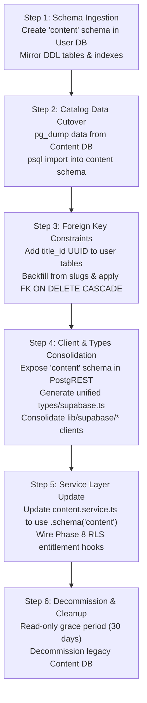

# ADR-0003: Database Topology Decision (Consolidated Single Project vs. Dual-Database Split)

[← Back to ADR Registry](README.md)

## Status
Accepted

## Date
2026-10-06

## Context
DramaShort was originally provisioned across two physically isolated Supabase projects:
1. **Content DB** (`czkkzoiuyqybafacpgsp`): Public catalog storage, hosting `titles`, `episodes`, `episode_media`, `channels`, and taxonomy tags.
2. **User DB** (`bpidsbcrvpkavvdvtpgh`): Stateful user data hosting `auth.users`, `profiles`, `favorites`, `watch_history`, `custom_lists`, `custom_list_items`, `notifications`, `support_tickets`, and planned monetization wallets.

This separation was initially intended to decouple static public video assets and catalog information from sensitive user identities and personal records. However, operating DramaShort across two disconnected databases has introduced substantial structural friction, performance penalties, and data integrity vulnerabilities as the platform matured through Phases 10–12.

As DramaShort prepares for **Phase 13.2 (Topology Execution)**, **Phase 15 (Real-Time Playback Analytics & Trending Rollups)**, and **Phase 8 (Freemium Paywall & Coin Economy)**, the database architecture stands as a critical decision gate.

### Current Database Identifiers
- **Content Database Project**: `czkkzoiuyqybafacpgsp` (Catalog, Episodes, Channels, Media)
- **User Database Project**: `bpidsbcrvpkavvdvtpgh` (Auth, Profiles, Activity, Lists, Tickets)

---

## Problem Statement

The physical split between Content DB and User DB imposes severe operational and technical costs across six primary domains:

1. **Referential Integrity Breakdown & Orphaned Records**:
   - User engagement tables (`favorites`, `watch_history`, `custom_list_items`) reference titles using loose text strings (`title_slug`), without foreign key constraints.
   - When an administrator modifies a drama slug in the catalog, all existing user favorites, bookmarks, and watch progress records referencing the previous slug are permanently broken.
   - In Task 12.7, an emergency database trigger (`trg_enforce_title_slug_immutability`) had to be introduced to freeze published drama slugs to prevent severing user data across the split. This workaround artificially restricts administrative flexibility for SEO or title rebrand updates.
   - When a drama is deleted from the Content DB, corresponding user engagement records in the User DB are not deleted, creating orphaned rows and corrupted user library views.

2. **Inability to Perform Cross-Database SQL Joins & Aggregations**:
   - Essential catalog discovery features—such as "Trending Dramas" (weighted views + watch velocity), "Most Favorited Dramas", and admin-level user viewing analytics—cannot be computed via SQL `JOIN` or analytical window queries.
   - Instead, the application layer must make sequential round-trips over REST/HTTPS to both databases, retrieve unjoined row sets into Node.js memory, and manually perform nested joins. This pattern suffers from high latency (200–400ms), excess memory pressure, and silent truncation caused by Supabase REST API default row limits (1,000 rows).

3. **Phase 8 Monetization & Paywall Entitlement Barrier**:
   - Phase 8 introduces a freemium coin economy where episodes 1–5 are free, and episodes 6+ require user coin unlocks (`public.user_unlocked_episodes`) or active VIP status (`public.profiles.is_vip`).
   - Episode streaming manifests and encrypted HLS media URLs (`episode_media`) reside in the Content DB, while entitlements and user wallets reside in the User DB.
   - Because PostgreSQL Row Level Security (RLS) cannot natively inspect tables located in a separate remote database instance, access control policies cannot be evaluated within the database engine. Every playback request must therefore be proxied through an application server route (`/api/playback/[episodeId]`) that uses elevated `service_role` superuser credentials across both databases, significantly expanding the attack surface.

4. **Operational Overhead and Compounded Financial Costs**:
   - Running two active Supabase projects doubles subscription costs ($25/month &times; 2 = $50/month, or $600/year minimum for Pro tier features such as daily backups and log retention).
   - Maintenance involves duplicate connection poolers (Supavisor), separate point-in-time recovery (PITR) schedules that cannot be atomically restored in unison, duplicate environment configurations, and fragmented migration toolchains (`npm run db:content:push` vs `npm run db:user:push`).

5. **Video Delivery & Token Signing Latency (Task 10.6 Gate)**:
   - In Phase 10 (Task 10.6), direct public access to `episodes.video_url` was locked down, introducing `episode_media` and `/api/playback/[episodeId]`.
   - Securing HLS streams against segment scrapers requires short-lived signed playback tokens (e.g. Bunny Stream or Cloudflare Stream token authentication) or signed CDN cookies.
   - Operating across split databases forces the playback route to make sequential network requests: first to User DB to verify authentication and entitlements, and then to Content DB to retrieve media keys and stream assets, adding 150–250ms of cold-start playback latency.

6. **Analytics Pipeline & Trending Computation Breakdown (Task 15.1 Gate)**:
   - Task 15 requires high-frequency playback event ingestion (`POST /api/events`) and real-time trending calculations (views, completion rates, and trending velocity rollups).
   - If playback events are captured in the User DB, computing trending rollups requires pulling thousands of raw event rows across databases to merge with `content.titles` in application memory, creating immense memory pressure and stale caching.

---

## Options Considered

### Option A: Merge into Single Supabase Project with `content` & `public` Schemas (Recommended)

Consolidate all database tables into a single Supabase PostgreSQL instance (utilizing the primary project `bpidsbcrvpkavvdvtpgh` or a unified production instance) partitioned logically into two PostgreSQL schemas:
- **`content` schema**: `channels`, `titles` (including genre and tags array columns), `episodes`, `episode_media`.
- **`public` schema**: `profiles`, `favorites`, `watch_history`, `custom_lists`, `custom_list_items`, `notifications`, `support_tickets`, `wallets`, `transactions`, `user_unlocked_episodes`, `analytics_events`.

#### Architectural Characteristics:
1. **True Foreign Key Constraints**:
   - `public.favorites(title_id UUID)` references `content.titles(id) ON DELETE CASCADE` (domain-aliased to `drama_id` where applicable).
   - `public.watch_history(title_id UUID)` references `content.titles(id) ON DELETE CASCADE`.
   - `public.custom_list_items(title_id UUID)` references `content.titles(id) ON DELETE CASCADE`.
   - `public.user_unlocked_episodes(episode_id UUID)` references `content.episodes(id) ON DELETE CASCADE`.
   - Schema alterations guarantee that drama renames or deletions cascade reliably at the database engine level with ACID guarantees. Human-readable `title_slug` columns remain as secondary indexed lookups for SEO routing.
2. **Unified Supabase Auth & Native RLS Entitlements**:
   - A single `auth.users` domain manages identity.
   - PostgreSQL RLS policies seamlessly span across schemas. The `content.episode_media` table can directly enforce access policies via native SQL:
     ```sql
     CREATE POLICY "Users can access free or unlocked episodes"
       ON content.episode_media FOR SELECT
       TO authenticated, anon
       USING (
         EXISTS (
           SELECT 1 FROM content.episodes e
           WHERE e.id = content.episode_media.episode_id
             AND e.is_free = true
         )
         OR (
           auth.uid() IS NOT NULL
           AND (
             EXISTS (
               SELECT 1 FROM public.user_unlocked_episodes u
               WHERE u.episode_id = content.episode_media.episode_id
                 AND u.user_id = auth.uid()
             )
             OR EXISTS (
               SELECT 1 FROM public.profiles p
               WHERE p.id = auth.uid() AND p.is_vip = true
             )
           )
         )
       );
     ```
   - **PostgreSQL Grants Prerequisite**: In PostgreSQL, RLS policies are only evaluated if the requesting role has schema `USAGE` and table `SELECT` permissions:
     ```sql
     GRANT USAGE ON SCHEMA content TO authenticated, anon;
     GRANT SELECT ON TABLE content.episode_media TO authenticated, anon;
     ```
     Without these grants, PostgREST queries fail with `403 Forbidden` (`permission denied for schema content` or `permission denied for table episode_media`) before RLS is evaluated. Once granted, the policy above ensures guests access only free episodes of published dramas, while authenticated users can also access coin-unlocked episodes and VIP content.
3. **High-Performance SQL Joins**:
   - Trending rollups, recommendation engines, and library lists execute within single sub-10ms queries with standard B-tree index scans.
4. **API and Client Architecture**:
   - Supabase PostgREST exposes both schemas by declaring `db-schemas = "public, content"`.
   - Client code queries the catalog via `supabase.schema('content').from('titles')` or consolidated database views.
   - Client libraries consolidate into a single client singleton (`lib/supabase/client.ts` and `lib/supabase/server.ts`), eliminating dual URL/key pairs.
5. **Signed Video Delivery Integration (Task 10.6 Resolution)**:
   - Video streaming providers (Bunny Stream / Cloudflare Stream) require server-generated signed playback tokens or signed cookies with a short TTL (e.g., 300 seconds) to protect streaming segments from unauthorized scraping.
   - Because `content.episode_media` and `public.user_unlocked_episodes` coexist in the same database, the server playback route (`/api/playback/[episodeId]`) performs entitlement validation and asset lookup in a single query, then generates HMAC-SHA256 signed playback URLs immediately without cross-database network latency.
6. **In-Database Analytics & Hybrid Telemetry (Task 15.1 Resolution)**:
   - Playback events (`public.analytics_events`) are ingested directly via `POST /api/events`.
   - Because events and catalog titles share the same Postgres instance, Task 15.3 real-time trending rollups execute as high-performance SQL window aggregations (`JOIN content.titles`).
   - High-volume top-of-funnel marketing telemetry (UI clicks, scroll depth, referrer attribution) is delegated to lightweight client analytics (e.g. PostHog or Plausible), keeping transactional database storage lean.

---

### Option B: Retain Dual-Database Split with `title_id UUID` References

Retain two physically separate Supabase projects (Content DB `czkkzoiuyqybafacpgsp` and User DB `bpidsbcrvpkavvdvtpgh`). Replace loose slug references with canonical `title_id UUID` values across all user-facing tables.

#### Architectural Characteristics:
1. **Application-Layer Orchestration (`lib/server/*`)**:
   - Replace `title_slug` with `title_id UUID` across `favorites`, `watch_history`, and `custom_list_items` to ensure slug renames do not sever user relationships.
   - Because cross-database foreign keys are impossible in PostgreSQL without foreign data wrappers (FDW), referential integrity cannot be enforced at the engine level.
2. **Eventual Consistency & Asynchronous Orphan Pruning**:
   - A background cron worker or scheduled routine must run periodically (e.g., nightly) to query Content DB for deleted titles, inspect User DB for dangling `title_id` references, and execute asynchronous cleanup deletions.
   - Transient orphans remain visible to users between deletion events and cron execution intervals.
3. **Application-Level Query Merging**:
   - Cross-database queries (e.g. fetching a user's favorited dramas with current titles, posters, and episode counts) require:
     1. Querying `public.favorites` in User DB for an array of `title_id` UUIDs.
     2. Querying `content.titles` in Content DB with `in('id', titleIds)`.
     3. Stitching the records together inside the Node.js API runtime.
4. **Service-Role Media Proxying**:
   - Row Level Security in Content DB cannot check User DB authentication tokens or wallet tables.
   - Every media stream request must hit a Next.js server route handler (`/api/playback/[id]`), verify user entitlements against User DB, and then issue a privileged `service_role` query to Content DB to retrieve media URLs.
5. **Headless Content Isolation**:
   - The catalog database remains completely decoupled from user identities and payment ledgers, allowing direct API access to be granted to third-party syndication partners or headless clients without risk of leaking user PII.
6. **Double-Hop Video Token Signing Latency**:
   - Gating protected video assets requires the playback route (`/api/playback/[id]`) to sequentially query User DB (to verify user entitlements and coin unlocks) and Content DB (to retrieve media asset refs and stream endpoints) before computing signed playback tokens, doubling cold-start latency.
7. **Cross-Database Analytics & ETL Burden**:
   - Playback events stored in User DB cannot be joined with catalog tables in Content DB. Real-time trending rollups cannot be executed with native SQL joins; they require either distributed Node.js array manipulation or a heavyweight external analytics ETL pipeline (e.g. daily PostHog export syncs).

---

## Comparative Trade-Off Matrix

| Evaluation Dimension | Option A: Merge into Single Project (`content` + `public`) | Option B: Retain Dual-Database Split (`title_id UUID`) |
| :--- | :--- | :--- |
| **1. Data Integrity & Referential Constraints** | **Superior (ACID)**<br>PostgreSQL-enforced foreign keys with `ON DELETE CASCADE`. Zero orphaned rows on drama deletion. Title slug edits have zero impact on user bookmarks or history. | **Weak (Eventual Consistency)**<br>Foreign keys cannot cross database boundaries. Requires scheduled orphan-pruning background jobs. Orphaned rows persist between cron runs; vulnerable to race conditions. |
| **2. Query Performance & Aggregations** | **Superior (<10ms)**<br>Native multi-schema SQL joins (`JOIN content.titles`). Database engine optimizes execution plans and utilizes compound B-tree indexes. Zero client-side stitching overhead. | **Poor (150–350ms+)**<br>Requires multiple round-trips over HTTPS. In-memory array merging in Node.js runtime. Subject to REST API 1,000-row caps; high memory footprint under load. |
| **3. Phase 8 Monetization & Paywall Entitlements** | **Direct RLS Evaluation**<br>Native RLS policies on `content.episode_media` inspect `public.user_unlocked_episodes` and `public.profiles.is_vip` directly using `auth.uid()`. Minimal backend proxying required. | **Complex Proxy Architecture**<br>RLS cannot evaluate entitlements across databases. All playback requests must pass through Next.js server endpoints using elevated `service_role` keys on both databases. Higher attack surface. |
| **4. Operational Overhead & Financial Cost** | **Low ($25/mo Pro tier)**<br>Single Supabase project ($300/year). Unified Supavisor connection pooling. Single PITR backup stream. Unified environment secrets and unified migration scripts. | **High ($50/mo Dual Pro tiers)**<br>Two Supabase projects ($600/year, 100% cost increase). Split connection poolers. Desynchronized PITR backup restores. Two sets of API keys and migration pipelines. |
| **5. Migration Effort & Rollback Risk** | **Moderate Initial Effort**<br>Requires exporting Content DB (`pg_dump --data-only`), importing into User DB `content` schema, updating client singletons, and brief read-only cutover window (~10 mins). Clean rollback via legacy project. | **Low Cutover / High Ongoing Debt**<br>Zero downtime initially: add `title_id` columns and run backfill scripts. However, permanently locks the codebase into maintaining dual clients, cross-service orchestrators, and orphan cleanup jobs. |
| **6. Multi-Tenant & Headless Reusability** | **Logical Schema Isolation**<br>PostgreSQL role-level grants (`REVOKE ALL ON SCHEMA public FROM partner_role; GRANT USAGE, SELECT ON SCHEMA content TO partner_role;`) provide strong schema security, but share physical compute. | **Physical Hardware Isolation**<br>Content DB is physically isolated from user PII, passwords, and billing records. Safe to grant direct read-only API access or database replicas to external third parties. |

---

## Decision Criteria

To determine the optimal architecture, the engineering team evaluated the decision against six foundational criteria:

1. **Current and Projected Business Reality (Headless Reusability)**:
   - *Question*: Is DramaShort's Content DB currently consumed by, or contracted to be shared with, any external third-party consumer or separate platform?
   - *Finding*: No. DramaShort is an integrated vertical short drama application. There are zero external consumer applications, syndication partners, or microservices consuming the Content DB today or planned within the next 12 months. Designing for physical database separation optimizes for an imaginary requirement while imposing daily engineering tax.
   - *Mitigation in Option A*: If third-party API access is needed in the future, Supabase allows role-based API keys restricted strictly to the `content` schema, or Supabase Edge Functions / Next.js API routes can act as a headless gateway (see detailed architecture in [Headless Reusability Architecture Guide](../architecture/reusable-content-api.md)).

2. **Phase 8 Monetization Architecture & Time-to-Market**:
   - Phase 8 introduces the core business model of the company (coin economy, VIP tiers, locked episodes).
   - Option A enables straightforward, battle-tested PostgreSQL RLS access policies governing media playback entitlements. Option B requires complex distributed state verification, distributed transaction rollbacks, and double `service_role` proxying.

3. **Data Integrity and User Experience**:
   - Users must never lose their watch progress or favorite lists when an editor refactors a drama slug or unpublishes content. Database-level `ON DELETE CASCADE` and `ON UPDATE CASCADE` eliminate entire classes of bug reports and manual data repair scripts.

4. **Lean Operational Efficiency**:
   - Operating a single Supabase project reduces infrastructure overhead by 50% ($300/year savings), simplifies monitoring, guarantees atomic backups/restores, and consolidates migration tooling into a single directory.

5. **Video Delivery Provider & Signed Token Integration (Task 10.6 Resolution)**:
   - *Resolution of Task 10.6 Specification*: In Task 10.6, video playback was locked down via `/api/playback/[episodeId]` and `episode_media`, deferring the provider and segment security choice to ADR-0003.
   - *Decision*: Adopt **Bunny Stream / Cloudflare Stream token signing via HMAC-SHA256 with short-lived tokens (300s TTL)** generated server-side by `/api/playback/[episodeId]`.
   - *Topology Fit*: Option A allows the server route to validate `public.user_unlocked_episodes` and `public.profiles.is_vip` against `content.episode_media` in a single query before signing the playback URL, avoiding multi-project API latency and double service-role exposure.

6. **Analytics Pipeline Architecture & Real-Time Trending (Task 15.1 Resolution)**:
   - *Resolution of Task 15.1 Specification*: Task 15.1 deferred the choice between an external analytics service (PostHog) and in-database play events to ADR-0003.
   - *Decision*: Adopt a **hybrid analytics model**:
     - In-database `public.analytics_events` for playback tracking and real-time SQL trending rollups (Task 15.3), unlocking single-query joins with `content.titles`.
     - External client telemetry (e.g., PostHog / Plausible) for top-of-funnel marketing conversion funnels to safeguard PostgreSQL compute from high-volume clickstream bloat.

---

## Recommendation

**Adopt Option A: Merge into a Single Supabase Project with `content` & `public` Schemas.**

Option A provides definitive referential integrity, unlocks native SQL joins for Phase 15 analytics and trending, drastically simplifies Phase 8 paywall entitlements, and reduces operational expenditure and architectural complexity.

---

## Implementation Roadmap (Task 13.2 Execution Plan)

The execution of this decision is scheduled for **Task 13.2** in the following phased sequence:



### Detailed Execution Phases:

1. **Step 1: Schema Ingestion (`supabase/user/supabase/migrations/`)**:
   - Create migration `20261006180000_create_content_schema.sql` in the User DB project (`supabase/user/supabase/migrations/`).
   - Execute `CREATE SCHEMA IF NOT EXISTS content;`.
   - Recreate `channels`, `titles`, `episodes`, and `episode_media` tables within the `content` schema, preserving existing primary key UUIDs, triggers, and indexes.
   - Grant schema privileges: `GRANT USAGE ON SCHEMA content TO anon, authenticated, service_role;` and `GRANT SELECT ON ALL TABLES IN SCHEMA content TO anon, authenticated;`.

2. **Step 2: Catalog Data Cutover Window**:
   - Schedule a brief 10-minute read-only maintenance window.
   - Run `pg_dump --data-only --schema=public` on Content DB (`czkkzoiuyqybafacpgsp`).
   - Transform table names to target schema (`content.*`) and import into User DB (`bpidsbcrvpkavvdvtpgh`).

3. **Step 3: Referential Foreign Keys & UUID Backfill**:
   - In `public.favorites`, `public.watch_history`, and `public.custom_list_items`:
     - Add `title_id UUID` column (domain-aliased to `drama_id` in client models).
     - Execute one-time SQL backfill linking existing `title_slug` to `content.titles.id`.
     - **Pre-Constraint Orphan Cleanup**: Prune pre-existing dangling references from the split-database era before applying foreign key constraints:
       `DELETE FROM public.favorites WHERE title_id IS NULL;`
       `DELETE FROM public.watch_history WHERE title_id IS NULL;`
       `DELETE FROM public.custom_list_items WHERE title_id IS NULL;`
     - Apply foreign key constraints with cascade: `ALTER TABLE public.favorites ADD CONSTRAINT fk_favorites_title_id FOREIGN KEY (title_id) REFERENCES content.titles(id) ON DELETE CASCADE;` (repeat for `watch_history` and `custom_list_items`) and set `title_id NOT NULL`.
     - Create foreign key B-tree indexes: `CREATE INDEX idx_favorites_title_id ON public.favorites(title_id);`, `CREATE INDEX idx_watch_history_title_id ON public.watch_history(title_id);`, and `CREATE INDEX idx_custom_list_items_title_id ON public.custom_list_items(title_id);` to eliminate full table scans during cascading deletes.
     - Drop legacy slug unique constraints (`ALTER TABLE public.favorites DROP CONSTRAINT IF EXISTS favorites_user_id_title_slug_key;`, `watch_history_user_id_title_slug_key`, `custom_list_items_list_id_title_slug_key`) and replace with `UNIQUE(user_id, title_id)` on `favorites` and `watch_history`, and `UNIQUE(list_id, title_id)` on `custom_list_items`.
     - **Retire Slug Immutability Trigger**: Drop emergency trigger `DROP TRIGGER IF EXISTS trg_enforce_title_slug_immutability ON content.titles;` since foreign keys now protect user relationships, restoring full admin agility to update drama slugs for SEO without corrupting user bookmarks.
     - Retain `title_slug` as an indexed column for performant human-readable URL resolution.

4. **Step 4: Client and Environment Consolidation**:
   - Configure Supabase PostgREST settings to expose both `public` and `content` schemas.
   - Run `supabase gen types typescript` to generate a unified `types/supabase.ts`.
   - Deprecate `lib/supabase/content.ts` and `lib/supabase/content-server.ts`.
   - Standardize all data operations on unified singletons `lib/supabase/client.ts` and `lib/supabase/server.ts`.
   - Remove redundant `NEXT_PUBLIC_CONTENT_SUPABASE_URL` and `CONTENT_SUPABASE_SERVICE_ROLE_KEY` environment variables.
   - Provision video streaming signing credentials (`STREAM_SIGNING_KEY`, `STREAM_LIBRARY_ID`) for Bunny Stream / Cloudflare Stream token signing.

5. **Step 5: Service Layer Refactoring & Future Plan Alignment**:
   - Update `lib/services/content.service.ts` to query `supabase.schema('content')`.
   - Update `user.service.ts` to utilize `title_id UUID` foreign keys.
   - Formulate Phase 8 RLS cross-schema policies for `content.episode_media`.
   - Update `FUTURE_PLAN.md` §5.2 to reflect single consolidated database topology for Telegram Bot and Mini App queries.

6. **Step 6: Verification & Decommissioning**:
   - Execute full test suite (`npm test`), build (`npm run build`), and verify zero orphaned rows.
   - Place Content DB into read-only standby mode for 30 days.
   - Decommission legacy Content DB project upon completion of the grace period.

---

## Consequences

### Positive Consequences
- **Absolute Data Integrity**: Full ACID compliance with cascading deletes; deleting a drama immediately cleans up favorites, watch progress, and custom list items without background cron latency.
- **Sub-10ms Cross-Domain Queries**: Trending algorithms, user watch histories with drama posters, and admin dashboard engagement stats execute via single indexed SQL joins.
- **Native Paywall Access Control**: Phase 8 coin wallet checks and episode unlock verification can be evaluated directly within PostgreSQL RLS policies.
- **50% Infrastructure Savings**: Halves Supabase subscription expenses ($25/mo vs $50/mo, saving $300/year).
- **Simplified Developer Experience**: Single client singleton, single migration directory, unified TypeScript type definitions, and synchronized PITR backup points.

### Negative Consequences & Mitigations
- **Cutover Window Required**: Task 13.2 requires a brief scheduled maintenance window (~10 minutes) for data dump and restore.
  - *Mitigation*: Performed during low-traffic maintenance hours with read-only banner notifications.
- **PostgREST Multi-Schema Configuration**: Developers must remember to use `.schema('content')` when querying catalog tables if using default PostgREST endpoints.
  - *Mitigation*: Abstract all catalog database interactions inside `lib/services/content.service.ts` so components and routes consume high-level domain helpers.
- **Shared Compute Resources**: High traffic on public catalog queries shares database CPU and memory with user authentication and payment ledger writes.
  - *Mitigation*: Implemented Next.js Server Components with ISR (`revalidate = 300`) in Task 13.3, caching public catalog pages at the edge and minimizing database read pressure.
