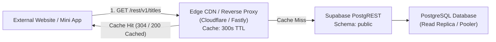

# Cross-Project Reusability Architecture & Implementation Guide
## Headless Content Catalog API for External Websites & Mini-Programs

[← Back to Single Supabase Project Decision (ADR-0005)](../adr/0005-single-supabase-project.md) | [Platform Overview](../../README.md)

---

## 1. Executive Summary & Purpose

Under [ADR-0005](../adr/0005-single-supabase-project.md), DramaShort runs on one Supabase project with every table in the `public` schema. (The separate `content` schema planned in [ADR-0003](../adr/0003-database-topology.md) was never used and is superseded.) The catalog and the user records sit side by side:
- **Catalog tables**: `channels`, `titles`, `episodes`, `episode_media`, `genres`, `tags`, `app_settings`.
- **User tables**: `profiles`, `favorites`, `watch_history`, `custom_lists`, `custom_list_items`, `wallets`, `coin_transactions`, `daily_checkins`, `user_unlocked_episodes`, `support_tickets`, `payment_orders`, `playback_events`. Accounts themselves live in Supabase Auth (`auth.users`).

What separates them is table and column privileges plus row security, not schemas.

This document provides the architectural specification and implementation guide for allowing **external websites, mobile applications, syndication partners, and Telegram Mini Apps** to safely consume the DramaShort content catalog directly via PostgREST and Supabase client SDKs, while guaranteeing **zero data leakage** of user profiles, private watchlists, or billing records.

---

## 2. PostgreSQL Security Boundaries & Role Grants

### 2.1 Threat Model & Security Invariants
When exposing a database instance to external third parties or public client devices, two fundamental invariants must be enforced at the database engine level:
1. **Zero Access to User Data**: External anonymous or partner clients MUST NOT have read or write access to `public.profiles`, `public.favorites`, `public.watch_history`, `public.wallets`, `auth.users`, or any user-specific ledger.
2. **Catalog Metadata Only (No Raw Stream Scraping)**: External clients querying `public.episodes` receive metadata (titles, episode numbers, durations, thumbnails) but CANNOT access raw video stream files (`video_url`) or server-gated playback manifests (`public.episode_media`).

### 2.2 PostgreSQL Privilege Matrix

| Role | `titles`, `channels`, `genres`, `tags`, `app_settings` | `episodes` | `episode_media` | User tables |
| :--- | :--- | :--- | :--- | :--- |
| **`anon` (External Consumers)** | `SELECT`; row security limits `titles` to Published | `SELECT` on 9 metadata columns; rows of Published titles only | ❌ No grants | ❌ No grants |
| **`authenticated` (App Users)** | Same as `anon` | Same as `anon` | ❌ No grants (served by the playback route) | Own rows only, as each table's grants and row-security policies allow |
| **`service_role` (Backend / CMS)** | `ALL` | `ALL` | `ALL` | `ALL` |

The 9 `episodes` columns readable by clients are `id`, `title_id`, `episode_number`, `title`, `thumbnail_url`, `duration_seconds`, `is_free`, `release_at`, `created_at`. `video_url`, `external_id` and `external_source` are not granted, so a request for them (including `select=*`) is refused.

### 2.3 Where the Grants Come From
These privileges are created by the migration chain in `supabase/migrations/`; do not apply them by hand. Catalog read grants start in `20260930163000_grant_permissions.sql`, `episode_media` is locked to `postgres` and `service_role` in `20261005120000_episode_media_lockdown.sql`, client write grants on the catalog are removed in `20261011110000_revoke_client_write_grants.sql`, and the user tables get their owner-scoped grants and policies in the ported `20261012100000`–`20261012100900` migrations.

Two scripts check them against a running database, and CI runs both:
- `scripts/sql/verify-catalog-rls.sql`: `episode_media` and `episodes.video_url` closed to `anon`, episodes of unpublished titles hidden, no client write privilege on catalog tables, and new tables not exposed by default.
- `scripts/sql/verify-user-side-rls.sql`: user rows readable and writable by their owner only, wallet and payment procedures limited to `service_role`, and no `anon` access to any user table.

---

## 3. PostgREST Configuration

Supabase exposes PostgreSQL tables through PostgREST, which serves the `public` schema. That is the only schema external consumers need:

### 3.1 PostgREST Server Configuration
`supabase/config.toml` (local development; the hosted project uses the same defaults):
```toml
[api]
enabled = true
port = 54321
schemas = ["public", "graphql_public"]
extra_search_path = ["public", "extensions"]
max_rows = 1000
```

### 3.2 PostgREST HTTP Routing
Requests go to `https://<project-ref>.supabase.co/rest/v1/<table>` with the anon key. No `Accept-Profile` header and no `db.schema` client option are needed, because every table is in `public`.

---

## 4. External Consumer Client Integration Code Samples

### 4.1 TypeScript / JavaScript Integration (Websites & Mini-Programs)

External consumers install `@supabase/supabase-js` and create a client with the project URL and anon key:

```typescript
import { createClient } from "@supabase/supabase-js";

// External application credentials (the DramaShort project URL and anon key)
const SUPABASE_URL = process.env.NEXT_PUBLIC_DRAMASHORT_SUPABASE_URL || "https://<project-ref>.supabase.co";
const SUPABASE_ANON_KEY = process.env.NEXT_PUBLIC_DRAMASHORT_ANON_KEY || "eyJhbGciOi...";

// 1. Initialize a read-only catalog client
export const catalogClient = createClient(SUPABASE_URL, SUPABASE_ANON_KEY, {
  auth: {
    persistSession: false, // External catalog consumers do not require user session persistence
  },
});

// 2. Query published dramas (row security returns Published titles only)
export async function fetchPublishedDramas(limit = 20) {
  const { data, error } = await catalogClient
    .from("titles")
    .select(`
      id,
      slug,
      title,
      synopsis,
      poster_url,
      genre,
      tags,
      total_episodes,
      episodes_available,
      views_count,
      rating,
      channel:channels (
        name,
        slug,
        code
      )
    `)
    .eq("status", "Published")
    .order("views_count", { ascending: false })
    .limit(limit);

  if (error) {
    throw new Error(`Failed to fetch catalog: ${error.message}`);
  }

  return data;
}

// 3. Query episodes for a drama (name the granted columns; select("*") is refused)
export async function fetchDramaEpisodes(titleId: string) {
  const { data, error } = await catalogClient
    .from("episodes")
    .select("id, episode_number, title, thumbnail_url, duration_seconds, is_free")
    .eq("title_id", titleId)
    .order("episode_number", { ascending: true });

  if (error) {
    throw new Error(`Failed to fetch episodes: ${error.message}`);
  }

  return data;
}
```

### 4.2 cURL / REST HTTP Integration

External services or lightweight environments without Node.js can query the REST API directly:

```bash
# Query top 10 trending published dramas
curl -X GET "https://<project-ref>.supabase.co/rest/v1/titles?status=eq.Published&select=id,slug,title,poster_url,genre,views_count&order=views_count.desc&limit=10" \
  -H "apikey: <SUPABASE_ANON_KEY>" \
  -H "Authorization: Bearer <SUPABASE_ANON_KEY>"
```

### 4.3 Python Integration (Backend Syndication & Feed Generators)

```python
import os
from supabase import create_client

SUPABASE_URL = os.environ.get("DRAMASHORT_SUPABASE_URL", "https://<project-ref>.supabase.co")
SUPABASE_ANON_KEY = os.environ.get("DRAMASHORT_ANON_KEY", "eyJhbGciOi...")

client = create_client(SUPABASE_URL, SUPABASE_ANON_KEY)

def get_channel_dramas(channel_code: str):
    response = (
        client.from_("titles")
        .select("id, slug, title, poster_url, synopsis, genre, total_episodes")
        .eq("channel_code", channel_code)
        .eq("status", "Published")
        .order("created_at", desc=True)
        .execute()
    )
    return response.data
```

---

## 5. Performance & Caching Strategy (ISR / CDN)

External catalog consumers should not hit the primary PostgreSQL database for every visitor view. The following caching tiers must be implemented:



1. **Incremental Static Regeneration (ISR)**:
   - Consumer Next.js apps should implement `export const revalidate = 300;` on catalog routes.
   - Catalog data refreshes every 5 minutes in the background, shielding the database from burst traffic.
2. **CDN HTTP Cache-Control**:
   - Edge reverse proxies must return `Cache-Control: public, max-age=60, s-maxage=300, stale-while-revalidate=600`.
   - PostgREST responses include HTTP `ETag` headers, allowing client browsers to validate cached data using lightweight `304 Not Modified` requests.
3. **Compression**:
   - Enable Gzip / Brotli compression for JSON responses. A 50-item drama list compresses from ~45 KB to under 7 KB.

---

## 6. Rate Limiting & Throttling Policies

To protect the shared PostgreSQL compute resources from abusive scrapers or misconfigured external loops:

1. **Anonymous IP Rate Limit**:
   - Limit: **60 requests per minute** per client IP.
   - Enforced at the Edge Gateway (Cloudflare WAF / Kong Gateway).
   - Exceeding the threshold returns `429 Too Many Requests` with a `Retry-After: 60` response header.
2. **PostgREST Row Caps**:
   - PostgREST enforces a hard `max_rows = 1000` limit per query to prevent out-of-memory errors.
   - External consumers must paginate large requests using `limit` and `offset` query parameters.
3. **Database Statement Timeout**:
   - The PostgreSQL role `anon` is restricted with a 3-second statement execution timeout:
     ```sql
     ALTER ROLE anon SET statement_timeout = '3000ms';
     ```
   - Any query taking longer than 3 seconds is aborted immediately, preserving connection pooler slots.

---

## 7. Independent Scaling & Compute Isolation Recommendations

When external partner traffic exceeds 500 requests/second, adopt the following scaling path:

1. **Dedicated PostgreSQL Read Replicas**:
   - Provision a Supabase Read Replica dedicated solely to the `anon` / catalog role.
   - All external read traffic routes to the replica endpoint, guaranteeing zero CPU or I/O contention on primary transaction processing (user signups, wallet top-ups, watch progress syncs).
2. **Supavisor Connection Pooling**:
   - Connect external traffic via the transaction-mode Supavisor pooler (port 6543) rather than direct session connections (port 5432).
   - This allows thousands of concurrent clients to share a lean pool of 20–30 active database connections.

---

## 8. Summary of Guarantees

| Concern | Resolution |
| :--- | :--- |
| **User Privacy** | `anon` has no grants on any user table; signed-in users reach only their own rows through row security. External consumers cannot read `profiles` or `favorites`. |
| **Video Protection** | `episodes.video_url` is not granted to `anon` or `authenticated`; `episode_media` is locked to `service_role`. |
| **Referential Stability** | External consumers can query canonical UUIDs (`titles.id`) or slugs (`titles.slug`). Renaming slugs preserves foreign key links. |
| **Compute Safety** | 3-second statement timeout, 60 req/min rate limits, and CDN caching protect database capacity. |
