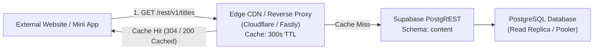

# Cross-Project Reusability Architecture & Implementation Guide
## Headless Content Catalog API for External Websites & Mini-Programs

[← Back to Database Topology Decision (ADR-0003)](../adr/0003-database-topology.md) | [Platform Overview](../../README.md)

---

## 1. Executive Summary & Purpose

Following the database consolidation accepted in [ADR-0003](../adr/0003-database-topology.md) (Task 13.2 Option A), DramaShort hosts both its public media catalog and user accounts on a single Supabase PostgreSQL instance partitioned logically into two schemas:
- **`content` schema**: High-read media catalog (`channels`, `titles`, `episodes`, `episode_media`).
- **`public` schema**: Sensitive user records, authentication state, and transactional data (`profiles`, `favorites`, `watch_history`, `custom_lists`, `custom_list_items`, `wallets`, `support_tickets`, `auth.users`).

This document provides the definitive architectural specification and implementation guide for allowing **external websites, mobile applications, syndication partners, and Telegram Mini Apps** to safely consume the DramaShort content catalog directly via PostgREST and Supabase client SDKs, while guaranteeing **zero data leakage** of user profiles, private watchlists, or billing records.

---

## 2. PostgreSQL Security Boundaries & Role Grants

### 2.1 Threat Model & Security Invariants
When exposing a database instance to external third parties or public client devices, two fundamental invariants must be enforced at the database engine level:
1. **Zero Access to User Data**: External anonymous or partner clients MUST NOT have read, write, or schema-inspection access to `public.profiles`, `public.favorites`, `public.watch_history`, `public.wallets`, `auth.users`, or any user-specific ledger.
2. **Catalog Metadata Only (No Raw Stream Scraping)**: External clients querying `content.episodes` receive metadata (titles, episode numbers, durations, thumbnails) but CANNOT access raw video stream files (`video_url`) or server-gated playback manifests (`content.episode_media`).

### 2.2 PostgreSQL Privilege Matrix

| Role | Schema `content` | Schema `public` | `content.titles` | `content.episodes` | `content.episode_media` | `public.*` User Tables |
| :--- | :--- | :--- | :--- | :--- | :--- | :--- |
| **`anon` (External Consumers)** | `USAGE` | `USAGE` (restricted) | `SELECT` (Published) | `SELECT` (metadata only) | ❌ `REVOKE ALL` | ❌ No table grants |
| **`authenticated` (App Users)** | `USAGE` | `USAGE` | `SELECT` (Published) | `SELECT` (metadata only) | ❌ Handled via Server Route | `SELECT/INSERT/UPDATE` (own rows via RLS) |
| **`service_role` (Backend / CMS)** | `ALL` | `ALL` | `ALL` | `ALL` | `ALL` | `ALL` |

### 2.3 Strict PostgreSQL Role Grant Script
To configure the security boundary, run the following SQL script on the Supabase database instance:

```sql
-- 1. Ensure content schema exists
CREATE SCHEMA IF NOT EXISTS content;

-- 2. Grant USAGE on content schema to anon and authenticated roles
GRANT USAGE ON SCHEMA content TO anon, authenticated;

-- 3. Grant SELECT on public catalog tables to anon
GRANT SELECT ON TABLE content.channels TO anon;
GRANT SELECT ON TABLE content.titles TO anon;

-- 4. Restrict column-level grants on content.episodes (deny direct video_url)
REVOKE SELECT ON TABLE content.episodes FROM anon;
GRANT SELECT (
  id,
  title_id,
  episode_number,
  title,
  thumbnail_url,
  duration_seconds,
  is_free,
  created_at
) ON TABLE content.episodes TO anon;

-- 5. Explicitly quarantine episode_media to service_role and postgres
REVOKE ALL ON TABLE content.episode_media FROM anon, authenticated;
GRANT ALL ON TABLE content.episode_media TO postgres, service_role;

-- 6. Guarantee zero access to sensitive user tables from anon
REVOKE ALL ON TABLE public.profiles FROM anon;
REVOKE ALL ON TABLE public.favorites FROM anon;
REVOKE ALL ON TABLE public.watch_history FROM anon;
REVOKE ALL ON TABLE public.custom_lists FROM anon;
REVOKE ALL ON TABLE public.custom_list_items FROM anon;
```

---

## 3. PostgREST Configuration & Multi-Schema Routing

Supabase exposes PostgreSQL tables through PostgREST. By default, PostgREST queries the `public` schema. To expose the `content` schema to external consumers:

### 3.1 PostgREST Server Configuration
In the Supabase project configuration (or `supabase/config.toml` for local development):
```toml
[api]
enabled = true
port = 54321
schemas = ["public", "content"]
extra_search_path = ["public", "extensions"]
max_rows = 1000
```

### 3.2 PostgREST HTTP Routing (`Accept-Profile` Header)
When querying PostgREST over HTTPS:
- External consumers must pass the header `Accept-Profile: content` to target tables within the `content` schema.
- Alternatively, client SDKs pass `{ db: { schema: 'content' } }` which sets this header automatically on every request.

---

## 4. External Consumer Client Integration Code Samples

### 4.1 TypeScript / JavaScript Integration (Websites & Mini-Programs)

External consumers install `@supabase/supabase-js` and configure the client targeting the `content` schema:

```typescript
import { createClient } from "@supabase/supabase-js";

// External application credentials
const SUPABASE_URL = process.env.NEXT_PUBLIC_DRAMASHORT_SUPABASE_URL || "https://bpidsbcrvpkavvdvtpgh.supabase.co";
const SUPABASE_ANON_KEY = process.env.NEXT_PUBLIC_DRAMASHORT_ANON_KEY || "eyJhbGciOi...";

// 1. Initialize client explicitly scoped to the 'content' schema
export const catalogClient = createClient(SUPABASE_URL, SUPABASE_ANON_KEY, {
  db: {
    schema: "content", // Directs all queries to content.* tables
  },
  auth: {
    persistSession: false, // External catalog consumers do not require user session persistence
  },
});

// 2. Query published dramas
export async function fetchPublishedDramas(limit = 20) {
  const { data, error } = await catalogClient
    .from("titles")
    .select(`
      id,
      slug,
      title,
      synopsis,
      poster_url,
      genre,
      tags,
      total_episodes,
      episodes_available,
      views_count,
      rating,
      channel:channels (
        name,
        slug,
        code
      )
    `)
    .eq("status", "Published")
    .order("views_count", { ascending: false })
    .limit(limit);

  if (error) {
    throw new Error(`Failed to fetch catalog: ${error.message}`);
  }

  return data;
}

// 3. Query episodes for a drama
export async function fetchDramaEpisodes(titleId: string) {
  const { data, error } = await catalogClient
    .from("episodes")
    .select("id, episode_number, title, thumbnail_url, duration_seconds, is_free")
    .eq("title_id", titleId)
    .order("episode_number", { ascending: true });

  if (error) {
    throw new Error(`Failed to fetch episodes: ${error.message}`);
  }

  return data;
}
```

### 4.2 cURL / REST HTTP Integration

External services or lightweight environments without Node.js can query the REST API directly:

```bash
# Query top 10 trending published dramas from the content schema
curl -X GET "https://bpidsbcrvpkavvdvtpgh.supabase.co/rest/v1/titles?status=eq.Published&select=id,slug,title,poster_url,genre,views_count&order=views_count.desc&limit=10" \
  -H "apikey: <SUPABASE_ANON_KEY>" \
  -H "Authorization: Bearer <SUPABASE_ANON_KEY>" \
  -H "Accept-Profile: content"
```

### 4.3 Python Integration (Backend Syndication & Feed Generators)

```python
import os
from supabase import create_client, ClientOptions

SUPABASE_URL = os.environ.get("DRAMASHORT_SUPABASE_URL", "https://bpidsbcrvpkavvdvtpgh.supabase.co")
SUPABASE_ANON_KEY = os.environ.get("DRAMASHORT_ANON_KEY", "eyJhbGciOi...")

# Initialize Supabase client pointing to the content schema
client = create_client(
    SUPABASE_URL,
    SUPABASE_ANON_KEY,
    options=ClientOptions(schema="content")
)

def get_channel_dramas(channel_code: str):
    response = (
        client.from_("titles")
        .select("id, slug, title, poster_url, synopsis, genre, total_episodes")
        .eq("channel_code", channel_code)
        .eq("status", "Published")
        .order("created_at", desc=True)
        .execute()
    )
    return response.data
```

---

## 5. Performance & Caching Strategy (ISR / CDN)

External catalog consumers should not hit the primary PostgreSQL database for every visitor view. The following caching tiers must be implemented:



1. **Incremental Static Regeneration (ISR)**:
   - Consumer Next.js apps should implement `export const revalidate = 300;` on catalog routes.
   - Catalog data refreshes every 5 minutes in the background, shielding the database from burst traffic.
2. **CDN HTTP Cache-Control**:
   - Edge reverse proxies must return `Cache-Control: public, max-age=60, s-maxage=300, stale-while-revalidate=600`.
   - PostgREST responses include HTTP `ETag` headers, allowing client browsers to validate cached data using lightweight `304 Not Modified` requests.
3. **Compression**:
   - Enable Gzip / Brotli compression for JSON responses. A 50-item drama list compresses from ~45 KB to under 7 KB.

---

## 6. Rate Limiting & Throttling Policies

To protect the shared PostgreSQL compute resources from abusive scrapers or misconfigured external loops:

1. **Anonymous IP Rate Limit**:
   - Limit: **60 requests per minute** per client IP.
   - Enforced at the Edge Gateway (Cloudflare WAF / Kong Gateway).
   - Exceeding the threshold returns `429 Too Many Requests` with a `Retry-After: 60` response header.
2. **PostgREST Row Caps**:
   - PostgREST enforces a hard `max_rows = 1000` limit per query to prevent out-of-memory errors.
   - External consumers must paginate large requests using `limit` and `offset` query parameters.
3. **Database Statement Timeout**:
   - The PostgreSQL role `anon` is restricted with a 3-second statement execution timeout:
     ```sql
     ALTER ROLE anon SET statement_timeout = '3000ms';
     ```
   - Any query taking longer than 3 seconds is aborted immediately, preserving connection pooler slots.

---

## 7. Independent Scaling & Compute Isolation Recommendations

When external partner traffic exceeds 500 requests/second, adopt the following scaling path:

1. **Dedicated PostgreSQL Read Replicas**:
   - Provision a Supabase Read Replica dedicated solely to the `anon` / catalog role.
   - All external read traffic routes to the replica endpoint, guaranteeing zero CPU or I/O contention on primary transaction processing (user signups, wallet top-ups, watch progress syncs).
2. **Supavisor Connection Pooling**:
   - Connect external traffic via the transaction-mode Supavisor pooler (port 6543) rather than direct session connections (port 5432).
   - This allows thousands of concurrent clients to share a lean pool of 20–30 active database connections.

---

## 8. Summary of Guarantees

| Concern | Resolution |
| :--- | :--- |
| **User Privacy** | `public` schema has zero table-level grants for `anon`. External consumers cannot read `profiles` or `favorites`. |
| **Video Protection** | Direct `video_url` column is revoked from `anon`; `episode_media` manifests are strictly locked to `service_role`. |
| **Referential Stability** | External consumers can query canonical UUIDs (`titles.id`) or slugs (`titles.slug`). Renaming slugs preserves foreign key links. |
| **Compute Safety** | 3-second statement timeout, 60 req/min rate limits, and CDN caching protect database capacity. |
